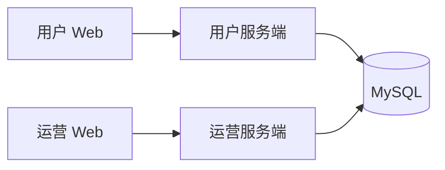

# 架构设计

## 2026-10-30 小程序实施更新

用户已授权实施原生小程序，并暂缓实际联调；本节替代下文小程序“仅讨论、未授权”的历史状态。新增 `apps/miniapp/`，TypeScript 6.0.3、TDesign 1.17.0，独立构建原生页面，共用现有 `server` 的业务接口与数据库。Web 的 Vite、端口和启动方式不变，运营端继续暂缓。

认证采用两类凭证：Web 保留 Cookie 会话和 CSRF，小程序使用 `X-Miniapp-Token` 访问同一服务，Redis 保存30天绝对有效期会话。已认证的小程序请求可用 POST 加 `X-HTTP-Method-Override: PATCH` 适配原接口；未认证头不能绕过 CSRF。微信身份交换由服务端完成，密钥不进入客户端。扫码票据保存在 MySQL，只有创建票据的浏览器可领取确认结果。

微信身份、扫码、独立头像后端、Web接入及17个小程序页面已实现，完成离线构建和针对性检查。实际微信、数据库迁移、Redis、供应商、跨端与真机联调均未执行。实施与接口以[实施计划](../02-需求文档/2026-10-30-微信小程序/03-实施计划.md)及[接口与数据设计](../02-需求文档/2026-10-30-微信小程序/04-接口与数据设计.md)为准。

2026-10-30 数据库中间件配置已创建：`infra/mysql/` 与 `infra/redis/` 分别维护独立 Compose、配置、环境模板和 README，固定 MySQL 8.0.45、Redis 7.4.11；默认仅回环发布端口，数据目录独立，MySQL 业务迁移继续由 ops 显式执行，Redis 使用 AOF 和 noeviction。Compose 解析已验证，目标容器运行未验证。见 [需求与验证](../02-需求文档/2026-10-30-数据库中间件配置/01-需求说明.md)。

2026-10-30 frp 开发调试方向已确认：作为基础设施中间件，frpc 与 frps 统一维护在 `infra/frp/`，分别运行于内网开发机与公网节点；仅用于小程序访问本地后端。内网端在 launch.json 增加按需启动入口，仅调试时运行。已实现固定版本 frps Compose、frpc 原生启动脚本与参数化配置。复用宿主机 Nginx HTTPS，经宿主机回环映射端口与 TCP 隧道访问本机后端；隧道强制 TLS 和 token，可选 CA 校验。已通过本机隔离转发、停止、恢复与错误凭据检查；公网部署、IDE 停止及小程序联调未验证。见 [frp 开发调试](../02-需求文档/2026-10-30-frp开发调试/01-需求说明.md)。

2026-10-30 小程序近期用途已确认：个人主体，开发供用户自己体验，继续完整功能设计；公开发布不属于近期目标。开发版与体验版权限需实际核验，未来公开发布的主体与类目限制见[需求](../02-需求文档/2026-10-30-微信小程序/01-需求说明.md)。本次仍为讨论阶段。

2026-10-30 小程序首版设计范围已确认：覆盖现有 Web 的完整用户功能，按手机场景重新设计页面和操作，后续按实际复杂度讨论分期；本次未授权实施。具体范围见[小程序需求](../02-需求文档/2026-10-30-微信小程序/01-需求说明.md)，此前首版范围待定的记录由本次确认补充。

2026-10-30 登录入口补充确认：保留现有用户名密码登录，作为老用户入口，与拟新增的微信扫码登录并存；微信新用户无需设置密码。仅确认需求，尚未实施扫码登录或账号绑定。

2026-10-30 小程序登录方向补充（已确认、待实现）：新用户通过微信登录创建账号，Web 支持微信扫码登录，无需设置密码。已确认由小程序承接 Web 扫码，用户明确确认后原浏览器登录；未关联身份先注册或绑定再确认。具体接口、权限和会话方案待设计验证；见[需求](../02-需求文档/2026-10-30-微信小程序/01-需求说明.md)。

2026-10-30 微信小程序应用边界更新（已确认、待实现）：在原四个应用规划基础上新增微信小程序客户端，共用 `apps/server/`，不新增小程序业务后端。产品以小程序为主，Web 保留，账号互通；小程序功能尽量齐全，两端是否同步支持具体功能在设计时讨论。小程序已确认采用微信原生开发，独立维护页面和组件，共用后端接口；目录确认为 `apps/miniapp/`；逻辑层确认为 TypeScript；通用组件采用 TDesign 微信小程序版，业务组件独立开发；身份绑定方案待确定。此决定扩展下文原桌面端范围与四应用规划；既有应用职责保持。见[需求草案](../02-需求文档/2026-10-30-微信小程序/01-需求说明.md)。

2026-10-30 生图选择更新（已确认）：使用GPT Image 2（`gpt-image-2`），不使用或回退到Kolors，替代下文2026-10-22的生图默认选择。当前开发配置已为该模型及`openai-edits`，沿用现有接入渠道；识别和规划不变。代码默认值已同步，现有渠道已完成24张灵感素材生成；应用多参考图试穿效果待验证。见[本次确认](../02-需求文档/2026-10-30-穿搭灵感库/01-需求说明.md#生图模型2026-10-30-已确认)。下文Kolors默认值与限制为原方案记录，不再作为新实施基线。

2026-10-30 开发阶段约定：用户明确以最新设计为准，无需历史兼容。本次穿搭灵感库按最新接口、路由和统一快照结构设计，不增加旧版适配分支；任务提交后固定快照及素材版本的业务规则保留。场合不自动填写，穿搭专区仅收录普通穿搭设计，常用搭配AI任务留在原入口。详见[需求更新](../02-需求文档/2026-10-30-穿搭灵感库/01-需求说明.md#开发期以最新设计为准已确认)。代码及24张素材已实施，HTTP和浏览器代表链路通过隔离验证；共享开发库及生产数据未处理。

2026-10-30 发型独立专区已实现：沿用server/web和现有分层，图库继续使用版本化项目资源；HairstyleFavoriteService与Mapper维护用户款式收藏，页面复用现有设计任务、详情与效果收藏。普通草稿按账号保存在当前页签内存，提交恢复单独管理；目录异常返回不可用，不误判全部下架。见[接口与数据设计](../02-需求文档/2026-10-30-发型独立专区/03-接口与数据设计.md)。未新增服务或运营端，真实供应商配置不变。

2026-10-29 发型图库增量已实现：`server` 通过版本化 classpath 目录和AI示意图提供登录后的图库分页、详情及受控图片路由；不新增运营端或数据库表。目录与摘要元数据缓存，发布保留旧版本资源，当前目录版本通过 `lookmate.hairstyles.current-version` 配置，缺省为v2（48款144图），保留v1资源供历史快照读取；配置在启动时读取。任务保存款式和图片摘要快照，执行及重试核验不可变图片；平台图片独立于用户文件清理。规划和生图均附加同款全部参考图并核验预算，可信本地图片字节进入OpenAI chat及multipart edits。当前单图协议在选款生成前拒绝，不丢图、不改变默认供应商。开发验证通过，真实供应商效果待联调；详见[需求与契约](../02-需求文档/2026-10-28-发型图库与设计交互/01-需求说明.md)。

2026-10-27 配置简化：移除生成、识别、后台调度、注册启停开关及预算确认开关，相关功能默认运行；保留供应商凭据、协议、数值预算与容量校验，以及维护模式。注册配置接口的 `registrationEnabled` 为兼容现有前端固定返回 `true`。历史文档中的关闭开关步骤不再适用。

最后更新：2026-10-24（本次补充前端列表新增入口布局规则）。

状态：应用边界、技术方向及明确标记的约定已确认；执行池划分、调度原则和维护标记文件方案已确认；未定容量数值、准入实现及其他待决项仍为草案。2026-10-20 已获第一步框架实施授权，完成 server/web 基础工程、核心构建与本地启动验证；业务及部署尚未实施。

业务语义见 [领域模型](02-领域模型.md)，实施范围见 [首版需求](../02-需求文档/2026-10-20-首版个人形象设计/01-需求说明.md)。

## 产品与应用边界

Lookmate 为个人提供发型和穿搭设计。管理端主要面向运营人员。首版由 AI 自动完成设计，仅实施桌面端 `web` 和用户服务端 `server`，不要求手机适配，暂不实施运营端或收费功能。已确认的业务范围和规则见 [首版需求](../02-需求文档/2026-10-20-首版个人形象设计/01-需求说明.md)。

长期架构包含四个业务应用，运营两端暂缓；衣物自动抠图已搁置，不新增应用或推理组件：

| 应用角色 | 职责边界 |
| --- | --- |
| 用户 Web | 面向普通用户的产品界面 |
| 用户服务端 | 用户侧业务流程与数据访问 |
| 运营 Web | 面向运营人员的管理界面 |
| 运营服务端 | 运营查询、维护与管理操作，具体功能待确定 |

server 与 console 两个业务后端直接访问数据库，不通过彼此的接口执行管理操作，不抽取共享业务模块。各自维护业务逻辑和数据访问代码，通过统一的数据库结构约定协作。前后端各自独立构建和部署，代码放在同一仓库。



## 技术方向

| 项目 | 已确认方案 | 尚未确定 |
| --- | --- | --- |
| 后端 | Java 21、Spring Boot 4.1.x、Spring AI 2.0.x、MyBatis-Plus 3.5.17（Boot 4 starter）、Maven 3.9.x | 搭建时锁定补丁版本并验证完整依赖组合 |
| 前端 | Node.js 24 LTS、React 19.x、TypeScript 6.0.x、Vite 8.x、Ant Design 6.x、TanStack Query 5.x，静态单页应用 | 具体版本锁定、构建验证和视觉设计 |
| 数据库 | MySQL 8.0.45，与开发库一致 | 部署镜像标识及账号权限 |
| 会话存储 | Redis 7.4.11，与开发环境一致，首版仅保存登录会话 | 部署镜像标识与生产环境验证 |
| HTTP 入口 | Nginx 1.30.x 稳定分支 | 补丁版本、域名、证书及路由配置 |
| 部署 | 独立 Docker Compose，运行时镜像挂载程序产物 | 镜像版本、部署环境及资源配置 |

trader 是目录与部署组织的参考，不自动继承其技术版本、认证机制、调度中心或其他业务组件。

### 后端版本（2026-10-20，已确认）

已确认以 Java 21、Spring Boot 4.1.x、Spring AI 2.0.x、MyBatis-Plus 3.5.17 的 Boot 4 starter 及 Maven 3.9.x 作为首版验证组合。使用正式发布版本，搭建时锁定补丁版本，不使用 SNAPSHOT 或浮动版本；本次确认版本组合及版本管理方式，尚未构建验证，不新增实施授权。

官方资料核对：Spring Boot 当前系统要求页列出 4.1.1，支持 Java 17 至 26 和 Maven 3.6.3 以上；Spring AI 当前文档列出 2.0.1，并明确 2.0.x 支持 Boot 4.0.x／4.1.x；MyBatis-Plus 安装文档提供 3.5.17 的 Boot 4 starter。以上是文档层面的兼容依据，不代表项目全部依赖已通过集成验证。

Spring Security、Spring Session 及其他 Boot 管理的依赖优先沿用 Boot 的依赖管理，Spring AI 使用其 BOM，避免分别指定相互冲突的版本。模型多图消息、七牛 SDK、数据库驱动和迁移工具仍需在获准搭建后验证。前端及基础设施版本已在下文确认，sub2api 参数继续留空。

参考：[Spring Boot 系统要求](https://docs.spring.io/spring-boot/system-requirements.html)、[Spring AI 兼容要求](https://docs.spring.io/spring-ai/reference/getting-started.html)、[MyBatis-Plus 安装](https://baomidou.com/en/getting-started/install/)。

### 前端与基础设施版本（2026-10-20，已确认）

已确认前端采用 Node.js 24 LTS、React 19.x、TypeScript 6.0.x、Vite 8.x、Ant Design 6.x 和 TanStack Query 5.x。Node.js 仅用于开发与构建，生产继续由 Nginx 提供静态产物。Ant Design 图标使用匹配的 6.x 系列，不引入旧版 React 19 兼容补丁。

已确认基础设施采用 MySQL 8.0.45、Redis 7.4.11 和 Nginx 1.30.x 稳定分支。2026-10-20 按用户要求，将 MySQL 与 Redis 版本统一为已验证的开发环境版本；Redis 首版仍只存登录会话。调整依据见 [中间件版本对齐开发环境](../04-技术决策/2026-10-20-中间件版本对齐开发环境.md)。迁移工具继续由 ops 独立维护，Flyway 具体版本及 MySQL 支持模块在搭建前核对。

前端提交依赖锁文件，构建时按锁文件安装；基础设施在部署配置中固定补丁版本和镜像标识，不使用 latest。补丁升级单独验证。具体包管理工具、Docker Engine 与 Compose 插件版本结合开发及部署环境确定，本次确认版本组合及版本管理方式，不代表完整环境已验证，也不新增实施授权。

上述组合仅完成官方资料核对，尚未安装、构建或执行迁移。实施验证包含前端类型检查和生产构建、Ant Design 表单与弹窗、Query 轮询，以及 MySQL 初始化迁移、Redis 会话和 Nginx 转发。

参考：[Node.js 发布状态](https://nodejs.org/en/about/previous-releases)、[Vite 8](https://vite.dev/blog/announcing-vite8)、[Ant Design 6](https://ant.design/docs/react/migration-v6-cn/)、[TypeScript 6.0](https://www.typescriptlang.org/docs/handbook/release-notes/typescript-6-0.html)、[TanStack Query 安装](https://tanstack.com/query/latest/docs/framework/react/installation)、[MySQL LTS](https://dev.mysql.com/doc/refman/8.4/en/mysql-releases.html)、[Redis 版本维护](https://redis.io/docs/latest/operate/oss_and_stack/install/version-mgmt/)、[Nginx 稳定版](https://nginx.org/en/download.html)。

## 应用命名

四个业务应用使用单个英文单词命名，已确认如下：

| 应用角色 | 目录 |
| --- | --- |
| 用户服务端 | `apps/server/` |
| 用户 Web | `apps/web/` |
| 运营服务端 | `apps/console/` |
| 运营 Web | `apps/admin/` |

`console` 专指运营服务端，`admin` 专指运营 Web；根目录 `ops/` 用于数据库迁移与维护。

## 目录组织

以下为已确认的规划结构，并非现有文件清单。

```text
lookmate/
├── AGENTS.md
├── README.md
├── .gitignore
├── .agents/
│   └── skills/
├── apps/
│   ├── server/
│   ├── web/
│   ├── console/
│   └── admin/
├── infra/
│   ├── mysql/
│   ├── redis/
│   ├── frp/
│   └── nginx/
├── ops/
│   ├── db/
│   │   ├── migrations/
│   │   └── checks/
│   ├── docker-compose.yml
│   └── README.md
├── tools/
│   ├── package.sh
│   ├── deploy.sh
│   └── deployment/
│       └── README.md
└── docs/
    ├── README.md
    ├── 01-项目总览/
    ├── 02-需求文档/
    └── 04-技术决策/
```

每个应用维护自己的 `src/`、构建配置、`docker-compose.yml`、`.env.example` 和 `README.md`。前端应用的 `deploy/nginx.conf` 维护自身静态资源和 API 转发配置；具体构建文件在依赖版本确定后补充，内部代码结构沿用下文已确认的组织方式。

每个基础设施目录维护独立的 `docker-compose.yml`、`config/`、`.env.example` 和 `README.md`。`infra/nginx/` 管理统一域名入口与 HTTPS，前端应用自身的 Nginx 配置负责该应用内容。

`ops/` 负责数据库迁移及维护，`tools/` 负责构建与部署操作，两者不承载在线业务。文档和目录在有实际内容时创建，不预先建立空模板。

文档实际文件及职责见 [文档导航](../README.md)。缺陷和审查目录仅在有相应记录时创建。

## 应用内部结构

已确认 `server` 使用单个 Maven 工程，打包为一个 Spring Boot 应用。采用 Controller → Service → MyBatis-Plus Mapper 的分层结构。`service/` 直接放业务服务类，不继续按账号、衣橱等领域细分子包。

```text
server 根包/
├── controller/
├── service/
├── dao/
│   ├── entity/
│   └── mapper/
├── integration/
│   ├── ai/
│   └── storage/
├── scheduler/
├── config/
└── common/
    ├── model/
    │   ├── param/
    │   └── dto/
    ├── api/
    ├── exception/
    ├── advice/
    ├── filter/
    └── util/
```

2026-10-21 已按确认方案完成后端包迁移。`common.api` 放响应模型与构造、写出组件，`common.exception` 放通用异常，`common.advice` 放统一异常处理，`common.filter` 放请求过滤器，`common.util` 放 CurrentUser、BoundedHttp 等工具。AuthGuardFilter、RequestBoundaryFilter 保留 Filter 后缀；CurrentUser 不参与过滤器链，保留工具类名称，不单设 security 包。`dao` 下放 entity、mapper，不增加仅转发 Mapper 的 Dao 实现层；`common.model` 下放 dto、param。供应商接入分为 integration.ai、integration.storage，两个调度入口移入 scheduler，业务执行仍在 service。本次只调整后端代码组织，接口、数据库和业务逻辑保持不变。

Controller 负责协议、参数校验和响应转换；Service 负责业务、数据归属及事务；Mapper 负责数据访问；Scheduler 触发任务领取、恢复与清理，业务执行交给 Service。普通 Service 不强制创建 Interface/Impl。模型接入以 Spring AI 为主，图片编辑能力未覆盖时补充官方 openai-java SDK；具体版本及中转站适配方式在接口兼容性核实后锁定。

前端已确认按功能组织：`app/` 管理入口、路由和布局，`pages/` 组合页面，`features/` 组织账号、衣橱、照片、设计和收藏功能，`components/` 放通用组件，`api/` 管理请求和类型，`styles/` 管理样式。区分服务端数据、页面临时状态和少量跨页面共享状态。服务端数据统一使用 TanStack Query 查询、刷新及轮询；写入成功后刷新相关查询，退出登录清空用户查询缓存。表单和弹窗使用组件状态，首版不额外引入 Redux。生成任务提交关闭自动重试，轮询只查询状态。

前端通过后端访问业务、认证和私有文件，不直接连接模型服务。请求错误统一包含稳定错误码、说明和请求追踪标识。日志关联请求、任务和模型调用，不记录密码、密钥或完整图片内容。

## 前端列表操作布局（2026-10-24，已确认）

列表页、列表标签页及工作台列表卡片统一遵循以下规则：

- 页面标题区只保留返回、标题和说明；新增、新建、添加及组合搭配等创建入口放在所属内容区内部，不放在页面标题旁或卡片标题右侧。
- 内容区工具栏左侧放筛选条件，右侧放操作按钮，两者在空间充足时保持同一行。刷新在新增之前，主要创建操作使用主按钮。
- 没有筛选条件的列表或标签页，左侧可显示当前内容名称，右侧沿用相同操作位置，不为布局增加无实际用途的筛选项。
- 窄桌面窗口或筛选项较多时允许换行，操作区保持靠右，避免控件相互挤压或横向溢出。
- 空列表仅展示说明，不重复提供工具栏已有的新增入口；工具栏在空列表时仍然显示，并沿用原有可用性校验。
- 收藏夹面板中的“新建收藏夹”、分组管理弹窗中的“新建分组”等局部创建操作保留在所属区域。表单提交、详情编辑及删除不属于本条列表新增入口规则。

本次统一范围为衣橱单品、常用搭配、个人照片、设计记录（含收藏标签）及工作台常用搭配卡片；不改变筛选、服务端分页或创建业务流程。

### 列表图片展示（2026-10-24，已确认）

照片、衣橱单品及常用搭配列表（含工作台卡片）的图片按原比例放大，居中裁切并填满各自展示区域，使用 `object-fit: cover`，不得拉伸变形。常用搭配拼图中的每张图片填满所属单元格，保留原有拼图结构。详情及大图预览继续完整展示图片，使用 `object-fit: contain`。此规则替代此前列表图片完整显示的约定，仅改变展示方式，不裁切或修改存储原图。

## 首版运行方案

部署在中国大陆单台服务器，保留本地开发方式。个人照片、衣物图片和生成结果使用七牛云对象存储。客户端图片直接上传七牛云，后端负责上传授权、文件归属与完成状态核验。生成结果由后台保存至七牛云，不依赖浏览器在线；服务器仅按需使用临时处理文件。私有访问方式和图片处理流程见下文已确认方案。

注册成功后进入登录页，不自动建立登录会话。采用服务端会话，浏览器通过 HttpOnly Cookie 携带会话标识，Redis 保存会话，写操作设置 CSRF 防护。密码保存安全哈希，不保存明文。认证采用 Spring Security，Redis 会话采用 Spring Session；Service 校验资源归属。首版不增加可配置角色权限系统，未来运营端使用独立会话命名空间。普通登录使用会话 Cookie，空闲 2 小时失效，单次登录最长 7 天。2026-10-24 增加可选记住登录，使用持久 Cookie，从本次登录起最长 30 天，期限由 lookmate.auth.remember-me-timeout 配置。记住状态保存在当前 Redis 会话内，TTL 随请求缩短至剩余绝对期限；Cookie 写出时同样取剩余期限。成功验密后重建会话，确保会话 ID 轮换且切回普通登录时恢复默认空闲 TTL 和会话 Cookie。页面轮询不能突破绝对期限，服务端每次独立校验。允许多设备登录，退出只终止当前会话，暂不提供设备管理页面。生产 Cookie 使用 HttpOnly、Secure、SameSite=Lax，继续启用 CSRF 防护。

生成任务状态保存在 MySQL，由 `server` 内的后台执行器定期领取，线程池限制全局并发。数据库条件更新和事务保证领取及账号并发限制。首版不引入独立任务应用、消息队列或调度中心，不缓存衣橱与个人资料。前端定时查询状态，页面关闭后任务继续执行。

## HTTP 接口约定（已确认）

成功 JSON 响应包含 data 和 requestId；错误 JSON 响应包含 code、message 和 requestId，字段校验错误附带字段信息。响应同时使用正确的 HTTP 状态码：未登录 401、参数不合法 400、任务名额冲突 409、内部异常 500。

提交生成任务返回 202 和任务编号，前端独立查询进度。图片访问改为七牛云存储，后端校验归属后返回短期签名地址，浏览器直接读取；已登录用户访问无权读取的私有资源时按不存在处理，避免暴露其他账号数据。接口组与传输约定见 [接口契约草案](05-接口契约.md)，方法和主要字段已有草案，完整响应及逐接口错误仍待补齐。

## 异常处理（已确认）

业务失败通过继承 RuntimeException 的业务异常表达，携带稳定错误码及安全提示参数。Service 返回成功数据，不返回表示失败的响应包装；Controller 不逐个 try/catch。HTTP 层使用统一异常处理器（拟采用 RestControllerAdvice）转换为既定 HTTP 状态码及 code、message、requestId，参数校验错误可附 fieldErrors，映射集中维护。

未知异常返回 500 和通用提示，内部记录关联 requestId 的诊断信息，不把原始异常 message、SQL、堆栈或供应商响应发给前端。认证、授权和 CSRF 过滤器失败由安全处理器输出同一格式，不能假定 Controller 异常处理器能捕获过滤器异常。

事务内运行时异常传播到事务边界触发回滚，不捕获后返回成功。已知唯一键冲突按具体约束转换为业务错误，不把所有数据库异常解释成重复数据。外部调用异常保留内部原因，并区分确定失败和结果未知。

后台执行没有等待中的 HTTP 响应。执行器边界捕获异常，根据执行权和阶段持久化 FAILED、UNKNOWN 或待保存状态，查询接口返回安全错误字段。失败状态通过独立、明确的事务持久化，不能随失败的业务事务一起回滚；数据库不可用时保留诊断并依靠恢复流程处理。统一 HTTP 异常处理不替代后台状态恢复。

## 并发修改（已确认方向）

用户修改资料、图片人工修订和收藏夹名称时使用版本号校验；dress 单品编辑采用最后成功保存为准，不使用 version 或手动确认版本。查询返回 version，修改携带原版本；按归属、ID、版本条件更新并递增版本。版本冲突返回 409 VERSION_CONFLICT，前端保留输入并提示刷新比较，不自动重放覆盖。

尺寸历史保持新增记录，任务状态使用状态条件和执行权，收藏归属使用唯一索引，不机械地给所有表加编辑版本。资料编辑版本与 active_task_id 等后台字段分离，避免任务状态变化导致表单冲突。具体字段范围见数据库和接口草案。决策理由见 [执行与异常处理 ADR](../04-技术决策/2026-10-19-执行隔离与异常处理.md)。

## 后台执行与容量控制

已确认同一 server 进程内使用隔离、有界的执行池，并限制新增工作容量。2026-10-20 确认以下资源划分、初始并发及调度原则，均通过配置管理；准入实现仍为技术草案，未定数值结合机器资源和渠道能力验证，不增加独立服务或消息队列。

| 工作 | 已确认执行边界 |
| --- | --- |
| 调度与租约维护 | 只派发、领取和续租，不执行耗时 HTTP 或图片解码 |
| 设计规划与生图 | 独立模型执行池，默认最多 2 个活动设计任务，可配置 |
| 衣物识别 | 独立模型执行资源，默认并发 1，可配置；不占用用户设计任务名额 |
| 上传核验与图片处理 | 独立处理池，限制解码并发和待核验数量 |
| 结果保存与恢复 | 独立保存池，优先处理已完整暂存的结果 |
| 清理与对账 | 默认单路低并发维护执行器，并发可配置，遵守维护门禁 |

DeepSeek 的衣物识别与设计规划共同受供应商总并发额度限制，该额度可配置，具体值待渠道验证。默认规划优先，同时保证识别有执行机会，不能长期饥饿；优先调度只影响尚未发出的请求，不中断已经执行的识别。调度权重或公平调度阈值可配置，具体算法与初值在实施设计时确定。

可配置范围包括设计和识别并发、供应商总并发、图片处理与保存执行池并发、清理并发、各队列容量、上传容量、暂存磁盘最低剩余空间及调度参数。图片处理并发结合解码内存确定。除已确认的初值外，不填写未经验证的容量数值；调整配置不能取消有界队列、结果保存优先和识别不长期饥饿等约束。配置加载和生效方式在实施时明确，当前未实现动态调参能力。

执行池队列有界，MySQL 是持久任务队列。先预留本地执行槽再领取数据库工作；派发失败释放槽位，未发生外部调用的工作退回可领取状态，发生过调用的工作按恢复规则处理，不能丢弃。拒绝策略不能让 HTTP 或调度线程承担耗时工作。转入 SAVING 后移交保存池，但任务终结前仍占用活动设计名额。

准入分别检查全局排队任务数、每账号及全局未完成上传数、暂存磁盘剩余空间。并发提交需原子预留容量，不能无保护地先统计后创建；单实例建议通过准入临界区串行完成计数与创建事务，重启后以数据库为准，未来多实例另行设计。实际阈值配置化，暂不承诺未测量的容量。

账号已有任务返回 409，账号请求过频或上传额度暂满返回 429，全局队列已满、维护或暂存空间不足返回 503。已存在的幂等键优先返回原任务，不受新提交容量限制。拒绝新增工作不删除已有任务；磁盘不足时暂停新的生图调用和需要落盘的处理，保留已有结果并报告故障。

执行池隔离仍需共同预算数据库连接、七牛请求及解码内存。记录队列长度、最老等待时间、保存失败、暂存空间和 UNKNOWN 数量；首版无需因此新增监控服务。

## 上传与生成运行约定（已确认）

图片改为客户端直传七牛云。客户端先向后端申请上传授权与文件 ID，上传完成并经后端核验后，再由照片库、衣橱或设计提交接口引用。业务接口不重复传输图片内容，后端校验文件所属账号、有效期和状态。未保存的临时文件沿用 24 小时清理规则。

首版接收 JPEG、PNG、WebP，单张最多 20 MB、解码后最多 2500 万像素，不接收 HEIC、SVG 或动图。这是项目上传限制，并非供应商接口上限。真实内容校验、方向纠正、定位等元数据移除及缩略图仍为必要处理；迁移到七牛直传后，由后端核验与对象处理承担，处理完成后才开放业务引用，不能只信任浏览器声明。图片预处理在提交任务前完成；送往模型的缩放和压缩使用独立派生输入，保留转换参数，不原地改写已经保存的任务输入。

每次设计使用 1 张本人照片，生成 1 张效果图；穿搭可以额外选择多件衣物，衣物参考图数量上限结合中转站协议确定。

全平台默认最多执行 2 个设计任务，其余在 MySQL 排队，该参数可配置。每账号最多一个排队或运行任务的规则不变。首版并发值不代表已验证供应商容量；结果未知的外部请求可能仍在运行，不能将本地并发限制等同于供应商实际在途请求上限。

前端每 3 秒查询活动任务，页面不可见时暂停轮询，恢复可见后立即查询，完成后停止。展示排队、方案生成、图片生成、结果保存等真实阶段，不显示推算百分比。UNKNOWN 不视为成功或确认失败，展示结果待确认及已约定操作；停止持续自动轮询，进入详情页或手动刷新时查询，后台独立按渠道能力核实，发现结果后更新任务。

语言模型要求输出设计说明、设计要点和生图提示词，通过结构化输出转换和程序校验后才开始生图。格式错误或缺少必需字段时标记规划阶段失败，保存脱敏诊断信息，用户手动重试，不自动追加修复调用。模型文字按纯文本或受限制的格式展示，不直接作为 HTML 执行。

模型调用超时根据中转站及所选语言模型接口确定，不等同于浏览器等待时间。

## 模型接入与切换

### 接入库与职责（已确认）

以 Spring AI 为主要模型接入库，DeepSeek 文字方案通过 ChatClient / ChatModel 调用。GPT Image 2 的多图编辑先核实所选 Spring AI 版本是否覆盖；未覆盖时使用官方 openai-java SDK。中转站特有参数及响应差异放在图片适配实现中处理，不据普通文生图支持推断多图编辑可用。

保留 DesignPlanner 和 ImageGenerator 两个薄的业务接口，隔离模型库的数据类型，不自建通用 AI 框架。模型库负责模型请求与响应；Service 负责业务流程、状态与持久化；Scheduler 触发任务领取、核实及恢复。采用代码编排固定流程，不额外引入工作流引擎或 Agent 框架。

```text
DesignService
  ├── DesignPlanner → Spring AI → DeepSeek
  └── ImageGenerator → Spring AI 或 openai-java → sub2api → GPT Image 2
```

显式配置 Spring AI 与底层 SDK 的超时和重试，避免多层重试叠加。外部结果未知时不自动重新提交生图请求；只有确认请求未执行或具备可靠供应商幂等保证时，才考虑对应重试策略。

参考：[Spring AI DeepSeek](https://docs.spring.io/spring-ai/reference/api/chat/deepseek-chat.html)、[Spring AI 图片接口](https://docs.spring.io/spring-ai/reference/api/image/openai-image.html)、[官方 Java 图片编辑接口](https://developers.openai.com/api/reference/java/resources/images/methods/edit)。这些资料说明库的能力，不代表已验证中转站兼容性。

### 模型选择与执行配置

2026-10-22 用户将默认渠道调整为硅基流动：图片识别与设计规划使用 `deepseek-ai/DeepSeek-V4.1-Flash`，生图使用 `Kwai-Kolors/Kolors`。这一决定替代 2026-10-20 的 DeepSeek 官方 API 与 sub2api 默认渠道。供应商、协议、模型、端点和密钥独立配置，真实能力和预算待联调，功能默认运行，仍校验供应商配置。

首版调用流程：

```text
本人照片、场景与风格要求、可选尺寸、本人衣橱候选及图片、必穿单品
  → 配置的视觉规划模型：图片理解、从已有衣橱挑选搭配、单品清单、设计说明及生图提示词
  → 配置的生图模型：提示词、本人照片、衣物参考图
  → 保存效果图和设计说明
```

已确认 DeepSeek 承担图片理解和衣橱自动搭配，不再沿用只处理文字的接入假设。图片理解不用于推断精确身体尺寸。设计说明表达设计意图，不宣称已检查最终图片或验证服装合身程度。

在用户服务端内分别定义设计规划和图片生成接口，通过供应商适配实现屏蔽请求格式及错误处理。它们不是跨后端共享业务模块。同协议且能力相容的模型通过配置切换，其他协议增加适配实现；不假设只改模型名称就能兼容所有供应商。

语言模型和生图模型分别配置提供商、服务地址、模型标识、密钥及超时。部署配置修改后重启生效，首版不提供用户选模页面，不自动故障切换。

提交任务时固定模型配置版本、生成参数和输入快照，运行中的任务保持原配置。需保留旧配置的可执行信息直至相关任务结束；凭据留在受控配置中，不写入任务记录。记录实际模型、提示词版本和供应商请求编号（如返回）。用户重试创建关联原任务的新任务，使用当前配置。

文字方案完成后立即持久化。生图确认失败时可复用该方案，仅重试生图；超时或重启后外部结果未知时标记待确认。只有实际渠道支持查询时才自动核实，不把未知结果当作失败而自动重复调用。

### 官方能力核对与接入建议（2026-10-20）

本节保留 2026-10-20 的历史核对，默认渠道已由 2026-10-22 配置调整取代。以下模型、传图方式和预算策略为当时建议，尚未确认或实测；本次未调用付费模型接口。

- 建议以 `deepseek-flash` 作为衣物识别和设计规划的首个验证模型，通过 Chat Completions 接入。官方 [图片理解文档](https://api-docs.deepseek.com/guides/vision/) 确认该模型接受图片，支持 Base64、外部 URL 和 Files API；Spring AI 所选版本的图片消息映射仍需验证。
- 建议优先使用后端在实际发起调用时签发的七牛短期下载地址，任务快照只保留资产定位信息。模型必须能在有效期内下载；文档规定外部图片下载须在 60 秒内完成。若渠道无法拉取，先验证 Base64 方案，不自动增加第二次模型调用。首版暂不建议引入供应商 Files API，避免增加远端文件的上传、关联和清理职责。
- 规划候选图预算与生图参考图预算分别配置，按实际图片张数计算，多图单品不能只按单品数计数。DeepSeek 文档列出的最多 600 张图片是接口上限，不作为本项目默认值；还须检查总字节数、尺寸、延迟及调用成本。候选筛选继续沿用先筛选、再固定快照的规则，必穿项不能静默丢弃，具体筛选和预算待确认。
- OpenAI 官方 [图片编辑接口](https://developers.openai.com/api/reference/resources/images/methods/edit) 当前列出最多 16 张输入图片。若中转站完整采用这一限制，1 张本人照片之外最多剩余 15 张衣物参考图；这只是条件推导，不能据此确认中转站上限或项目默认值。
- 生图已确定按 sub2api 方式接入，参数按用户要求先留空。多图编辑协议、输入和输出格式、请求大小限制、超时、请求查询及幂等能力延后至联调前核实；沿用结果未知不自动重发生图的规则，不假设存在查询接口。

上述建议继续使用现有任务输入快照、文件引用和版本化配置；当前没有因官方 API 渠道选择而提出新增表。涉及供应商文件 ID 持久化或新的调用状态时，另行审阅数据库方案。验证至少覆盖多图识别、返回单品 ID 校验、私有图片拉取、请求超限和断连后结果未知；当前仅完成文档核对。

## 七牛存储（已确认）

已确认存储使用七牛云、客户端直传，采用限定单个对象的短期上传凭证和短期下载签名。备份本轮暂不考虑，移除备份表与复制保护流程；原备份决策暂缓。

采用私有空间：后端签发限定单个对象 key、大小和有效期且禁止覆盖既有对象的上传凭证；客户端直传后通知后端，后端向七牛核实对象和实际内容，处理完成后才开放业务引用。浏览器只取得短期凭证，不持有七牛永久密钥。

后端鉴权后返回短期下载签名，浏览器直接读取七牛；签名地址在过期前可被持有者使用，不等同于每次下载都重新登录鉴权。文件表保存 bucket、key 等稳定定位信息，不把临时签名 URL 当作永久地址。


参考：[七牛 Java SDK](https://developer.qiniu.com/kodo/sdk/java)、[七牛安全机制](https://developer.qiniu.com/kodo/1644/security)。上述授权与读取方向已确认，具体配置与实现尚未验证。

## 图片处理、持久化与故障恢复（已确认）

### 上传核验与派生图片

首版由 server 后台完成真实内容校验、方向纠正、元数据移除及缩略图生成，不依赖浏览器持续在线。客户端完成通知用于及时触发处理，后台定期检查待上传记录对应的七牛对象，补偿通知遗漏。原始图、处理图和缩略图使用不同且不可变的对象 key，业务只引用核验通过的处理结果；原始未核验文件不签发业务访问链接。

处理采用持久化状态和执行权标识，重复完成通知不能启动重复处理。核验失败记录原因并安排对象清理；执行器中断后可重新领取核验工作，不把进程消失视为用户上传失败。暂存、派生及失败文件均纳入引用和清理管理。

### 生成结果保存

收到模型结果后先保存到 server 自己的持久化暂存目录，再上传七牛、写入结果及文件引用。该目录独立于程序发布版本，容器重建不能清空；不是图片长期主存储。临时文件写完后原子转为完整文件，再记录持久化状态。七牛上传使用稳定目标 key，重试前核实对象，避免重复生成对象。

URL 结果须先下载到暂存目录，Base64 结果须先解码落盘。只有可恢复文件已完整保存，才能承诺只重试保存。收到响应但尚未可靠保存就崩溃且渠道无法再次取回时，保留不确定性，不能自动重发生图。图片和结果入库完成后清理暂存；磁盘写入失败不标记任务成功。

### 版本化模型配置

server/config/ 内保存版本化模型配置，单独指定当前版本；凭据通过独立受控配置引用，不写入任务记录或版本快照。任务按提交时记录的版本加载对应配置，进程重启后仍可解析旧任务。队列、运行及恢复中的任务需要某版本时保留该版本。缺失旧配置时阻止对应任务执行并明确报错，不静默使用当前版本替代。

### 维护协调

由 ops 中的一次性任务协调发布维护，server 执行维护状态。控制入口仅限内部网络并使用运维身份校验，不作为普通用户 API；这不引入 server 与 console 的接口调用。

维护状态覆盖新任务提交、任务领取、上传授权、上传完成后的业务入库、普通业务写入及文件清理。进入维护时先停止接收新工作，等待已在执行的工作完成或按已确定规则进入可恢复状态；不直接强杀模型请求。已有七牛直传凭证仍可能被使用，恢复后补查上传结果。

已确认移除 maintenance_control，首版单实例使用 server 持久化目录中的维护标记文件。部署脚本通过内部控制入口请求维护，由 server 原子写入标记并停止接收新工作，等待已有工作结束；不由多个进程并发改写文件。标记独立于发布版本，容器重建不清空。

标记包含操作编号及维护阶段，重启后读取并保持维护。写入采用同目录临时文件及原子替换；读取异常保持维护并报告原因，不默认为正常运行。仅明确不存在标记时视为无持久维护请求。重启不能仅凭旧 QUIESCED 标记认定已静止，须重新检查执行器及恢复状态。发布检查通过后显式解除维护；操作编号防止旧发布流程解除新维护请求。具体路径和文件结构在部署实现时确定。

该决定见 [维护标记文件决策](../04-技术决策/2026-10-20-维护标记文件.md)，目前尚未实现或演练。

### 依赖故障边界

| 故障 | 服务行为 |
| --- | --- |
| MySQL 不可用 | 停止业务写入及任务领取，依赖数据库的接口返回服务不可用；不发送无法持久记录的新模型请求 |
| Redis 不可用 | 拒绝需要登录校验的请求，不绕过认证；已持久化的后台任务不依赖浏览器会话继续执行 |
| 七牛不可用 | 上传授权、核验及保存等相关步骤报告暂不可用，保留处理状态与本地暂存，等待恢复；不假报上传完成 |
| 模型不可用 | 限于生成流程，普通资料和衣橱功能可继续；按确定失败或结果未知区分状态，不自动重复调用 |
| 暂存磁盘写入失败 | 停止无法可靠保存的处理，保留诊断及已持久数据，不标记成功 |

健康检查区分进程存活和业务依赖可用性，避免仅因外部模型不可用就反复重启整个应用。恢复规则与演练目标见 [故障处理 ADR](../04-技术决策/2026-10-19-故障恢复与维护协调.md)。

## 数据库协作与维护

已确认业务表不创建数据库外键，关联完整性由应用代码在事务中校验和维护。每张业务表都具备主键、创建时间和更新时间；Flyway 内部迁移历史表保留工具原生结构，不手动改造。具体字段及索引见 [数据库设计](04-数据库设计.md)。

MySQL 由两个后端直接访问。数据库结构变更统一放在 `ops/db/migrations/`，两个后端不各自维护和自动执行一套迁移；启动时检查所需结构兼容性。

两个后端使用独立数据库账号，按实际需要分配权限。双方都会修改的字段需要在数据库设计中说明状态变更条件、事务和并发规则。运营修改应保留操作人、时间和修改内容，具体审计范围待业务设计确定。

修改数据库不会自动执行另一个服务内的逻辑。涉及缓存更新或任务触发时，需要单独设计生效机制；不因此引入两个后端之间的接口调用。

数据库迁移采用 Flyway，通过 `ops/` 中的一次性 Compose 服务显式执行，版本化 SQL 放在 `ops/db/migrations/`，使用 V1__initial_schema.sql 等命名。已执行脚本不修改，后续变更新增脚本；应用启动只检查版本，不自动迁移。Flyway 自行维护迁移历史表。数据库整体设计和升级兼容细节仍待审阅。

## Docker Compose 部署

### 独立组件

每个应用、每种基础设施分别维护 Compose，可以独立启停、更新和部署。各项目同时独立维护配置和运行目录，不采用根目录集中 config/、compose/、data/、logs/ 的部署布局。项目目录内保留自己的 docker-compose.yml、.env、config/、程序产物，以及按实际需要建立的 data/、logs/、backups/。统一工具仅负责调用各项目入口，不把 Compose 或实际配置合并为一份。根目录不再维护重复定义全部服务的总 Compose；统一操作由 `tools/` 脚本调用各组件 Compose 完成。

MySQL、Redis 等基础设施可与应用同机部署，也可部署到不同机器。应用发布默认不重启基础设施。

本地开发时，通过 Compose 启动基础设施，应用从 IDE 或前端开发服务器运行。部署环境使用各应用的 Compose 启动运行容器。

### 构建与运行

参考 trader，使用已有运行时镜像挂载程序产物，不为首版单独构建应用镜像。Java 后端挂载构建好的程序；前端由 Nginx 挂载静态产物提供服务，页面和 `/api` 使用同一域名，API 转发到后端。

构建与部署分离：`package.sh` 构建、校验并打包选定应用，`deploy.sh` 部署选定应用。发布产物按版本存放，更新时切换到新版本并重建相应容器。脚本尚未实现。

### 网络与配置

同机部署时，由部署工具创建明确命名的外部 Docker 网络，将需要通信的组件接入。不同主机之间通过配置的内网域名或 IP 连接，不依赖 Docker 容器名称跨主机解析。

仓库保存配置模板与 `.env.example`。实际 `.env`、证书私钥、运行数据、日志、备份及构建产物不提交。持久化数据目录独立于应用发布版本，应用更新不覆盖数据。

已确认仅入口 Nginx 对外提供 HTTP/HTTPS，应用、MySQL 和 Redis 通过内部网络连接，不向公网开放端口；各项目仍独立维护 Compose 与配置。本地开发由 Vite 代理 /api，数据库和 Redis 可绑定宿主机回环地址供 IDE 调试。

具体网络名称、端口、挂载路径、健康检查、镜像版本和资源限制在部署环境明确后设计。

## 单实例发布与维护（已确认）

首版接受短暂停机：暂停接收新任务，停止领取新任务，等待运行任务结束，停止应用；必要时通过 ops 执行数据库迁移，再更新应用、检查健康状态并恢复使用。默认不强行中断模型调用，意外中断遵循既有恢复和结果待确认规则。首版不增加滚动发布和多实例部署。

迁移失败时保持维护状态，不启动不兼容应用。应用回退前核对数据库兼容性，不把程序版本回退视为数据库变更已撤销。维护提示、等待上限及健康检查细节在部署实现前补齐。

## 待讨论事项

1. 前后端及 MySQL、Redis、Nginx 版本组合已确认，搭建时锁定具体版本并验证；包管理工具、Flyway、Docker Engine 与 Compose 插件的具体版本仍待核对。
2. 数据库实体、字段、索引、状态、生命周期和事务设计；见 [数据库草案](04-数据库设计.md)。
3. 硅基流动模型标识已配置；视觉能力、单图生图效果、预算及请求查询能力仍需联调。穿搭与整体设计需要多参考图，当前 Kolors 配置明确不可用。
4. 衣物参考图数量上限、后台未知请求核实频率及七牛凭证有效期；每次 1 张本人照片、1 张效果图，以及会话期限、并发、单图限制和前端轮询行为已确定。
5. 单机部署的域名、网络、健康检查及资源配置；各项目部署目录独立，七牛私有直传、短期访问签名已确认，具体配置待定。

以上事项完成讨论后更新对应文档。框架搭建进展见下节；模型接口尚未验证。

穿戴单品及分类表使用 dress、dress_category；维护门禁不建表，使用持久化标记文件。备份已暂缓。命名及范围调整依据见 [范围调整决策](../04-技术决策/2026-10-19-表命名与备份范围调整.md)。

## 参考

参考同级 trader 项目中的 `README.md`、`docs/adr/0002-compose-mounted-programs.md` 和 `tools/deployment/README.md`。本项目仅采用已在本文确认的组织方式，不整体复制 trader 的组件或发布流程。

## 衣橱视觉理解与自动选衣（2026-10-20 调整）

2026-10-21 补充：[穿搭算法设计](../02-需求文档/2026-10-20-首版个人形象设计/02-穿搭算法设计.md) 的核心方案已确认：程序候选筛选、一次模型规划、结构化校验与生图衔接。候选目标 24 与历史窗口 10 等参数作为联调初值；内部输出映射、图片预算及失败契约待细化。未实现，不替代既有快照、事务和调用恢复规则。

用户已确认由 DeepSeek 理解图片，从已有衣橱自动搭配，允许指定必穿单品；除未选用衣橱鞋子时可生成并明确提示示意鞋外，首版不补造用户没有的单品。示意鞋与衣橱选中单品分开表达，不伪造单品 ID。GPT Image 2 负责效果图生成。选衣结果包含服务端候选中的单品 ID，代码检查归属、候选范围和必穿要求后再生图，历史结果保留单品及文件快照。

官方 [图像理解文档](https://api-docs.deepseek.com/zh-cn/guides/vision/) 于 2026-10-20 核对：deepseek-flash 支持图片输入，可采用 Base64、外部 URL 或 Files API。它是当前可用候选，具体模型和 SDK 版本尚未锁定，也未实测项目图片。不能将任意 DeepSeek 模型都视为支持视觉；供应商切换需验证图片能力。

已确认在单品入库或图片替换后识别并保存特征，设计时先筛选候选，再对候选图片做理解和搭配。识别失败保留单品，支持重试或手动补齐；用户修订优先，旧图片的迟到识别不能覆盖新图或用户修改。

SQL 拆分 dress 单品、dress_image 多图与图片级特征、dress_recognition 整组识别任务；model_call 按 DESIGN_TASK 或 DRESS_RECOGNITION 归属记录调用，当前 15 张表。单品表不保存识别租约或执行权，用户保存整组图片后触发一次识别。图片识别采用独立有界模型执行资源，与图片文件核验区分，受供应商总并发和维护门禁限制；不占用用户的一个设计任务名额。识别配置版本在入队时固定，旧配置保留规则与设计调用一致。JSON 输出校验失败不自动追加修复调用。

候选在提交事务中筛选并固定图片及特征，必穿单品强制纳入；模型返回的选择必须在候选范围内。具体字段、写回条件和清理规则见 [数据库设计](04-数据库设计.md#衣橱识别与自动搭配的数据方案)。这些技术细节已写入 SQL，尚未运行数据库或模型验证。


## 第一阶段框架实现（2026-10-20）

已建立 `apps/server/`、`apps/web/` 与 `tools/package.sh`，可分别启动、构建。后端使用根包 `cc.riskswap.lookmate`，当前只有启动类与安全配置，不预建空的业务分层；前端已建立 app、pages、styles。npm 作为前端包管理工具，使用 package-lock.json 复现安装。

核心锁定版本为 Java 21、Maven Wrapper 3.9.16、Spring Boot 4.1.1；前端锁定 Node.js 24.22.0、React 19.3.1、TypeScript 6.0.3、Vite 8.3.4、Ant Design 6.6.7、TanStack Query 5.104.5。Spring AI BOM 2.0.1 和 MyBatis-Plus 3.5.17 只在 dependencyManagement 中锁定；未接入运行时 starter，不代表完整集成已验证。

框架启动无需数据库、Redis 或模型密钥。接入持久化前补齐数据源、MyBatis-Plus 与数据库结构兼容检查，接入认证时补齐 Spring Session Redis、会话期限和业务错误出口。应用继续不自动执行 Flyway。独立 Compose、基础设施、迁移执行和生产部署留待后续接入阶段，本轮没有创建替代这些约定的部署方式。

后端仅公开 GET `/actuator/health` 和 `/actuator/health/liveness`，返回 Actuator 原生健康响应，不套用业务 JSON 包装；健康值仅代表当前进程。其余请求默认拒绝，没有默认账号或登录页。默认绑定回环地址，前端开发服务器在 5173 端口代理 `/api` 到后端 8080 端口。

构建、测试与浏览器证据见 [项目框架搭建记录](../02-需求文档/2026-10-20-项目框架搭建/01-需求说明.md)。


### 开发环境配置与基础包（2026-10-20）

用户指定 Java 基础包为 `cc.riskswap.lookmate`，启动类、配置类、测试及 Maven groupId 已统一。2026-10-27 按用户要求，开发配置统一使用项目根目录 `.env.dev`（Java properties 格式），替代此前的项目外共享路径及 `apps/.env.dev`。从 `apps/server` 启动时，`dev` profile 默认读取 `../../.env.dev`；VS Code 与迁移工具指向同一根目录文件。仍可通过 `LOOKMATE_DEV_CONFIG` 指定其他绝对路径；其他启动目录须显式设置该变量。私有配置由用户维护，不提交。

本地配置复用 trader 的 MySQL、Redis 连接参数及凭据，数据库切换到 `lookmate`，Redis 使用 DB 1（trader 使用 DB 0）。真实配置不提交，接入字段参考 `apps/server/integrations.example.properties`；数据库与 Redis 已完成开发验证，迁移仍由 ops 显式执行。


### 贫血对象约定（2026-10-20）

Entity、DTO、Param 等 Java 贫血对象使用 Lombok，按需要选择 Getter、Setter 和构造器注解；equals/hashCode 与 toString 按对象语义显式选择，敏感字段不进入 toString。服务逻辑仍由 Service 承担。

server 已添加 Lombok 编译期依赖和显式注解处理器，版本沿用 Spring Boot 依赖管理（当前 1.18.46），可执行 JAR 排除 Lombok。当前尚无业务数据对象，不为接入 Lombok 创建空业务类。

## 登录注册接入（2026-10-20）

server 已接入 MyBatis-Plus 3.5.17、MySQL 驱动及 Spring Session Redis，密码使用 Spring Security PBKDF2，用户和密码哈希通过 Mapper 读写。应用启动仅读取 Flyway V1 成功记录与认证所需列，不执行迁移。原框架阶段“无需数据库和 Redis”的启动边界已结束；AI 和其他业务模块尚未接入。

登录失败组合限制和 IP 请求限制使用有界内存计数，默认容量 10000 项，满时清理过期项后拒绝新计数项，不淘汰有效限制。重启重置计数，Redis 仍只存会话。计数阈值、窗口与锁定时间可配置；失败组合暂停不影响已有会话。

本地显式迁移使用 ops 的 Flyway Maven 入口，版本 12.4.0、驱动 9.7.0；生产一次性 Compose 迁移入口仍待部署阶段补齐。已在 MySQL 8.0.45 隔离库验证，Redis 为 7.4.11，现已将这两个版本作为项目中间件基线；生产部署仍待验证。生产 Cookie 默认 Secure，本地 dev 显式关闭；转发头默认不信任，可信代理配置随 Nginx 部署验证。具体配置和验证见 [服务端说明](../../apps/server/README.md) 与 [登录注册需求](../02-需求文档/2026-10-20-登录注册/01-需求说明.md)。

## 前端布局实施（2026-10-20）

私有页面采用固定侧栏和独立工作区，公开页及登录注册保留原布局。`WorkspacePage` 承载认证边界与公共导航，`WorkspaceContent` 组合工作台、记录、衣橱、资料和设计页面，私有页面以 History API 进行站内导航，切换时保留公共布局；页签写入查询参数以支持刷新、直接进入和浏览器历史。2026-10-21 按用户要求移除私有顶部栏，用户信息及账号菜单位于侧栏底部。业务接口尚未接入，本地表单状态不持久化、不创建任务。具体范围和验证见 [页面布局需求](../02-需求文档/2026-10-20-前端页面与菜单布局/01-需求说明.md)。

## 工作台查询实现（2026-10-20）

工作台和任务详情采用 Controller → WorkspaceService → DesignQueryMapper，只读取公开字段，关联按账号校验，使用短只读事务保持单次查询快照一致。前端沿用 TanStack Query 与既有会话处理。未新增表、索引或后台执行器；详情不返回供应商配置或私有存储地址。实现及开发验证见 [工作台需求](../02-需求文档/2026-10-20-工作台/01-需求说明.md)。

## 设计记录实现补充（2026-10-20）

Controller 按资源分为 DesignController（`/api/designs`）、FavoriteController（`/api/favorites`）和 CollectionController（`/api/collections`），公共路径在类级声明。设计列表、收藏与收藏夹操作继续调用 RecordsService → RecordsMapper；设计详情归入 DesignController，继续调用 WorkspaceService。写事务先锁当前 user，收藏与关联变化原子提交；收藏夹重命名校验 version。分页读取在同一只读事务查询列表与总数，收藏列表批量读取任务及归属，避免逐条查询。沿用现有表与唯一索引，无迁移或新增依赖。

## 我的衣橱实现补充（2026-10-20）

已实现 WardrobeController → WardrobeService → DressMapper，沿用 V1 衣橱、识别、文件和调用表，无数据库迁移。写操作先锁 user，再按既定顺序锁定单品、图片、识别与文件；图片集合快照和历史引用保留。文件和识别各有独立有界执行器，外部调用及图片处理在事务外；数据库执行权、版本和图片集合校验阻止失效结果写回。

2026-10-23 原图直传方案替代异步核验：UPLOADING → TEMP，绑定业务后转 READY。complete 在事务外查询七牛对象大小及 MIME，再短事务复核归属、状态和有效期；不下载、解码、转码或生成派生图。接受 JPEG、PNG、WebP、20 MiB 以内原图，尺寸可空；缩略图由七牛 imageView2 参数生成，参数先加入 URL 再签名。清理先锁定并复查当前引用，相同对象 key 去重删除，历史派生对象继续追踪。衣物识别保留独立后台任务，不阻塞保存。验证见 [原图直传](../02-需求文档/2026-10-23-原图直传与后台识别/01-需求说明.md)。

衣物视觉识别通过 RecognitionGateway 隔离供应商实现。当前 Spring AI 的 DeepSeekChatModel 适配源码未支持这里需要的图片消息，因此本模块暂用 JDK HttpClient 调用官方 chat/completions 的 image_url 请求；这项局部例外不替代规划模块的 Spring AI 方案。请求单次发送、有界响应和总超时，不自动重发未知结果。参考 [Spring AI 适配源码](https://raw.githubusercontent.com/spring-projects/spring-ai/v2.0.1/models/spring-ai-deepseek/src/main/java/org/springframework/ai/deepseek/DeepSeekChatModel.java) 与 [DeepSeek 图片输入文档](https://api-docs.deepseek.com/guides/vision/)。具体视觉模型留空，待提供配置后验证渠道兼容性。

入队记录模型配置快照；当前仅加载一个配置版本，执行时不匹配则失败，不静默改用新模型。完整旧版本配置保留、设计规划优先且识别公平的共享调度、持久化维护门禁尚未实现，须随设计执行与部署补齐。当前 maintenance 只控制本进程调度及存储操作；开发初始容量参数见 [服务端配置](../../apps/server/integrations.example.properties)。

识别准入采用单进程全局锁并持有到事务完成，计数 PENDING／RUNNING；创建、集合修改和重试事务使用 READ_COMMITTED，避免等待锁后读取旧快照。全局默认 100、单账号 20，均可配置。超额保存单品但识别失败；手动重试返回 503 并回滚，不破坏原 UNKNOWN 引用。

## 个人资料实现补充（2026-10-21）

ProfileController／PhotoController → ProfileService → ProfileMapper 实现资料、尺寸历史和照片管理，复用现有文件核验、绑定与清理流程。所有资料关联写入先锁 user，并检查统一的用户编辑版本；读取采用短只读一致性事务。27 项尺寸以精确十进制解析和持久化，历史不原地修改。未新增表、依赖或迁移。前端使用独立 profile 功能组件，复用图片上传与私有访问，版本冲突时保留输入并显式刷新比较。具体范围及开发证据见 [个人资料需求](../02-需求文档/2026-10-21-个人资料/01-需求说明.md)。

## 修改密码与会话失效（2026-10-21）

登录在同一次账号读取中验证密码并取得密码哈希指纹，指纹仅保存在服务端会话。受保护请求在现有账号有效性查询中比较当前指纹；密码修改使所有旧指纹失效，无指纹的升级前会话也需重新登录。指纹为密码哈希的 SHA-256 摘要，不代替密码哈希算法，不返回客户端。并发旧密码登录仍携带旧指纹，不能取得新密码对应的会话身份。

修改密码先在事务外验密和计算新哈希，再按账号、有效状态及原哈希精确匹配执行单条条件更新；零行更新返回冲突，不覆盖并发修改。成功后立即注销当前会话，其他旧会话在下次请求时失效；已执行中的请求不承诺撤回。Redis 继续只存会话，不增加表、迁移或跨存储事务。详细行为见 [修改密码](../02-需求文档/2026-10-21-修改密码/01-需求说明.md)。


### 当前用户读取（2026-10-21）

Controller 统一通过 common.util 包的 `CurrentUser.account(request)` 获取账号摘要，通过 `CurrentUser.id(request)` 获取 Long 用户 ID。工具类读取 AuthGuardFilter 已校验并写入请求的账号，不另查数据库或持有全局用户状态；认证与会话有效性校验仍由现有过滤器负责。


### 响应体构造（2026-10-21）

Controller 统一调用 common.api 包的 `ApiResponses.ok(data, request)` 构造成功响应；ApiExceptionHandler 与过滤器错误写入组件 ApiErrors 统一调用 `ApiResponses.error(exception, request)` 构造错误响应体。工具类统一读取 requestId，保留现有成功和错误 JSON 结构；HTTP 状态码、Retry-After 等响应头仍由原出口设置。字段校验错误在统一错误体上追加 fieldErrors。Controller 不再维护重复的 response 方法。

本轮 Java 21 下执行 `./mvnw -q test`，格式检查、编译及 43 项测试通过，包括服务不可用响应的状态码、错误码、requestId 和敏感信息保护检查；51 项环境依赖集成测试跳过，未重跑真实数据库及 HTTP 集成链路。

`common` 位于 server 工程内部，不作为应用间共享业务模块。各类已按“应用内部结构”归入相应子包，迁移验证见 [后端包结构整理](../testing/02-checks/2026-10-21-后端包结构整理.md)。

## 生成链路实施（2026-10-21）

页面、预览、提交、后台执行及结果展示已接通，完整契约见 [生成技术契约](../02-需求文档/2026-10-20-首版个人形象设计/03-生成技术契约.md)。GenerationService 负责归一化、无模型签名预览、幂等准入、快照与手动重试；GenerationEngine 负责简单候选筛选、一次规划及严格输出校验；GenerationExecutor 与 GenerationScheduler 在单进程内执行有界任务，不增加模型、消息队列或独立服务。

预览 token 绑定账号、输入、资料与必穿内容摘要、日期和有效期，不预留容量或保存 Redis 业务状态。候选按类别、已有偏好和稳定种子挑选，先保留必穿及可用基础路线，再按图片数量和字节预算缩减。每件候选采用正面图优先的代表图；输出只接受实际送模的图片 ID。一次规划校验通过后直接生图，非法结果停止，没有自动修复调用。效果图提示按模式保持本人特征，只改发型保留原服装，只改穿搭保留原发型。

规划与衣物识别共享 PlanningSlots 供应商额度；规划优先，并限制连续规划授权次数以保证等待中的识别有机会执行。生成池默认2，保存恢复使用独立池；任务租约定时续期。无可靠暂存的外部结果不确定时转 UNKNOWN，不自动重发；完整文件可靠暂存后只恢复保存。文件通过原子替换及 fsync 落盘，保存采用稳定对象 key 并先核对已有对象。

任务直接保存非敏感调用配置快照与提示词版本，旧凭据以 endpoint|model 查找，不因只匹配模型名向其他地址发送密钥。该实现取代上文“仅由配置版本号定位文件”的设计方式；仍须保留原端点所需凭据直至旧任务结束。参数、限额与暂存路径见 [配置样例](../../apps/server/integrations.example.properties)。

生成默认运行，仍校验供应商配置，模型标识、生图端点及参数、实测预算未配置时返回 GENERATION_UNAVAILABLE。HTTP 适配按视觉 chat 与 multipart edits 实现；真实 DeepSeek、sub2api 和七牛兼容性，以及模型选衣/图像保真效果仍待联调。UNKNOWN 暂无已验证的供应商查询渠道，保留待确认和手动刷新，不将刷新承诺为自动找回。开发证据见 [生成验证](../testing/02-checks/2026-10-21-设计生成.md)。


## 供应商配置实施（2026-10-22）

`HttpRecognitionGateway` 与 `HttpGenerationGateway` 使用 JDK HttpClient 调用配置端点，识别和规划支持 `openai-chat`；生图支持 `openai-edits` 与 `siliconflow-images`。以上实现补充并取代前文的固定渠道、空模型默认值和待接入 Spring AI 规划描述。供应商标签只用于记录，协议显式选择，不根据模型名猜测。

默认端点分别为硅基流动 `https://api.siliconflow.cn/v1/chat/completions` 与 `https://api.siliconflow.cn/v1/images/generations`。后者只接受单个 `image`，有效图片预算最多 1；穿搭与整体设计在无模型预览、提交和重试时拒绝，网关同时拒绝多图，不截断参考图。发型模式仍须完成密钥、签名和实测预算配置后才能启用。

生成快照新增协议与供应商；无协议的旧快照仍解释为原 chat/multipart 协议。凭据继续严格按原端点和模型解析。识别保留单配置快照匹配策略：切换后的旧排队任务明确失败，不静默换端点。规划与识别仍共享一个有界额度；切换到不同供应商时也共用此保守限额，不新增调度器。

HTTP 可控供应商与配置测试覆盖协议、端点、模型、旧快照、凭据隔离和失败不重发；真实服务及保真效果未验证。配置方式、限制和证据见 [服务端说明](../../apps/server/README.md#模型供应商切换2026-10-22) 与 [本轮需求](../02-需求文档/2026-10-22-模型供应商配置/01-需求说明.md)。

## server 内置衣物抠图（2026-10-23，已确认，待实现）

> 当前状态：已搁置。2026-10-23 用户决定前期不实施，需求已搁置。以下保留历史讨论与设计，不作为当前实施范围；恢复需用户另行明确。未新增推理依赖、服务、业务代码或数据库迁移，现有上传、展示、识别和生成流程保持不变。本节标题和正文保留当时结论，历史“待实现”不表示当前计划。

用户调整此前独立图片服务方案：前期在现有 Java server 内通过 ONNX Runtime 直接运行分割模型，不创建 apps/image，不引入 Python、FastAPI 或内部 HTTP 调用。模型前后处理与推理封装在 server 内，由业务服务直接调用；接口签名及具体类组织在实施时确定。

用户侧仍异步等待，直接调用指后台执行线程内的方法调用，不在上传 HTTP 请求中同步等待推理。沿用独立有界执行资源的原则，初期抠图并发 1，容量及超时参数可配置；具体队列、重试与取消语义待细化。模型随部署准备、固定版本，启用时加载复用，不在用户首次请求时下载。server 继续负责权限、业务状态、文件核验、缩略图及七牛保存。

首版仅做平铺／挂拍单件衣物去背景，返回透明 PNG，不做识别、生图、真人服装提取或衣架修补。上传核验后立即抠图，不等待衣服保存；衣橱展示抠图结果，不满意可重新上传照片，核验后自动抠图。保留未抠图源文件，失败不阻止衣服保存。首次处理及换图处理期间的展示待细化，不再将切回原图作为正常展示选择。现有 ImageProcessor 统一输出 JPEG，接入时需支持透明输出及缩略图。

同进程方案不具备独立服务的内存与故障隔离：推理线程、原生内存及图片解码资源与业务服务共享，需验证峰值资源并限制并发，不能仅按 JVM 堆配置评估容量。请求超时不等于原生推理已停止，名额释放和恢复机制待验证。后续是否拆分服务以实际负载决定，当前不预建远程调用层。

模型、ONNX Runtime 版本、CPU／GPU 组合与平台兼容性待验证；RMBG-1.4 与 BiRefNet 轻量版仍为候选。本次仅调整设计，未授权实施。换图处理中的展示、识别／生成用图、数据关联和历史清理等未决项见 [衣物自动抠图](../02-需求文档/2026-10-23-衣物自动抠图/01-需求说明.md)。当前决策见 [server 内置衣物抠图](../04-技术决策/2026-10-23-server内置衣物抠图.md)，替代此前独立服务设计。

2026-10-23 补充：首版采用简单后台处理与用户重新上传照片，不要求完善高可用；暂不展开复杂自动恢复、模型热切换或多实例容灾。保留并发与输入限制、失败提示、权限及旧结果写回校验等基本正确性要求。

## 衣物抠图详细设计草案（2026-10-23）

> 当前状态：已搁置。2026-10-23 用户决定前期不实施，需求已搁置。以下保留历史讨论与设计，不作为当前实施范围；恢复需用户另行明确。未新增推理依赖、服务、业务代码或数据库迁移，现有上传、展示、识别和生成流程保持不变。本节标题和正文保留当时结论，历史“待实现”不表示当前计划。

[交互与逻辑设计](../02-需求文档/2026-10-23-衣物自动抠图/02-交互与逻辑设计.md) 提议复用现有文件生命周期，另设抠图状态；核验后即处理，衣服保存独立进行。Java 推理通过独立有界执行器调用，轻量数据库待处理列表用于防止漏通知，单进程重启将遗留运行项标记失败，不增加多实例高可用。文件源变体不变，新增透明 PNG 变体；具体方案为草案，未改代码。

## 图片处理替换（2026-10-23，已被原图直传替代）

图片核验使用 Thumbnailator 0.4.21 完成 EXIF 方向滤镜、白底合成、缩略图与 JPEG 重编码，沿用 metadata-extractor 读取方向和 TwelveMonkeys WebP 解码。JPEG 不再通过图片计数判断动画，避免尾随数据误判；APNG/WebP 动画、大小与像素限制保留。原图及专项测试通过，运行中的服务尚未重启，修复后真实七牛链路未复验。详见 [核验修复](../03-BUG修复/2026-10-23-上传图片核验失败/01-问题说明.md)。

## 原图直传与后台识别（2026-10-23 确认）

用户进一步取消上传方向纠正、白底、转码与本地缩略图。上传状态不再承担后台业务任务状态，server 保留现有持久化衣物识别执行器。生成结果按供应商原始格式保存并保留有效性检查，不另存缩略图。Thumbnailator 上传方案已被替代，需求和验收见 [原图直传与后台识别](../02-需求文档/2026-10-23-原图直传与后台识别/01-需求说明.md)。


## 效果图尺寸与展示（2026-10-28）

详情画框按图片天然比例显示，以最大高度及可用宽度约束，不裁切或拉伸，保留外层图文两栏位置。旧图和原照片同样适用。

新任务通过 `ImageComposition` 解析尺寸后存入模型配置快照。优先级为显式 `image-parameters` 尺寸、`image-sizes-by-type` 对应类型、已确认模型默认值。仅 `siliconflow-images` 且模型为 `Kwai-Kolors/Kolors` 默认发型1024x1024、穿搭/整体768x1024；其他模型未配置时保留原参数。单参考图准入限制继续有效。

新快照记录 `compositionType`，规划后保存生图提示词时追加头肩或全身构图说明；无该字段的旧快照保持原行为。现行手动重试仍读取当前供应商配置，新策略任务在端点、协议和模型相同时保留原尺寸，改变供应商时使用当前参数；旧任务重试不自动注入新策略。IMAGE_ONLY继续复用原保存提示词。无需数据库迁移或接口调整。验证及局限见[需求记录](../02-需求文档/2026-10-28-效果图比例与自适应展示/01-需求说明.md)。


## 工作台穿搭计划（2026-10-28，已实现）

穿搭计划与场景标签仍在server单进程内按Controller → Service → Mapper实现，不新增后台任务服务。web按features/planner组织，TanStack Query维护账号隔离的计划、日期统计和场景缓存，所有列表使用服务端页码分页。计划日期为本地日历日期，已安排搭配通过独立快照和资产引用保留；来源修改或删除不覆盖计划。V8由ops显式执行，应用只检查兼容性。实施边界及验证见[正式计划](../02-需求文档/2026-10-28-工作台穿搭日历/03-正式实施计划.md)。
