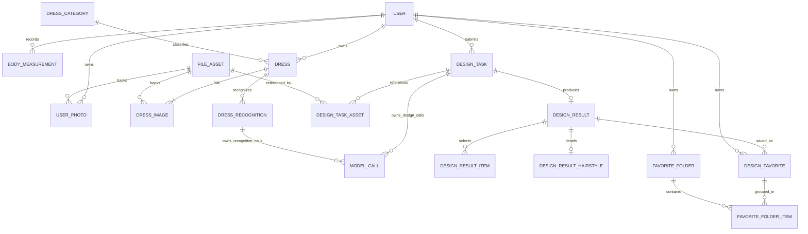

# 数据库设计

## 2026-10-30 微信账号与认证票据

已生成 `V11__wechat_accounts.sql`，尚未执行；新代码启动兼容检查要求 V11。`user` 的用户名与密码允许为空，新增微信 AppID/OpenID 唯一组合、`auth_version` 和独立 `avatar_file_id`。已有密码账号保留原凭据，微信新账号不生成虚拟用户名或密码。头像纳入文件引用检查。

新增 `auth_ticket`：自增主键、唯一票据键、类型、浏览器归属摘要、载荷、状态、过期时间及创建/更新时间。支持短期绑定凭据和扫码状态，单次消费；关联写入沿用先锁 user 的短事务，外部微信请求在事务外。注册绑定依靠身份唯一约束防止并发重复归属。改密提升认证版本，使所有旧登录会话失效。

字段、锁顺序、清理和错误处理详见[接口与数据设计](../02-需求文档/2026-10-30-微信小程序/04-接口与数据设计.md)。仅完成离线编译及模拟边界测试，真实 SQL、数据库锁和 Redis 持久化待联调；不将脚本生成视为迁移完成。

2026-10-30 发型专区新增`hairstyle_favorite`，保存账号与稳定款式的唯一收藏关系、下架回显JSON快照及创建/更新时间；唯一索引(user_id, hairstyle_id)，列表索引(user_id, created_at, id)。写入沿用先锁user的短事务，取消幂等。迁移`V9__hairstyle_favorites.sql`已生成并在独立库执行，应用启动要求V9结构；未迁移共享开发库或生产。字段与事务详见[接口与数据设计](../02-需求文档/2026-10-30-发型独立专区/03-接口与数据设计.md)，运行证据见[开发验证](../testing/02-checks/2026-10-30-发型独立专区.md)。

2026-10-29 发型图库使用版本化项目资源，不新增表或迁移。`design_task.input_snapshot`及其中的`inputSummary`保存目标款式、版本、图片URL/大小/SHA-256快照；平台图不占用用户`file_asset`，不纳入用户文件清理，旧资源由发布流程保留。每次仍只有一张本人照，现有PERSON/OUTPUT引用规则保持。完整实现与验证见[发型图库需求](../02-需求文档/2026-10-28-发型图库与设计交互/01-需求说明.md)。

2026-10-27 个人照片管理调整：沿用 user_photo 与 user 的默认照片引用，无表、索引或迁移变更。新增及替换在 user 锁内校验容量和版本；替换创建新照片行并原子删除原行，按 ID 顺序锁定涉及文件，有效引用仍存在时不安排清理。补充新增沿用 REFERENCE 编码，旧记录不重分类，主要引用沿用 PORTRAIT / FULL_BODY。见[实施契约与验证](../02-需求文档/2026-10-27-基础资料与照片合并/01-需求说明.md)。

最后更新：2026-10-20。

状态：依据用户要求已生成初始化 SQL，尚未执行迁移或运行数据库验证；SQL 生成不代表所有业务与并发规则已实现。MySQL、MyBatis-Plus、不建外键、业务表具备主键和创建／更新时间、Flyway 统一迁移以及已确认表名调整继续有效。2026-10-20 已确认现有 17 张表的职责拆分、按账号短事务串行维护关联、历史设计及重试的独立快照与图片引用、两步文件清理和任务删除后的去重边界。当前 SQL 的字段类型、可空性、默认值、状态编码和索引已确认为首版基线，具体实现及运行验证尚未完成。

业务定义见 [领域模型](02-领域模型.md)，接口传输见 [接口契约](05-接口契约.md)。本设计的逻辑关系不代表物理外键；领域对象也不要求逐个创建代码模块。Redis 仅保存登录会话。

## 实体与关系建议

| 实体／建议表名 | 主要内容 | 主要约束 |
| --- | --- | --- |
| 用户 `user` | 账号认证、显示名称、当前尺寸、默认照片和任务名额 | 4～32 位字母、数字或下划线，转小写后唯一 |
| 尺寸历史 `body_measurement` | 身高、体重及各项尺寸、记录时间 | 每次保存新增完整记录，历史不原地修改 |
| 文件 `file_asset` | 所属账号、存储键、类型、字节数、清理状态 | 数据库保存元信息，文件内容位于七牛云 |
| 个人照片 `user_photo` | 文件关联、照片类型 | 照片库记录与底层文件分离 |
| 衣物类别 `dress_category` | 类别编码、名称、顺序 | 系统固定字典，编码唯一 |
| 穿戴单品 `dress` | 名称、类别、颜色、季节、备注及图片集合版本 | 用户拥有的一件实物，至少一张图片 |
| 单品图片 `dress_image` | 文件关联、排序、图片级 AI 特征及人工修订 | 一件单品多张图，第一张为封面 |
| 整组识别 `dress_recognition` | 输入快照、状态、执行权、租约及历史结果 | 一次识别一条记录，重试新建 |
| 设计任务 `design_task` | 类型、状态、输入快照、模型配置版本、重试来源 | 提交幂等，数据库原子领取，账号并发控制 |
| 模型调用 `model_call` | 所属任务、阶段、模型、请求编号、状态、错误 | 区分文字和图片调用，不存密钥 |
| 任务图片引用 `design_task_asset` | 任务、文件、用途、顺序 | 区分本人照、衣物图和生成图，支撑引用清理 |
| 设计方案 `design_result` | 所属任务、固定方案栏目、生图提示词 | 每任务最多一份，可先存文字，再补图片 |
| 方案单品 `design_result_item` | 选中实物、名称和分类快照、搭配理由及穿着方式 | 穿搭方案专用，按顺序展示 |
| 发型详情 `design_result_hairstyle` | 发型名称、长度、刘海、分缝、卷直、发色及打理 | 发型方案专用，每方案一条 |
| 收藏 `design_favorite` | 用户、设计方案、收藏时间 | 用户与方案组合唯一，允许尚未分组 |
| 收藏夹 `favorite_folder` | 用户、名称 | 同一账号下名称唯一 |
| 收藏归属 `favorite_folder_item` | 收藏夹、收藏 | 组合唯一；一个收藏可以属于多个收藏夹 |

当前 17 张业务表的职责拆分已确认（已同步初始化 SQL，尚未执行）；字段与索引基线已确认，尚未运行验证。已确认移除 maintenance_control，维护状态改用 server 持久化目录中的标记文件，不计入业务表。备份暂不考虑，移除 backup_batch 和 backup_object。

图中的关系均为逻辑关联，不生成数据库外键。当前尺寸、默认照片和重试来源为额外引用，图中省略以便阅读。实体数量不代表所有业务都需要单独的服务或代码模块。

## 字段通用约定（已确认）

以下主键、时间字段和命名规范覆盖全部业务表。已确认采用 Flyway，其内部迁移历史表保留工具原生结构，作为明确例外，不手动添加业务字段。

- 数据库采用 MySQL、InnoDB、UTF-8 字符集。版本采用已确认的 MySQL 8.0.45，与开发库一致，镜像标识在部署前锁定；当前 SQL 使用 utf8mb4_bin 排序规则。
- 每张业务表都必须有主键，统一设计为 `id BIGINT` 自增正整数，包括个人资料和关联表；对前端以字符串传递，避免 JavaScript 整数精度问题。业务组合唯一性单独通过唯一索引表达。
- 不创建数据库外键或级联约束。关联对象是否存在、是否属于同一账号，以及新增、修改和删除时的关联完整性，由应用代码在事务中校验和维护。
- 下表中的 `必填` 表示 `NOT NULL`，`可空` 表示默认 `NULL`。未注明默认值的必填字段由应用显式写入，不用空字符串或零代替未知值。
- 每张业务表都包含 `created_at DATETIME(3)` 和 `updated_at DATETIME(3)`，均必填，由应用使用 UTC 写入。插入时两者取同一时间，修改记录时同步更新 updated_at，created_at 保持不变。历史尺寸和关联表也保留这两个字段；不发生修改的记录两者保持初始值，字段存在不改变历史尺寸和任务输入不可原地改写的规则。
- 用户所属的业务子表包含 `user_id BIGINT`，必填，归属创建后不可修改。user 的 id 即账号标识，不再保存指向自身的 user_id；类别和全局技术表不增加 user_id。服务端从登录会话取得账号，不信任请求里的账号 ID。
- 状态字段用 `VARCHAR` 存储稳定编码，取值和状态转换由代码校验，不创建 CONSTRAINT CHECK。
- 用户名保存小写标准值，唯一比较采用精确比较。收藏夹名称去除首尾空白，按 Unicode NFC 规范化后精确比较；已确认英文名称大小写不同可以共存；例如 Travel 和 travel 是不同名称，首尾空格不用于区分名称。
- 当前 SQL 字段长度已确认为首版基线；用户文本限制见下文已确认的字段审阅记录，接口和表单需同步校验，模型输出写入前校验，不静默截断。

## 表字段

### 账号与个人资料

`user`：

| 字段 | 类型 | 空值／默认 | 含义 |
| --- | --- | --- | --- |
| username | VARCHAR(32) | 必填 | 小写标准用户名，唯一 |
| password_hash | VARCHAR(255) | 必填 | 带算法参数的密码哈希 |
| status | VARCHAR(16) | 必填，ACTIVE | ACTIVE / DISABLED；停用仅预留状态，不增加首版运营功能 |

含通用 `id`、创建及更新时间。密码强度、会话失效和停用检查由认证设计处理，Redis 会话不另建数据库表。

以下资料和任务控制字段直接放在同一张 `user` 表，不再单独建立用户资料表；user.id 即账号标识。

| 字段 | 类型 | 空值／默认 | 含义 |
| --- | --- | --- | --- |
| display_name | VARCHAR(64) | 可空 | 显示名称 |
| current_measurement_id | BIGINT | 可空 | 当前尺寸版本 |
| default_portrait_id | BIGINT | 可空 | 默认头像照片记录 |
| default_full_body_id | BIGINT | 可空 | 默认全身照片记录 |
| active_task_id | BIGINT | 可空 | 占用该账号任务名额的任务 |

`body_measurement`：含通用 `id`、`user_id`、创建及更新时间，包含以下 27 项尺寸，全部为可空 DECIMAL(6,2)。体重单位为 kg，其余为 cm。填写值大于零，由代码校验；具体合理范围在表单设计中确定。

| 字段 | 含义 | 单位 |
| --- | --- | --- |
| `height` | 身高 | cm |
| `weight` | 体重 | kg |
| `neck` | 颈围 | cm |
| `chest` | 胸围 | cm |
| `underbust` | 下胸围 | cm |
| `waist` | 腰围 | cm |
| `abdomen` | 腹围 | cm |
| `hip` | 臀围 | cm |
| `shoulder` | 肩宽 | cm |
| `back_width` | 背宽 | cm |
| `arm_length` | 臂长 | cm |
| `upper_arm` | 上臂围 | cm |
| `forearm` | 前臂围 | cm |
| `wrist` | 腕围 | cm |
| `front_waist_length` | 前腰节长 | cm |
| `back_waist_length` | 后腰节长 | cm |
| `inseam` | 内侧腿长 | cm |
| `outseam` | 外侧腿长 | cm |
| `thigh` | 大腿围 | cm |
| `knee` | 膝围 | cm |
| `calf` | 小腿围 | cm |
| `ankle` | 踝围 | cm |
| `head` | 头围 | cm |
| `left_foot_length` | 左脚长 | cm |
| `right_foot_length` | 右脚长 | cm |
| `left_foot_width` | 左脚宽 | cm |
| `right_foot_width` | 右脚宽 | cm |

保存新增完整记录，允许全空以表达当前不提供尺寸；全空记录在任务中按无有效尺寸处理。删除当前尺寸先清空资料引用，再删除记录；任务快照不引用可删除历史行作为唯一依据。

已确认尺寸字段不加单位后缀，保留 DECIMAL(6,2)：长度、宽度和围度统一使用 cm，体重使用 kg。数据库、业务 API、历史记录及任务输入快照采用同一单位，页面标明单位；传给模型时附带明确的厘米／千克描述。接口最多接收两位小数，超出时返回参数错误，避免依赖数据库隐式舍入。未填写为 NULL，填写必须大于零。字段单位固定，不随页面显示或模型切换改变。

已确认 body_measurement 不增加 measured_at、measurement_method 或 notes：不单独记录实际测量时间、测量方式和测量备注，保留通用 created_at、updated_at。此决定不影响 dress 的备注字段。

已按确认清单扩充至 27 项，脚长和脚宽区分左右，其余部位记录一组值。记录身体尺寸，不混入成衣尺寸、鞋码或品牌尺码；测量位置说明在表单设计中补齐。

### 文件、照片和衣物

`file_asset`：含通用 `id`、`user_id`、创建及更新时间。

| 字段 | 类型 | 空值／默认 | 含义 |
| --- | --- | --- | --- |
| bucket | VARCHAR(128) | 必填 | 七牛空间名称 |
| storage_key | VARCHAR(255) | 必填 | 服务端生成的不可变对象 key，与 bucket 组合唯一 |
| original_name | VARCHAR(255) | 可空 | 原文件名，仅用于展示 |
| mime_type | VARCHAR(64) | 登记前可空，TEMP/READY 必填 | 七牛对象信息报告的图片类型 |
| size_bytes | BIGINT | 登记前可空，TEMP/READY 必填 | 文件字节数，正数 |
| width / height | INT | 可空 | 可选像素尺寸；直接上传原图不解码填充 |
| status | VARCHAR(16) | 必填，UPLOADING | UPLOADING / VERIFYING / TEMP / READY / REJECTED / DELETING |
| expires_at | DATETIME(3) | 可空 | 临时上传的清理期限，按申请上传时起 24 小时计算，不因重复通知延长 |
| cleanup_after | DATETIME(3) | 可空 | 无引用文件待清理时间 |

2026-10-23 原图直传方案替代此前核验加工流程：申请时创建 UPLOADING，客户端上传后通过 complete 在事务外查询七牛对象信息，再短事务复核归属、状态和有效期，成功进入 TEMP；保存业务引用后进入 READY。上传期间不运行后台加工，衣物识别使用独立业务任务。临时有效期不因重复完成通知延长。

新上传的 storage_key 与 original_key 指向同一原图，thumbnail_key 为空；不预留展示图或缩略图键。历史 TEMP/READY 保持原 storage_key 和引用，不覆盖历史对象。历史 UPLOADING/VERIFYING 可通过 complete 重新登记原图。遗留 verification_token、verification_lease_until、thumbnail_key 字段保留兼容，不新增结构迁移或改写已应用的 V1。

mime_type、size_bytes 在完成登记后取七牛对象信息；width/height 对直接上传原图可为空，不作为可用性前提。上传不解码，像素及动画限制不再属于上传准入。未完成和无引用临时资产到期可清理；READY 按引用清理，DELETING 不得通过完成通知复活。清理对相同对象 key 去重，同时覆盖历史派生对象，继续复核全部有效引用。

详情见 [原图直传与后台识别](../02-需求文档/2026-10-23-原图直传与后台识别/01-需求说明.md)。

`user_photo`：含通用 `id`、`user_id`、创建及更新时间；`asset_id BIGINT` 必填，`photo_type VARCHAR(16)` 必填（PORTRAIT / FULL_BODY / REFERENCE）。默认照片引用必须符合类型。删除默认照片先清空对应资料引用，已提交任务仍保留自己的文件引用。

`dress_category`：含通用 `id`、创建及更新时间；`code VARCHAR(32)` 必填且唯一，`name VARCHAR(32)` 必填，`sort_order INT` 必填默认 0。迁移初始化上装、下装、连衣裙、外套、鞋、包、配饰，不提供首版类别管理页面。

`dress`：含通用 `id`、`user_id`、创建及更新时间。此处 dress 泛指穿戴单品，包括衣服、鞋、帽子、包和饰品，不局限于连衣裙。每条单品通过 dress_image 关联至少一张可用图片，dress 本身不存 asset_id；整组保存后不得为空，存在性、归属和核验状态由代码在事务中校验。

| 字段 | 类型 | 空值／默认 | 含义 |
| --- | --- | --- | --- |
| name | VARCHAR(100) | 必填 | 非空白名称 |
| category_id | BIGINT | 必填 | 固定类别 |
| color | VARCHAR(100) | 可空 | 自由文本颜色 |
| season_mask | TINYINT UNSIGNED | 必填，0 | 1/2/4/8 分别为春夏秋冬，可按位组合，0 为不限 |
| notes | VARCHAR(1000) | 可空 | 备注 |

dress 仅保留 image_revision BIGINT NOT NULL DEFAULT 1（图片集合版本），移除 version 和 manual_confirmed_revision。单品编辑不做版本冲突校验，按服务器最后成功保存为准；PATCH 未传字段仍保持原值。不保存识别状态、租约、执行权、模型配置、错误或图片特征。

季节值限制为 0～15。图片集合增删、替换或排序变化时递增 image_revision；名称等文字资料修改不改变图片集合版本。第一张为封面，整组图片保存成功后再触发一次识别，不按每张上传分别调用模型。旧设计仍使用自己的快照及文件引用。

### 单品图片与整组识别

字段和并发规则详见本文末尾“衣橱识别与自动搭配的数据方案”；dress_image 与 dress_recognition 均包含 id、user_id、created_at、updated_at。

### 任务、调用和结果

`design_task`：含通用 `id`、`user_id`、创建及更新时间。

| 字段 | 类型 | 空值／默认 | 含义 |
| --- | --- | --- | --- |
| design_type | VARCHAR(16) | 必填 | HAIRSTYLE / OUTFIT |
| status | VARCHAR(24) | 必填，QUEUED | QUEUED / PLANNING / GENERATING / SAVING / SUCCEEDED / FAILED / UNKNOWN |
| client_request_id | VARCHAR(64) | 必填 | 客户端为一次明确提交生成的幂等标识 |
| request_hash | CHAR(64) | 必填 | 规范化提交内容摘要，相同幂等键不同输入拒绝 |
| input_snapshot | JSON | 必填 | 文字要求、尺寸、所选衣物文字资料、输入格式版本 |
| model_config_snapshot | JSON | 必填 | 规划与生图模型、配置版本、参数、提示词版本，不含密钥 |
| retry_of_task_id | BIGINT | 可空 | 原任务仍存在时的关联 |
| retry_source_id | BIGINT | 可空 | 原任务标识快照，原任务删除后仍可追溯其编号 |
| resume_stage | VARCHAR(16) | 必填，PLAN | PLAN / IMAGE，重试是否复用文字方案 |
| current_call_id | BIGINT | 可空 | 当前阶段模型调用编号 |
| result_url_ciphertext | MEDIUMTEXT | 可空 | 生图结果临时下载地址密文，保存完成清空 |
| attempt_token | VARCHAR(64) | 可空 | 当前执行权标识，防止旧执行器写回 |
| lease_until | DATETIME(3) | 可空 | 执行权租约，过期后先核实而非直接重发模型请求 |
| next_check_at | DATETIME(3) | 可空 | 待核实或待保存的下一次处理时间 |
| started_at / finished_at | DATETIME(3) | 可空 | 开始和终止时间 |
| hidden_at / purge_after | DATETIME(3) | 可空 | 未知任务隐藏时间及隐藏后 7 天的清理期限 |
| error_code | VARCHAR(64) | 可空 | 可分类错误码 |
| error_message | VARCHAR(1000) | 可空 | 脱敏后的用户可理解错误摘要 |

`SAVING` 是对草案状态的补充：外部生成成功但尚未完成可靠暂存、七牛保存及结果入库。此阶段仍占账号名额，仅重试结果保存，不再次生成。若缺少完整暂存且无法核实外部结果，进入 UNKNOWN；有明确证据确认结果无法取回或内容无效时才进入 FAILED 并说明原因。不能仅凭暂存文件缺失认定生成失败。

重试的任务拥有独立输入、方案和图片引用，不依赖原任务存活。图片重试复制原方案，配置快照记录此次生图配置；方案中另保留原规划来源，不能误记为新语言模型生成。

`model_call`：已确认简化为模型调用记录，不承担图片暂存和保存调度。以下 15 个字段已同步 SQL。执行权绑定归任务，结果暂存归任务保存流程及持久化文件清单；尚未进行业务恢复验证。

| 字段 | 建议类型及空值 | 含义 |
| --- | --- | --- |
| id | BIGINT 主键 | 一次实际调用的编号 |
| user_id | BIGINT 必填 | 用户归属 |
| owner_type | VARCHAR(24) 必填 | DESIGN_TASK / DRESS_RECOGNITION |
| owner_id | BIGINT 必填 | 对应设计或整组识别任务 |
| stage | VARCHAR(16) 必填 | RECOGNIZE / PLAN / IMAGE |
| provider / model | VARCHAR(128) 必填 | 实际提供商与模型 |
| request_id | VARCHAR(255) 可空 | 外部请求编号，渠道未返回时可空 |
| status | VARCHAR(24) 必填，默认 PREPARED | PREPARED / SENT / SUCCEEDED / FAILED / UNKNOWN |
| started_at / finished_at | DATETIME(3) 可空 | 调用开始及结束时间，UTC |
| error_code / error_message | VARCHAR(64) / VARCHAR(1000) 可空 | 安全错误码及摘要 |
| created_at / updated_at | DATETIME(3) 必填 | 通用时间字段，UTC |

当前共 15 个字段。删除 invocation_no，以调用 ID 区分调用；配置及提示词版本从所属任务的固定配置快照追溯。prompt_text、request_metadata、response_metadata 不再默认完整存储，正式方案和识别结果使用各自业务表。

model_call 不再保存 execution_token。design_task 和 dress_recognition 各增加可空 current_call_id BIGINT。创建调用记录与设置任务 current_call_id 在同一短事务中完成，核查任务状态、执行权和既有调用。真正发送前使用 PREPARED → SENT 条件变更确保本地仅一个发送者；SENT 持久化后进程崩溃仍可能无法判断外部是否收到，必须核实或进入 UNKNOWN，不自动重发。

执行器持有当次任务 attempt_token 和调用 ID；写回时同时匹配当前 token、current_call_id、阶段及归属，租约恢复后的旧执行器不能写回。恢复器先读取 current_call_id 核实原调用，不因为获得新 token 就创建并发送新调用；可接管完整暂存结果或查询到的结果。跨规划／生图阶段转移时原子写入正式方案后才切换当前调用编号，旧阶段记录仍按归属和 stage 可查。

调用前持久化记录和发送意图。数据库提交与外部 HTTP 无法原子完成；崩溃窗口内不能仅凭记录状态推断供应商未收到请求。无查询或供应商幂等保障时按 UNKNOWN 处理。图片保存失败由任务保存流程处理，不反向将已成功的模型调用标为失败。

配置快照及正式结果不能替代所有恢复信息：外部结果临时 URL 等若是再次取回结果的必要信息，应交给任务恢复记录受控保存，不能随 response_metadata 一并丢弃。完整文件的定位、大小及摘要保留在持久化文件清单中，具体存储规则见下文。

`design_task_asset`：含 `id`、`user_id`、创建及更新时间；`task_id BIGINT`、`asset_id BIGINT`、`role VARCHAR(16)`、`position INT` 均必填。另含可空 source_dress_id BIGINT 和 source_dress_image_id BIGINT，保留单品及单品图片来源编号快照，不作为可删除源记录的强引用。role 为 PERSON / CANDIDATE / DRESS / REFERENCE / OUTPUT，position 从 0 开始。每个任务每种用途每个位置唯一，首版 PERSON 和 OUTPUT 仅允许位置 0，PERSON 必须恰好一条；OUTPUT 仅完整成功时必需。REFERENCE 为预留用途，首版提交接口不接受任意附加参考图，衣物图使用 DRESS。图片顺序是模型输入的一部分。

方案采用固定栏目，以下三表划分已确认；具体类型与长度已按下表写入 SQL，尚未执行数据库验证。本轮替代原先 plan_json 和 explanation 的方案内容设计，其他用途的 JSON 不因此全部移除。

三表都包含 id BIGINT 主键、user_id、created_at、updated_at，不建立外键或 CHECK，归属、方案类型和字段有效性由代码维护。

`design_result`：

| 字段 | 建议类型 | 含义 |
| --- | --- | --- |
| task_id | BIGINT 必填且唯一 | 所属任务 |
| title | VARCHAR(100) 必填 | 方案名称 |
| summary | TEXT 必填 | 概述，替代 explanation |
| style | VARCHAR(255) 必填 | 整体风格描述 |
| occasion | VARCHAR(255) 必填 | 适用场景 |
| design_reason | TEXT 必填 | 结合用户需求的设计理由 |
| color_advice | TEXT 可空 | 穿搭配色说明；发型可空 |
| wearing_advice | TEXT 可空 | 整套穿着建议；发型可空 |
| image_prompt | MEDIUMTEXT 必填 | 最终生图提示词，内部使用 |
| plan_provenance | JSON 必填 | 原始规划模型与版本等技术来源，不保存面向用户的方案正文或密钥 |

`design_result_item`：

| 字段 | 建议类型 | 含义 |
| --- | --- | --- |
| result_id | BIGINT 必填 | 所属方案 |
| dress_id | BIGINT 必填 | 提交时的实物单品编号快照，源记录删除后保留 |
| dress_name | VARCHAR(100) 必填 | 生成时的单品名称 |
| category_name | VARCHAR(32) 必填 | 生成时的分类名称 |
| match_reason | TEXT 必填 | 选择该单品的理由 |
| wearing_method | TEXT 必填 | 该单品具体穿着方式 |
| sort_order | INT 必填 | 从 0 开始的展示顺序 |

同一方案同一单品唯一 (result_id, dress_id)，按 (result_id, sort_order, id) 查询。dress_id 是历史来源编号，不要求源记录永久存在；图片通过方案所属任务的 design_task_asset.source_dress_id、source_dress_image_id 和 DRESS 用途查找，不重复保存签名 URL。

`design_result_hairstyle`：

| 字段 | 建议类型 | 含义 |
| --- | --- | --- |
| result_id | BIGINT 必填且唯一 | 所属方案 |
| hairstyle_name | VARCHAR(100) 必填 | 发型名称 |
| length_advice | TEXT 必填 | 长度建议 |
| bangs_advice | TEXT 必填 | 刘海建议，可明确不留刘海 |
| parting_advice | TEXT 必填 | 分缝建议，可说明无需固定分缝 |
| texture_advice | TEXT 必填 | 卷直建议 |
| hair_color_advice | TEXT 必填 | 发色建议，可明确保留原发色 |
| care_advice | TEXT 必填 | 日常打理说明 |

文字规划完成时，在同一事务内保存主体及对应明细：OUTFIT 必须有至少一条有效单品且无发型详情；HAIRSTYLE 必须有一条发型详情且无穿搭单品。类型由 design_task.design_type 决定，不重复存另一份类型。整体穿着建议描述整套搭配，单品穿着方式描述各件实物；发色建议由发型详情保存。

任务成功仍要求完整文字方案与已就绪 OUTPUT 图片。图片失败可展示和复用文字，但不开放收藏。IMAGE_ONLY 重试复制主体及对应全部明细到新方案，保留规划来源；删除方案时同事务清理两类明细及收藏。模型传输可采用结构化 JSON，校验后映射到列和明细行，原始响应仅作为受控诊断，不替代正式方案字段。

### 收藏

`design_favorite`：含 `id`、`user_id`、创建及更新时间；`result_id BIGINT` 必填，`(user_id, result_id)` 唯一。不要求存在收藏夹归属。

`favorite_folder`：含 `id`、`user_id`、创建及更新时间；`name VARCHAR(64)` 必填且去除首尾空白后非空，按通用规范化规则保存，`(user_id, name)` 唯一。

`favorite_folder_item`：含通用 `id` 主键、`user_id BIGINT`、创建及更新时间；`favorite_folder_id BIGINT` 和 `design_favorite_id BIGINT` 均必填，另设 `(favorite_folder_id, design_favorite_id)` 联合唯一索引。加入归属时必须保证收藏夹、收藏和方案属于同一账号。

## 任务状态建议

`QUEUED` → `PLANNING` → `GENERATING` → `SAVING` → `SUCCEEDED`。

确认失败进入 `FAILED`，请求已发出但结果无法核实进入 `UNKNOWN`。已完成文字方案可在图片失败后保留。重试创建关联原任务的新任务；复用文字方案时，新任务可跳过规划阶段。

模型调用表分别记录每个阶段的实际调用结果。生成图片成功但结果入库与七牛存储保存失败，需要保留供应商返回信息并重试保存，不能直接再次生图。是否可查询或重新下载取决于实际渠道能力。

## 并发与文件生命周期建议

- 创建任务时同时完成幂等检查、输入快照及图片引用写入，避免任务已创建但输入缺失。
- 同一账号的运行资格需要数据库事务或原子条件更新保证，不能仅通过线程池或页面禁用实现。每账号最多一个排队或运行任务，`UNKNOWN` 不占名额。创建任务时锁定 user，在同一事务中检查并设置 active_task_id；仅本任务仍占名额时才清空，避免迟到结果清掉新任务名额。
- 任务保存所用衣物文字资料、尺寸和模型参数快照；照片以不可变文件引用保存，资料修改不改变旧任务输入。
- 文件清理前需确认照片库、衣物和任务均无有效引用；清理与创建引用之间需要并发保护。
- 删除方案时删除其收藏关系；删除收藏夹仅删除分组和归属，保留收藏。
- 排队或运行任务不能删除或取消，成功或确认失败的任务可删除；`UNKNOWN` 任务仅允许隐藏，保留核实所需数据。隐藏状态与执行状态分别存储，不能用一个删除标记代替两种含义。
- 隐藏的 `UNKNOWN` 任务确认结果后即清理；隐藏满 7 天仍未知时停止核实并清理，不重新展示迟到结果。仍显示的任务不自动删除。
- 衣物类别固定单选，季节多选且空集合表示不限季节，颜色为自由文本。

## 关联约束与索引

不使用数据库外键，所有关联通过普通 ID 字段表达。应用在写入时校验目标存在、状态有效和账号归属；私有资源按 user_id 与目标 ID 查询，类别为全局表，仅校验类别存在。删除和关联创建采用相同的父记录锁或等效并发控制，在事务内完成校验与变更，避免校验后目标被并发删除。两个后端及 ops 维护程序均须遵守这些规则。

保留主键、业务唯一索引及查询索引；不因取消外键而取消用户名、收藏归属或提交幂等性的唯一约束。数据一致性检查由 ops/db/checks/ 核查孤立引用和跨账号关联，不自动删除异常数据。

个人资料的当前尺寸、默认照片和活动任务均为可空引用。先创建用户记录，之后再设置这些引用，以避免初始化循环依赖。重试来源删除时先将关联字段清空，保留编号快照；删除操作不连带删除后续重试任务。

| 查询或约束 | 建议索引 |
| --- | --- |
| 每表主键 | 所有表 id 主键 |
| 登录与注册唯一性 | user(username) 唯一 |
| 各资源的账号隔离、稳定分页 | 对应表 (user_id, created_at, id) |
| 照片按类型筛选 | user_photo(user_id, photo_type, created_at, id) |
| 衣橱类别筛选 | dress(user_id, category_id, created_at, id) |
| 任务提交幂等 | design_task(user_id, client_request_id) 唯一 |
| 领取任务 | design_task(status, created_at, id) |
| 超时、核实与隐藏清理 | design_task(status, lease_until)、(status, next_check_at)、(purge_after) |
| 调用阶段查找 | model_call(owner_type, owner_id, stage, id) 普通索引；任务发送保护由代码事务及调用状态条件更新维护 |
| 任务图片顺序 | design_task_asset(task_id, role, position) 唯一 |
| 查询文件是否仍被引用 | user_photo(asset_id)、dress_image(asset_id)、design_task_asset(asset_id)；另按用户查 holds_input_assets=1 的识别快照并核对其中资产 ID |
| 文件到期与清理 | file_asset(status, expires_at)、(status, cleanup_after) |
| 每任务一个方案 | design_result(task_id) 唯一 |
| 对象目标唯一性 | file_asset(bucket, storage_key) 唯一 |
| 文件核验恢复 | file_asset(status, verification_lease_until) |
| 类别编码 | dress_category(code) 唯一 |
| 收藏与分组唯一性 | design_favorite(user_id, result_id)、favorite_folder(user_id, name) 唯一；favorite_folder_item(favorite_folder_id, design_favorite_id) 唯一 |
| 取消收藏时解除归属 | favorite_folder_item(design_favorite_id) |
| 删除原任务时解除重试关系 | design_task(retry_of_task_id) |

尺寸历史、收藏和任务列表默认按创建时间及 ID 倒序稳定分页。关联查询所需索引与上述索引合并规划，避免重复；衣物季节和颜色暂不增加独立索引，后续根据真实查询验证。

## 编辑版本（字段草案）

单品 dress 已改为最后成功保存为准，不做编辑版本校验。其他仍采用版本校验的对象如下：user、dress_image、favorite_folder 保留 version BIGINT NOT NULL DEFAULT 0。更新条件包含账号归属、ID 和版本（user 表直接以登录账号对应的 id 校验归属），成功后递增；零行更新时区分不可见资源（404）和版本冲突（409）。收藏夹成员增删不递增名称版本。

资料显示名称、默认照片、当前尺寸变化递增资料版本；active_task_id 后台变化不递增。删除照片或尺寸引起默认引用清空也递增。保存、切换或删除尺寸时锁定资料并校验版本，在同一事务完成记录与当前引用变更；删除非当前尺寸不递增资料版本。记录仍不可原地修改。

版本校验不替代删除与引用创建的锁，也不替代任务状态及执行权校验。字段已写入初始化 SQL，尚未在数据库创建；事务与版本控制仍待实现。

## 事务边界

| 操作 | 必须原子完成的数据库变化 |
| --- | --- |
| 注册 | 插入用户及合并后的资料字段，用户名唯一冲突返回明确提示 |
| 修改密码 | 事务外验密与哈希计算；单条原子更新按 user.id、ACTIVE 状态、原 password_hash 的二进制精确值匹配，更新 password_hash 与 updated_at，不递增资料 version；无需迁移 |
| 保存／切换尺寸 | 锁定个人资料，新增记录或校验历史归属，更新当前引用 |
| 删除尺寸／默认照片 | 锁定个人资料，清空相关默认引用，再删除源记录 |
| 保存照片／衣橱整组图片 | 锁定用户、单品及图片记录，再锁文件；校验归属、状态和至少一张图片，保存引用、顺序、集合版本及识别任务，文件转 READY |
| 提交任务 | 锁定个人资料；先检查同幂等键，再检查活动名额；锁定输入文件并校验；写任务及快照和引用，设置 active_task_id |
| 领取任务 | 原子领取 QUEUED，设置阶段、执行权及租约；仅领取成功者可以调用模型 |
| 完成／失败／转未知 | 校验任务执行权和预期状态，写结果及状态，仅在 active_task_id 等于本任务时清空名额 |
| 重试 | 创建新任务；需要复用时复制文字及来源，建立独立文件引用；遵守同一账号名额限制 |
| 删除任务／方案 | 校验允许删除的状态，清空后续重试任务的原任务关联，删除收藏归属及收藏、方案单品／发型明细、结果、调用记录、图片引用、任务，并安排零引用文件清理 |
| 隐藏未知任务 | 设置 hidden_at 和 purge_after，重复隐藏不延长 7 天期限 |
| 删除收藏夹 | 删除夹内归属，再删除收藏夹，保留收藏与方案 |
| 取消收藏 | 删除所有归属，再删除收藏，不删除方案 |

首版锁顺序建议：涉及账号资源关联的写事务先锁 user，再锁任务／方案、照片／衣物／尺寸、dress_image、dress_recognition、model_call、收藏夹、收藏及归属，最后锁 file_asset；同类多行按 ID 升序。没有某类资源则跳过，不能反向补锁。提交时在相同事务中读取被锁定衣物及尺寸，写入快照，避免文字与图片来自不同编辑版本。

单纯文件核验和清理只锁 file_asset，不在持有文件锁后再锁用户业务记录。清理在文件锁内核查引用；创建引用必须先拿同一文件锁并检查状态，因此文件一旦转 DELETING 就不能新增引用。

上述按账号串行化仅覆盖短数据库写事务，首版取舍是减少无外键关联维护的竞争复杂度；外部 HTTP、解码、文件传输均在事务外执行，不持有资料锁。未来运营服务也须遵守锁顺序。死锁仅重试无外部副作用的数据库事务，不能连带重发模型请求。

## 清理与恢复

- 尺寸记录删除不改变任务快照。任务输入和调用记录属于私有数据，不能作为普通日志长期复制。
- 临时上传 24 小时后过期。已经引用的文件在最后一个引用删除后安排清理；清理器锁定文件行，重新核实所有引用（包含 holds_input_assets=1 的 dress_recognition.input_snapshot 图片资产），转 DELETING 后提交，再删除七牛对象及派生文件。添加引用只接受未过期 TEMP 或 READY，不能引用 DELETING。
- 文件删除成功后删除元信息；失败则保留 DELETING 并重试。清理重复执行时将文件已不存在视为成功。
- 隐藏 UNKNOWN 任务在确认结果或隐藏满 7 天时清理。清理前使旧执行权失效；迟到响应不得重建已删除任务，新落盘但无法归属的文件进入孤立文件清理流程。
- 租约超时只表示本地执行权需要恢复，不证明外部请求失败。核实已有请求、恢复结果入库与七牛存储保存或标记 UNKNOWN，不自动重发生图。
- 全部账号数据暂不设计自动过期；首版不提供账号注销功能。任务已删除后的同幂等键去重仅在任务记录仍存在时成立，客户端不得复用已完成操作的提交键。
- 备份方案暂缓，不建立备份批次与对象表。

## 可靠保存与维护结构（技术草案）

以下是已确认恢复方向的具体实现建议，待整体审阅，相关字段已写入初始化 SQL，不代表已经在数据库创建表或验证恢复能力；不新增维护或备份表。

### 模型结果暂存

model_call 不再包含 staging_*、save_* 或 target_object_key。design_task 仅新增 result_url_ciphertext MEDIUMTEXT NULL，用于保存供应商临时下载地址的密文；URL 在转入 SAVING 时与当前调用编号一起核对并持久化，完整结果保存入库后清空。加密密钥来自受控配置，不放在数据库、文件清单或日志。Base64 响应直接解码落盘，不放进该字段。

暂存路径由 task_id/current_call_id 构成固定目录，不接受客户端路径。完整文件与清单使用同目录临时文件、落盘同步及原子重命名；清单包含任务／调用编号、产生文件时的执行权标识、大小、摘要和固定目标空间及对象键。清单最后发布，只有文件及清单都完整且校验一致时才视为可恢复结果。原始完整文件落盘但清单尚未完成的情况需要恢复器核实，不能直接标成功。

目标对象键按任务和调用编号确定，存储空间从任务固定配置取得，在上传前固定到清单；配置不得中途改变目标。恢复器取得当前任务执行权，检查调用仍为 current_call_id，再验证旧执行器留下的完整文件并接管。过期执行器不能直接提交数据库状态或覆盖已有完整文件，已删除任务的孤立文件只能清理。

保存进度复用任务 SAVING/SUCCEEDED；下次保存时间复用 next_check_at，保存错误复用任务 error_code/error_message，不再额外维护第二套保存状态及计数。仅对存储步骤做受控间隔重试，不重发模型。上传响应丢失时核实固定目标对象，完成文件引用、方案和任务成功状态的事务后才删除本地文件及清单。

外部结果 URL 失效且无完整文件时，按实际证据区分确定不可恢复和 UNKNOWN；收到响应但尚未可靠保存就崩溃，仍不承诺结果可恢复。清单完整性、进程重启接管、旧执行器拒绝、上传成功而数据库提交失败均需后续演练，当前未执行。

### 维护门禁（不建表，已确认）

移除 maintenance_control。单实例发布维护使用 server 持久化目录的标记文件，原子写入、重启读取，读取异常保持维护；具体执行规则见 [架构设计](03-架构设计.md#维护协调)。维护状态不放入业务数据库或 Redis。

### 进程恢复范围

保留模型调用核实、完整暂存文件接管、七牛保存重试及孤立文件清理。没有可核实外部请求或完整暂存结果的调用按 UNKNOWN 处理，不自动重发生图。备份及整机灾难恢复方案本轮移出范围。

实施时验证上传七牛后数据库提交失败、完整暂存落盘后重启、旧执行权写回被拒绝等场景；当前没有运行这些验证。

## 整体审阅范围

业务规则已经分轮确认。不建外键、每表具备主键及创建／更新时间的约定已确认。2026-10-20 补充确认 17 张表的职责拆分，以及下述事务、快照、清理和去重边界；当前 SQL 的字段类型、可空性、默认值、状态编码和索引已确认为首版基线，具体实现及运行验证尚未完成；收藏夹英文名称大小写语义、只收藏成功结果以及尺寸全空记录处理均已确认，详见首版需求。

本轮确认范围：

- 同一账号的关联写入先锁 user，再按统一顺序操作相关记录；仅短数据库事务串行，模型调用、图片处理及文件传输在事务外执行。
- 历史设计和重试任务保留独立快照与图片引用，源衣物或原任务删除不破坏已保留的结果及后续重试。
- 文件先在事务中核查全部有效引用并标记 DELETING，再删除七牛对象及派生文件；成功后删除元信息，失败保留状态重试。识别快照持有的文件也计入引用。
- 提交幂等仅覆盖任务记录存续期；任务物理删除后不再保留去重占位，首版不新增独立幂等记录表，客户端不得复用已完成操作的提交键。

迁移由 ops 使用 Flyway 显式执行，应用不自动迁移。前后端及基础设施版本组合已确认，具体版本锁定和构建验证尚未完成；衣物参考图数量上限、sub2api 协议及执行超时留待联调前补齐；本人照片数、效果图数和单文件上传限制已确认。本次授权覆盖初始化 SQL 生成；数据库执行、应用搭建和业务代码不在本次范围。

## 字段、状态与索引审阅结论（2026-10-20，已确认）

已确认沿用当前 SQL 的字段类型、可空性、默认值、状态编码及索引作为首版基线，具体约定如下。本次确认设计，不新增应用搭建、编码或迁移执行授权。

- 主键使用自增 BIGINT，接口 ID 使用字符串；时间使用应用显式写入的 UTC DATETIME(3)。尺寸沿用已确认的 DECIMAL(6,2)，未知值用 NULL，不用零或空字符串代替。
- 已确认用户可编辑文本长度：显示名称和收藏夹名称 64、衣物名称和颜色 100、衣物备注 1000 个字符。接口和表单同步校验，超限明确报错，不截断；模型输出也在写入前校验，不依赖数据库截断。
- 保留当前任务、调用、识别、文件四组独立状态编码。设计任务成功必须完成方案及图片保存；model_call 的 SUCCEEDED 只表示该次调用成功。UNKNOWN 不当作确定失败；SUPERSEDED 只使识别结果失去写回资格，不表示供应商请求已取消。
- 保留当前唯一索引，覆盖用户名、提交幂等、对象定位、单品图片、识别次数、任务图片位置、任务方案、方案单品、发型详情及收藏关系。普通索引覆盖按账号列表、领取任务、租约恢复、到期核实、文件清理及反向引用查询；暂不增加颜色、季节和 JSON 特征索引。
- 单品图片顺序继续由整组事务校验唯一和连续，不增加排序唯一索引。识别输入资产仍按用户及 holds_input_assets 过滤后检查 JSON 快照，后续以真实规模验证清理耗时，不能把该索引视为按 assetId 直接检索。

静态核对结果：初始化 SQL 包含 17 张表，均有 id、created_at、updated_at；未定义外键，所有索引引用的列均存在，四组状态编码均可容纳于对应 VARCHAR 长度。未执行 SQL、EXPLAIN、并发或恢复测试，不能据此认定索引性能及状态迁移实现已通过验证。

## 已确认命名

穿戴单品表使用 dress，分类表使用 dress_category，涵盖衣服、鞋、帽子、包和饰品。maintenance_control 已移除，备份表继续暂缓。

## 文档核对与验证目标

当前设计列出 17 张业务表（已同步初始化 SQL，尚未执行），维护状态通过标记文件保存，不建表。表职责、短事务原则、独立快照及引用、两步文件清理和删除后的去重边界已确认。字段、状态编码和索引基线已确认，实现及运行验证尚未完成，不把本轮文档审阅视为数据库或并发测试通过。

后续实施验证至少覆盖（当前仅为验证目标）：

- 同账号并发提交只产生一个活动任务，同键同内容返回原任务，同键不同内容冲突。
- 衣物编辑与任务提交并发时，输入快照的文字和图片保持一致。
- 文件清理与引用创建竞争时，不能产生引用已删除文件的记录。
- 任务完成或转未知与新任务提交竞争时，旧任务不清除新任务名额。
- 收藏、加入分组与删除方案／收藏夹竞争时，不遗留孤立或跨账号记录。
- 业务运行时异常使原事务完整回滚；后台失败状态在原事务结束后另行持久化。

幂等去重目前只覆盖任务记录存续期；任务物理删除后原键不再有数据库占位。若后续要求删除后仍保证服务端去重，需要另设保留期明确的幂等记录，这是当前方案的已知边界。

## 初始化 SQL

已生成 [V1__initial_schema.sql](../../ops/db/migrations/V1__initial_schema.sql)，执行边界见 [ops 说明](../../ops/README.md)。脚本当前包含 17 张表及 7 个固定分类，已包含两张方案明细表和固定栏目调整；无物理外键。

SQL 当前采用 MySQL 8.0+ 语法及 utf8mb4_bin 排序规则，不创建 CHECK 约束，部署版本仍需锁定。模型暂存元信息已移至持久化文件清单，model_call 仅保存调用记录；设计任务新增 current_call_id 和 result_url_ciphertext，整组识别任务新增 current_call_id。所有时间列由应用显式写入 UTC，初始分类使用 UTC_TIMESTAMP(3)。用户名格式与小写化、收藏夹 NFC 规范化仍在代码中处理。

## 业务校验边界（已确认）

数据库不建立 CONSTRAINT CHECK，状态枚举、尺寸正值、版本与计数非负、名称非空、季节范围、文件就绪元信息完整性及任务图片用途／位置校验均由代码处理。所有写入入口遵守同一规则；校验失败通过已确定的运行时业务异常和统一异常处理返回。主键、唯一索引、查询索引及 NOT NULL 字段定义保留，不取消并发唯一性保障。当前仅修改 SQL，应用校验尚未实现。

## 衣橱识别与自动搭配的数据方案

业务已确认：单品多图、排序首图为封面；用户一次保存整组图片后触发识别，结果按图片写入 dress_image，人工修订优先。SQL 当前为 17 张表，新增 dress_image 和 dress_recognition，未执行数据库迁移。

### dress_image：图片与识别特征

| 字段 | 类型及空值 | 含义 |
| --- | --- | --- |
| dress_id | BIGINT 必填 | 所属单品 |
| asset_id | BIGINT 必填 | 不可变文件引用；替换图片必须新建图片记录 |
| sort_order | INT 必填 | 从 0 开始，第一张为封面 |
| view_type | VARCHAR(16) 可空 | AI 视角建议 FRONT/BACK/SIDE/DETAIL/OTHER |
| description | TEXT 可空 | AI 对当前图片的描述 |
| colors | JSON 可空 | 可见颜色数组，不等于整件单品主色 |
| pattern | VARCHAR(255) 可空 | 可见图案描述 |
| style_tags | JSON 可空 | 风格标签数组 |
| fit | VARCHAR(100) 可空 | 可判断的版型 |
| material_description | VARCHAR(1000) 可空 | 可见材质外观，不当作真实成分 |
| details | JSON 可空 | 领口、袖型、口袋、纽扣等白名单细节 |
| recognition_id | BIGINT 可空 | 生成上述 AI 值的识别任务 |
| manual_features | JSON 可空 | 人工按字段覆盖，显式 null 表示清空为未知 |
| version | BIGINT 必填，默认 0 | 图片人工编辑版本，AI 回写不递增 |

图片识别字段保存 AI 原值；读取时按同名 manual_features 覆盖得到有效值，不另存一套重复的有效字段。未覆盖的键使用 AI 值，显式 null 不回退；删除覆盖键才恢复 AI 值。用户只能修改白名单人工字段，不能提交 recognition_id 或执行信息。颜色和风格使用数组，details 使用对象，未知值可空，不要求每张图片识别出全部内容。

同单品同文件唯一索引 (dress_id, asset_id)，避免重复添加同一图片。按 (user_id, dress_id, sort_order, id) 查询，asset_id 和 recognition_id 分别建索引。排序号唯一、连续且至少一张图片由代码在锁定单品后的整组事务中校验；不建立 CHECK 或额外排序唯一约束，避免换序更新的中间冲突。替换时旧记录删除、新记录新 ID，不转移旧图的人工修订；保留图片仅重排时保留人工修订。

### dress_recognition：一次整组识别任务

| 字段 | 类型及空值 | 含义 |
| --- | --- | --- |
| dress_id | BIGINT 必填 | 所属单品 |
| image_revision | BIGINT 必填 | 固定的图片集合版本 |
| attempt_no | INT 必填 | 同单品同集合版本从 1 开始，重试递增 |
| status | VARCHAR(16) 必填，默认 PENDING | PENDING/RUNNING/SUCCEEDED/FAILED/UNKNOWN/SUPERSEDED |
| input_snapshot | JSON 必填 | schemaVersion、图片 ID、资产 ID、顺序及基础资料 |
| holds_input_assets | TINYINT 必填，默认 1 | 是否仍持有快照图片引用，取值 0/1，由代码校验 |
| config_snapshot | JSON 必填 | 配置、模型及提示词版本，不含密钥 |
| result_snapshot | JSON 可空 | 模型按图片 ID 返回的结构化结果，保留历史原值 |
| current_call_id | BIGINT 可空 | 当前识别调用编号 |
| attempt_token | VARCHAR(64) 可空 | 当前执行权 |
| lease_until / next_check_at | DATETIME(3) 可空 | 执行租约及下次核实时间 |
| started_at / finished_at | DATETIME(3) 可空 | 开始及结束时间 |
| error_code / error_message | VARCHAR(64) / VARCHAR(1000) 可空 | 安全错误码及提示 |

唯一索引 (dress_id, image_revision, attempt_no)；增加用户单品历史、status+created_at+id、status+lease_until、status+next_check_at、user_id+holds_input_assets 索引。每次识别或显式重试新增记录，不覆盖旧任务的配置和结果。任务保留 result_snapshot 用于回溯，dress_image 只保存当前采用的图片级特征和来源。

### 保存、重试及结果写回

保存时锁 user → dress → dress_image → dress_recognition → model_call → file_asset，同表多行按 ID 升序。新增单品及首组图片、建立文件引用与 PENDING 识别任务同事务提交，返回保存成功，不等待模型。整组图片的增删、替换或排序变化只创建一个新集合版本和识别任务；单纯用户文字或图片特征修改不触发识别。

RUNNING 由原子领取 PENDING 产生，设置执行权和租约；成功为 SUCCEEDED，确认失败为 FAILED，不可核实为 UNKNOWN。已有失败单品仍可编辑、重试或手动补齐。重试创建当前集合更高 attempt_no 的新任务，UNKNOWN 重试需要明确提示旧调用可能仍执行；当前 PENDING/RUNNING 不接受重复重试。重试携带目标 recognitionId，在锁定单品后核对它仍是当前集合的最新可重试任务，随后新建一次识别；重复旧请求不能再次创建任务。无需单品编辑版本。

新集合或重试产生时使旧未完成任务转 SUPERSEDED 并清空执行权，保留调用诊断；已成功或失败历史不改写结论。当前结果写回要求：单品存在且归属一致、集合版本仍匹配、任务为该集合最大 attempt_no、执行权匹配、状态允许、快照中的全部图片 ID 与当前资产和顺序匹配。新任务即使失败，也不允许旧任务再成为最新结果。

模型按 dress_image 的 ID 返回每张图的结果，必须覆盖输入图片且无未知或重复 ID；特征允许未知。先完整校验，再在一个事务中写 result_snapshot、逐图 AI 字段与 recognition_id，最后标记 SUCCEEDED 并释放输入引用，避免半组成功。不修改人工修订、图片人工 version 或 dress 的用户基础资料。

人工修改与 AI 回写分别更新不同字段，均遵守锁顺序；代码合并读取人工覆盖，不能直接用 AI 回写整个实体。图片集合改变后，留存图的旧特征可展示为历史，但不能冒充新集合识别结果；新识别写回保留这些留存图的人工覆盖。换图新记录不继承旧特征。后台成功不自动覆盖单品主色等用户填写资料。

### model_call 归属与文件引用

owner_type 使用 DESIGN_TASK 或 DRESS_RECOGNITION，owner_id 分别指向 design_task 或 dress_recognition。后者只能调用 RECOGNIZE，前者只能调用 PLAN/IMAGE。当前 SQL 用所属任务 current_call_id 关联调用，结合任务 attempt_token 校验写回；不再直接关联 dress，不再保留单张 input_asset_id/input_revision。多图来自识别任务 input_snapshot，简化后不要求完整保存 request_metadata，实际必要参数从固定快照追溯。

识别任务 input_snapshot 的 images 数组持有所有输入资产：在 holds_input_assets=1 期间，文件清理器按资产所属 user_id 查询持有引用的任务，读取并核对快照中的 assetId，不可只查普通关联表。建立快照引用时也锁定相关文件。该 JSON 检查方案是首版取舍，实际性能需验证；数据量增长再考虑独立识别输入关联表。

SUCCEEDED、FAILED 或 SUPERSEDED 后释放 holds_input_assets，UNKNOWN 继续保留到核实或显式重试作废。释放后历史快照仍保留图片编号，不保证已无任何引用的文件继续存在。删除单品时使识别执行权失效，删除单品图片、识别任务及其模型调用，并安排零引用文件清理；迟到响应不得重建数据。设计任务已有图片引用独立保留。单独清理识别历史时不得删除仍被 dress_image.recognition_id 使用的任务。

### 设计候选与来源快照

候选在提交时按当前单品基础资料和可用图片校验，不再使用手动确认版本或单独确认操作。识别失败后用户直接保存补齐资料即可；名称、分类及至少一张可用图片是基础条件，不强制 AI 识别成功。仅采用与当前图片集合匹配的识别特征，旧结果不作为新集合有效 AI 特征；缺少信息时使用用户资料和当前图片，由规划判断是否足以搭配并明确提示。图片人工修改仍按 dress_image 自身 version 校验，不再更新不存在的单品 version。

提交事务固定 requiredDressIds 和候选列表。每个候选包含 dressId、imageRevision、名称、分类、单品资料及 images 数组（dressImageId、assetId、sortOrder、recognitionId、有效特征、图片编辑版本）。必穿单品必须属于可用候选，否则明确提示；不得静默跳过或补造不存在的单品。

候选各图用 CANDIDATE 在 design_task_asset 建立引用，保留 source_dress_id、source_dress_image_id 编号快照。position 是该用途内所有图片的全局顺序，不是单品内排序；单品内排序保存在输入快照。选衣输出 selectedDressIds 必须是候选子集并覆盖必穿项，检查通过后记录 DRESS 图片引用和选中单品快照。受模型图片上限限制时明确失败或在提交前限制数量，不悄悄丢失必穿单品。具体上限仍待渠道确认。

衣橱后续编辑不改变已提交设计。历史源图片或单品删除后，任务图片及文字快照仍能展示；重新选衣属于新提交，重试沿用原快照。衣橱不足时提示，规划无法完成搭配时不调用生图。

### 后续验证目标

至少验证整组保存只产生一次识别任务、最后一张图不能被删除、重排封面及版本一致、同集合重试的旧结果不能写回、全组结果原子提交、人工修订不被覆盖、替换图片不继承旧特征，以及识别快照引用和历史设计引用能阻止误清理。当前仅验证 SQL 语法和结构，未执行这些业务测试。

固定栏目后续验证：规划主体与明细同事务保存、方案类型与明细匹配、重复单品拒绝、原衣橱删除后历史名称与图片可读、仅重试生图时完整复制明细。当前仅记录验证目标，尚未执行。

## 登录注册迁移验证（2026-10-20）

V1 原脚本未改动，已使用 Flyway 12.4.0 在本轮独立 MySQL 8.0.45 测试库执行成功。用户名小写唯一性、并发重复注册和认证字段读写已验证；其余业务表仅完成建表，不代表其业务、索引性能或事务行为已验证。既有 lookmate 开发库及生产均未迁移；项目数据库版本已统一为本次验证的 MySQL 8.0.45，生产部署仍待验证。应用启动检查 V1 成功记录和认证必需列，绝不自动建表或迁移。历史章节中的“未执行”描述各次设计时状态。

## 个人资料实现与验证（2026-10-21）

本轮沿用 V1 的 user、body_measurement、user_photo 和 file_asset，无结构变更。已在隔离 MySQL 8.0.45 验证 27 项完整尺寸新增、当前引用切换／删除、资料版本并发、事务回滚及照片删除后的有效引用保留。尺寸校验采用已确认的正数、两位小数及 DECIMAL(6,2) 存储上限，不额外引入生理范围限制。证据见 [个人资料验证](../testing/02-checks/2026-10-21-个人资料.md)；既有开发库和生产未迁移。

## 个人属性扩展（2026-10-21，已实现迁移并在隔离库验证）

用户已确认采用“基础属性留在用户表，兴趣与偏好独立一张表”的方案。业务范围见 [个人属性与尺寸交互](../02-需求文档/2026-10-21-个人属性与尺寸交互/01-需求说明.md)。以下扩展已通过新增 V2 实现，上文 17 张表及字段表仍描述 V1 基线；V2 新增 user_preference 后为 18 张业务表。已验证空库全量与存量V1升级，原数据保留，新增基础属性保持NULL。共享开发库已于 2026-10-21 按用户授权执行 V2 并通过 Flyway 校验；生产未执行。

| 表 | 职责与关系 |
| --- | --- |
| user | 保留原有字段，增加性别和出生日期；出生日期使用 DATE，年龄在使用时计算，不单独存储 |
| user_preference | 用户兴趣、穿搭偏好、发型偏好和明确限制；与用户一对一，不继续按兴趣或偏好类别拆表 |
| body_measurement | 沿用 27 项尺寸及多条历史，不增加性别、出生日期或偏好字段 |

偏好表采用明确业务字段，多选内容使用各自独立的 JSON 数组字段，不使用一个任意结构的大 JSON，也不采用通用属性名／属性值表。

| 内容 | 已确认存储方向 |
| --- | --- |
| 兴趣爱好、喜欢的风格、喜欢的颜色、不喜欢的颜色 | 各自独立的 JSON 数组字段 |
| 染发、烫发等接受度及打理投入 | 有明确取值的普通字段，允许未填写 |
| 穿搭补充、发型补充、明确限制说明 | 各自独立的文本字段 |

常见标签保存稳定编码，自定义内容与编码分开表达，不把显示名称当作稳定标识；业务选项及数量、文字长度限制已在需求中确认；具体字段名、JSON 元素结构和枚举编码已补齐，见下方设计明细链接。一般不喜欢与明确禁止须保留区别。

user_preference 沿用通用字段约定，包含独立自增主键 id、必填 user_id、created_at 和 updated_at；user_id 建唯一索引，保证每个用户至多一条偏好记录，不建外键。首次成功保存偏好时创建，清空保留记录；读取无记录返回 preferences=null，已存在记录的空集合返回 []，均不得推断成用户没有偏好。

偏好更新沿用 user.version 的资料版本保护和先锁 user 的短事务规则；关联写入与版本更新在同一事务中完成，不因拆表引入独立偏好版本。资料读取和保存的用户体验不由物理表拆分决定，完整请求响应见下方设计明细链接。

标签数量及文本长度限制见需求中的已确认字段清单；性别编码、偏好字段明细、日期校验与迁移设计已补齐，尚未执行。本方案为职责与扩展性取舍，未声称已有性能收益或完成运行验证。

设计输入的个人资料快照范围已确认，见 [领域模型](02-领域模型.md)：保存实际使用的性别、提交日期计算出的年龄、兴趣与偏好及本次限制例外。出生日期不复制为模型输入；用户资料不维护独立年龄字段与任务保存当次年龄快照并不冲突。具体快照字段和迁移随生成模块细化，本轮不修改 SQL。

本次目标结构的完整字段、类型、空值、JSON 与稳定编码规范，以及增量 Flyway 迁移和兼容检查设计见 [交互与契约设计](../02-需求文档/2026-10-21-个人属性与尺寸交互/03-交互与契约设计.md)。该明细为本节的实施设计依据，上文既有 17 表基线保留历史状态；新增迁移文件见下文 V2。

实现迁移见 [V2__personal_attributes_and_preferences.sql](../../ops/db/migrations/V2__personal_attributes_and_preferences.sql)。应用启动只检查 V1/V2 成功记录及所需字段，不自动迁移。隔离MySQL的偏好唯一性、版本并发和事务回滚证据见 [本轮开发验证](../testing/02-checks/2026-10-21-个人属性与尺寸交互.md)。

## 生成链路持久化（2026-10-21）

本轮以 [生成技术契约](../02-需求文档/2026-10-20-首版个人形象设计/03-生成技术契约.md) 实施任务提交与执行。新增 [V3__design_generation_outcome.sql](../../ops/db/migrations/V3__design_generation_outcome.sql)，只增加 design_task.outcome_snapshot JSON NULL，不新增业务表、不修改 V1/V2。V1–V3 已在隔离库执行；共享开发库和生产尚未执行 V3，启动新版服务前必须显式迁移。

input_snapshot 使用 schemaVersion=2，保存规范化输入、当次个人资料、候选及图片特征、近期组合、随机种子和预算。plan_provenance 保存已验证的内部输出 schemaVersion=1；结果主表与发型/衣物明细在同一事务写入。outcome_snapshot 使用 schemaVersion=1，保存失败阶段、类别、错误码、安全说明及建议动作。输入快照不因失败而改写。

提交、重试、阶段写入和结果绑定沿用先锁 user 的短事务。外部模型、图片处理及对象上传不持有数据库事务。输入文件引用先固定；输出只有在对象保存和数据库结果提交完成后绑定 OUTPUT。FULL 复制原输入再规划，IMAGE_ONLY 复制原文字方案和提示词；都创建新任务并使用当前调用配置。OVERALL 沿用 VARCHAR(16)，应用层同时写入两类明细。

应用兼容检查要求 V3 和 outcome_snapshot。隔离数据库中的成功持久化、并发幂等、越权、快照、重试与恢复证据见 [生成开发验证](../testing/02-checks/2026-10-21-设计生成.md)。旧应用不理解新模式和快照；回退不能只根据新增列可空判断兼容。

## 常用搭配持久化（2026-10-22）

本轮依据[常用搭配契约](../02-需求文档/2026-10-22-常用搭配/04-接口与实现约定.md)新增 V4、V5、V6。V4 增加 outfit、outfit_item、outfit_item_asset、outfit_group、outfit_group_member；V5 增加 outfit_ai_job；V6 为 outfit 增加可空 source_output_file_id。V1–V6 合计24张业务表，不建外键，新增表均有主键、账号、创建及更新时间。迁移已在本轮两套隔离库执行，共享开发库与生产未执行。

| 表 | 字段与约束 |
| --- | --- |
| outfit | name VARCHAR(100)、note VARCHAR(2000)可空、pinned BOOLEAN默认false、version/revision BIGINT默认0；source_design_id/source_output_file_id BIGINT可空；账号、置顶、创建时间、ID组成排序索引 |
| outfit_item | outfit_id、dress_id、position、snapshot JSON；同套实物唯一，快照含名称、分类、图片与特征，不随源衣物更新 |
| outfit_item_asset | outfit_id、asset_id；组合唯一，asset_id有清理引用索引；同时保留单品图和源效果图引用 |
| outfit_group | name VARCHAR(50)、version BIGINT默认0；同账号名称唯一 |
| outfit_group_member | outfit_id、group_id；组合唯一，按账号和组查询；一套可属多个分组 |
| outfit_ai_job | task_id、outfit_id、revision、kind VARCHAR(16)；task_id唯一，按账号/搭配/创建时间/ID查询历史 |

修改先锁 user，并在短事务内维护成员、版本和引用。version 用于所有编辑冲突；revision 仅在单品集合/顺序或穿法变化时增加。删除分组只解除关系并更新受影响搭配version，不改变revision。删除衣物保留搭配快照，读取时报告missing。清理文件必须把outfit_item_asset纳入有效引用；删除搭配释放其引用，不释放AI任务持有的引用。

EVALUATION和IMAGE复用design_task与既有调度，不新增队列。任务保存当次搭配revision、固定输入和独立文件引用；旧任务与当前搭配revision比较得到stale，不覆盖新搭配。文字评价无需生成图片，完整效果图仍使用既有结果落库规则。从设计复制的原效果图固定对应初始组合，revision变化后展示为历史图。

应用启动要求迁移至V6；运维仍需显式执行ops迁移，应用不自动改库。具体开发验证见[本轮记录](../testing/02-checks/2026-10-22-常用搭配.md)。

## 衣物自动抠图持久化草案（2026-10-23，未实施）

> 当前状态：已搁置。2026-10-23 用户决定前期不实施，需求已搁置。以下保留历史讨论与设计，不作为当前实施范围；恢复需用户另行明确。未新增推理依赖、服务、业务代码或数据库迁移，现有上传、展示、识别和生成流程保持不变。本节标题和正文保留当时结论，历史“待实现”不表示当前计划。

建议扩展 file_asset 保存上传用途、独立抠图状态、两个派生对象 key、文件大小、模型配置快照、执行标识及安全错误摘要；不新增任务表，dress_image.asset_id 仍引用同一资产，不覆盖既有源图 key。字段、默认值、索引、临时有效期和引用清理详见 [数据方案](../02-需求文档/2026-10-23-衣物自动抠图/02-交互与逻辑设计.md#5-数据方案草案无迁移执行)。这是待评审的增量方案，不修改当前数据库基线或已执行迁移；后续由 ops 显式执行，编号按实施时最新版本分配。

## 当前尺寸独立修改（2026-10-26）

依据[尺寸交互优化](../02-需求文档/2026-10-26-身体尺寸交互优化/01-需求说明.md)，V7 在 `body_measurement` 增加 `record_kind`（CURRENT／HISTORY），保持 27 项数值及原有表职责。历史列表只分页查询 HISTORY；CURRENT 行可更新，每账号最多一行，通过生成列 `current_user_id`（仅 CURRENT 取 user_id）及唯一索引保证。增加 `(user_id,record_kind,created_at,id)` 索引支持历史分页。

迁移保留全部旧历史，按旧 `user.current_measurement_id` 复制数值和时间生成独立 CURRENT 行，再切换当前引用；新 ID 使用 MySQL 自增，不复用历史 ID。迁移需停止旧版本写入，新服务启动要求 V7；不支持混合版本写入。当前清空删除 CURRENT 行并清引用，历史删除不影响当前值。使用历史复制数值到当前行；保存历史新增 HISTORY 并更新 CURRENT。关联写入仍先锁 user，版本及性别在同一事务提交。新任务按提交时数值生成独立快照，旧任务不回读当前行。共享开发库与生产未执行本次迁移。

## 2026-10-27 固定补充照片角度

`user_photo.photo_type` 的 `VARCHAR(16)` 增加内部编码 `SIDE_FACE`、`BACK_HEAD`、`SIDE_BODY`、`BACK_BODY`，分别表示侧脸、后脑、侧面全身、背面全身。不改字段、表或索引，不执行迁移；旧三类记录保持原样。全部角度写入先锁 user，在短事务中校验空位或替换同角度，保证同账号每角度最多一张。默认头像/全身引用不得指向补充角度类型。API 将这些内部编码映射为 `photoType=REFERENCE` 和 `angle`，参考图分页筛选包含全部四种编码。

## 穿搭日历增量（2026-10-28，已实现）

V8新增 outfit_plan、outfit_plan_asset、outfit_scene、outfit_scene_option，所有表具备主键、账号和创建/更新时间，无外键。计划保存日期、场景、备注、版本、来源搭配ID、独立JSON快照及提交键摘要；账号/提交键唯一，账号/日期/创建时间/ID支持分页。资产引用单独建表，清理统计纳入计划引用。写入先锁user，再按资产ID升序处理；删除来源不级联删除计划。应用启动要求V8但不执行迁移，迁移仅由ops显式运行。本轮共享开发库和生产迁移未执行。字段、索引、空值和接口规则见[正式实施计划](../02-需求文档/2026-10-28-工作台穿搭日历/03-正式实施计划.md)，V1–V8已在隔离MySQL执行，专项集成、真实HTTP与浏览器代表路径通过，见[开发验证](../testing/02-checks/2026-10-28-工作台穿搭日历.md)。

## 穿搭灵感库增量（2026-10-30，已实施）

平台素材采用版本化资源目录，不进入用户衣橱或file_asset。V10新增outfit_inspiration_favorite，包含id、user_id、inspiration_id、display_snapshot、created_at和updated_at；账号与稳定灵感ID唯一，账号/创建时间/ID索引支持收藏倒序分页，不建外键。收藏变更先锁user；重复收藏保留原收藏时间。当前版本用于正常展示，下架时回显收藏快照并允许取消。

所有设计任务统一使用input_snapshot schemaVersion=3及明确的fixedOutfit布尔值，规划输出schemaVersion=2；无参考时outfitInspirationReference及inspirationAdaptation为null。普通穿搭专区的查询与COUNT都按fixedOutfit=false筛选。此次开发期更新不适配旧快照或迁移旧任务数据。字段、事务、素材版本和验收细节见[接口与数据设计](../02-需求文档/2026-10-30-穿搭灵感库/03-接口与数据设计.md)。V10仅在隔离验收库执行，共享开发库与生产不在本轮迁移范围。
