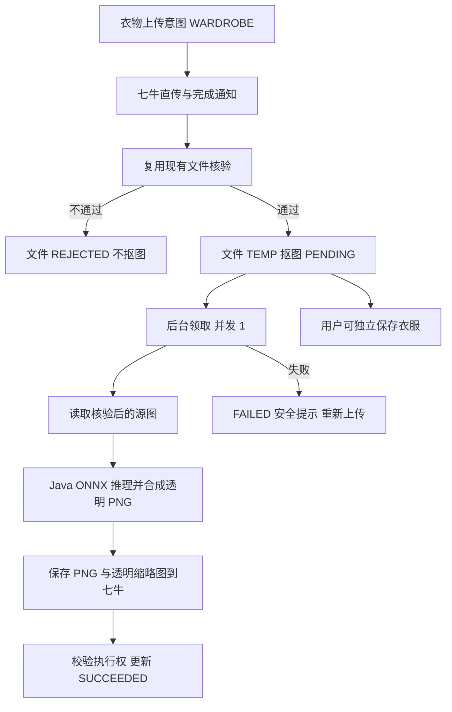

# 衣物自动抠图交互与逻辑设计

最后更新：2026-10-23。

状态：已搁置，未实施。2026-10-23 用户决定前期不实施，需求已搁置。以下保留历史讨论与设计，不作为当前实施范围；恢复需用户另行明确。未新增推理依赖、服务、业务代码或数据库迁移，现有上传、展示、识别和生成流程保持不变。

历史状态：设计草案，未实施、未执行模型或浏览器验证。上传核验后即抠图、衣橱展示抠图结果、不满意重新上传、server 内 Java 直接推理及简化高可用范围已确认。本文件新增的页面状态、字段、数据结构和默认行为为本轮建议，不自动视为用户确认或实施授权。

## 1. 设计目标与当前实现

复用现有添加／编辑单品弹窗、单品详情和衣橱卡片，不新建抠图页面。沿用桌面 Web、React、Ant Design 和 TanStack Query，不改变页面整体风格或服务端分页。

当前 ImageUpload 供 wardrobe、photo、design 三种场景复用，但上传请求没有用途字段；FileService 仅核验并生成 JPEG 展示图和缩略图。DressEditor 要求全部文件为 TEMP／READY 才能保存，PrivateImage 默认访问 DISPLAY／THUMBNAIL。列表及详情目前仅在衣物识别未完成时轮询，不能直接覆盖抠图状态。

本轮采用双状态：文件生命周期继续决定是否可保存；抠图状态独立决定衣橱如何展示。新上传衣物图启用抠图，本人照片和设计输入照片沿用现有链路。未抠图源图指核验、方向纠正和元数据移除后的图片；不向业务暴露未经核验的直传文件。

## 2. UI 布局与文案

### 2.1 添加／编辑单品

沿用 800px 弹窗、上方名称／分类／颜色／季节／备注表单、下方图片网格及“取消／保存单品”底栏。每张图片保留封面标签、排序和移除操作，新增常驻文字按钮“重新上传”，不依赖悬停才能发现。

```text
添加单品                                      ×
名称、分类、颜色、季节、备注 ……

单品图片
至少一张，第一张为封面。上传后自动去除背景；
效果不满意，可重新上传一张照片。

┌ 封面 ──────────┐ ┌ 图片 2 ─────────┐
│                │ │                 │
│   透明抠图预览   │ │   ◌ 正在去除背景  │
│                │ │                 │
│ 正面.jpg        │ │ 背面.jpg         │
│重新上传 移除    │ │重新上传 移除     │
│前移（禁用）后移 │ │前移 后移（禁用） │
└────────────────┘ └─────────────────┘
[选择图片]
图片核验完成后即可保存，去背景会在后台继续。
                                [取消] [保存单品]
```

视觉沿用当前 .dress-image-drafts 的三列网格、16px 间距、12px 内边距和 10px 圆角；上传区域预览高度沿用 140px，详情 240px。使用统一浅色背景与 object-fit: contain 展示透明 PNG，不将白底烘焙进文件，不裁掉衣服边缘。保留现有窄窗口降为单列的规则，不扩大为移动端适配项目。

按钮可通过键盘触发；“重新上传”具有“重新上传第 N 张图片”的可访问名称，移除后焦点落在相邻图片操作或“选择图片”。状态同时使用文字和图标，不只靠颜色；异步变化用礼貌级状态提示，不抢走输入焦点。长文件名省略显示并可查看完整名称。

### 2.2 单张图片状态

| 状态 | 图片区域 | 操作与说明 |
| --- | --- | --- |
| 正在上传 | 固定高度占位、“正在上传…” | 可移除；不显示虚构百分比；若后续使用真实字节进度才显示百分比 |
| 正在核验 | 占位、“正在检查图片…” | 可移除或重新上传；这张图尚不能保存到衣服 |
| 等待抠图 | 占位、“等待去除背景…” | 可保存衣服、移除或重新上传 |
| 正在抠图 | 占位、“正在去除背景…” | 可保存衣服、移除或重新上传，不显示剩余秒数 |
| 抠图成功 | 透明抠图预览 | 可放大、排序、移除、重新上传 |
| 抠图失败 | 占位、贴近该图的错误提示 | “未能去除背景，请重新上传照片”；保留表单，可保存已核验文件 |
| 上传／核验失败 | 占位及原因 | 重新上传或移除；包含该图时不能保存 |
| 图片读取失败 | “图片暂时无法读取” | “刷新图片”只重取签名或图片，不触发推理 |
| 状态查询失败 | 保留最后一次内容，标记“状态暂未更新” | “刷新状态”只查询；不能把网络错误改成抠图失败 |

首版不提供切回原图、同图重新推理、模型选择、参数调节、抠图编辑画布或对比滑杆。选择同一磁盘文件再次上传不需要额外检测，但不承诺结果有变化。

### 2.3 保存、取消和重新上传

- 新增：至少一张图片，全部已通过文件核验即可保存；PENDING／RUNNING／FAILED 的抠图状态不阻止保存。校验失败仍沿用现有行为，要求移除或重新上传不可用图片。
- 保存时若还有未完成抠图，底部说明“保存后仍会继续去除背景”；若已有失败则说明“部分图片处理失败，保存后可在编辑中重新上传”。保存按钮文案保持“保存单品”。
- 点击“重新上传”只为对应槽位选择一张新照片，保留排序及封面位置，不创建新衣服。打开文件选择器后取消，不改变草稿。
- 选定新文件并通过本地格式检查后，该槽位改为新上传草稿；不立即 PATCH 衣服。其他槽位和文字输入保持不变。文件核验失败时不能提交这个草稿；用户可以再次选择或取消整个编辑。
- 在用户点击保存前，已保存衣服的旧图片继续有效；新照片核验成功后即使抠图未完成，也允许保存换图。保存成功后新槽位显示其自身处理状态，不继续显示旧衣服照片来冒充新图。
- 取消编辑不提交换图，不改已保存的衣服或图像特征。已送达服务器的上传／抠图不强制取消，未绑定文件按临时文件规则清理。未完成的浏览器直传可中止。
- 新图片的抠图结果只更新新 fileId，不负责自动替换 dress_image；关联切换只有衣服保存接口可以完成。

### 2.4 列表、详情与历史图片

衣橱卡片使用首图的抠图缩略图；详情使用每张图的抠图展示图。新图片未成功时均用固定尺寸占位，展示“等待去除背景／正在去除背景／图片处理失败”，不回退源图。卡片仍可打开详情和编辑，图片处理不锁住整个单品。

详情继续显示原有衣物识别状态，明确使用“去除背景”和“识别特征”两种文案，不合并为一个“AI 处理中”。重新上传统一在编辑弹窗完成，避免详情里另建自动提交的换图流程。

存量图片建议不批量补抠，标记为 LEGACY，保留原有展示且不宣称已经抠图；用户主动换图后走新流程。此为兼容性建议，需用户确认，若要求所有旧图也变为抠图，需要另行确定补处理范围。

## 3. 前端状态与刷新

ImageDraft 增加 uploadPurpose、cutout 对象；file.status 决定可保存性，cutout.status 决定预览。重新上传产生新草稿 key 与 fileId，迟到回调仅能更新匹配的 key＋fileId，不复用旧请求结果。

FileAsset 和 DressImage 响应都带 cutout 摘要，列表返回当前页各图的状态，避免每张卡片另查一次文件状态。查询仍以 accountId 隔离缓存。

- 编辑弹窗：核验或抠图未完成的文件每 2 秒 GET 文件状态；比较完整抠图状态，不只比较原有 file.status，否则 TEMP 不变时会漏掉成功结果。
- 列表／详情：当前页或当前单品存在识别或抠图待处理状态时，复用一次每 3 秒的业务查询；不能每轮拉取整个衣橱。
- 页面隐藏暂停轮询，恢复可见时查询一次；终态停止轮询。401 停止并走登录流程，404 标记图片失效；其他查询错误暂停自动轮询并提供手动刷新，不自动重提交任务。
- 成功后访问 CUTOUT／CUTOUT_THUMBNAIL；缓存键包含账号、fileId、variant。PrivateImage 在 fileId 或 variant 改变时清除旧加载失败状态。
- 保存后刷新已有 dresses／dress 查询；关闭或取消编辑停止前端查询，但不承诺取消后台计算。

## 4. 后端流程



### 4.1 分工与执行边界

FileService 继续负责直传、核验、访问授权和清理；新增 CutoutService 负责领取、执行和写回。推理封装为 integration.ai 下的 OnnxBackgroundRemover，图片方向纠正及通用编解码仍由 integration.storage.ImageProcessor 承担。业务服务直接调用组件，不增加 Interface／Impl 或远程代理层。

scheduler 下增加轻量轮询入口，使用独立有界执行器；不在文件核验线程中等待抠图，不占用已有识别／规划供应商并发名额。初期只运行一个抠图任务，ONNX 内部计算线程数也显式限制；容量及具体数值实施前结合测试确定。

核验成功事务同时使文件变为 TEMP 并将 WARDROBE 的抠图状态置 PENDING，避免先核验成功再丢失入队通知。以数据库 PENDING 作为简单待处理列表，执行器只领取可立即执行的任务，不在内存堆积第二条长队列。用户保存单品可独立将 TEMP 改为 READY，不改变 cutout.status。

待处理上限的统计包含 WARDROBE 的上传／核验中预留以及 PENDING／RUNNING，沿用单进程准入锁，并受已有上传限额共同限制；全局满返回 503，账号满返回 429。领取阶段不因为执行器忙而把已接收任务标为失败。模型关闭或不可用时新衣物上传仍允许；核验成功但抠图尚未执行时记录 FAILED／CUTOUT_UNAVAILABLE，给出失败提示并保留可保存的源文件；个人照片不受影响。

### 4.2 最小状态机

文件生命周期保留 UPLOADING → VERIFYING → TEMP → READY 及 REJECTED／DELETING，不增加“抠图中”到 file.status。

| cutout.status | 含义 | 后续 |
| --- | --- | --- |
| NOT_REQUIRED | 非衣物或存量未启用 | 不处理 |
| WAITING_SOURCE | 衣物上传／核验尚未成功 | 核验成功转 PENDING；核验拒绝则 FAILED |
| PENDING | 已核验，等待执行 | 原子领取为 RUNNING；过期或待删除的临时资产不领取 |
| RUNNING | 本进程正在执行 | 保存成功 SUCCEEDED，异常 FAILED |
| SUCCEEDED | 两个 PNG 已保存且结果已提交 | 不修改、不原地重算 |
| FAILED | 本次处理失败 | 用户重新上传产生新 fileId；不提供同图重算接口 |

同一 fileId 只做一次抠图；重复 complete 通知不重置任何抠图终态。失败可能发生在模型加载、解码、推理、输出校验或七牛保存阶段，不新增 UNKNOWN 状态。

### 4.3 推理输入输出

读取 storage_key 对应的核验后源图，不直接对 original_key 推理。按所选 ONNX 的实际输入输出元信息实现通道、尺寸、归一化和遮罩解析；不能仅根据模型名称猜张量名或格式。模型选择后以同图参考结果核对前后处理。

遮罩恢复为核验后源图尺寸，合成带 alpha 的 PNG；不重绘 RGB、不裁切画布。缩略图长边沿用 320px，保留透明通道。保留输入 20 MiB／2500 万像素限制；输出建议同样设置 20 MiB 上限，编码后超限明确失败，不无界缓冲或静默缩小，此数值随样本验证。

格式、宽高、有限数值、可解码性和全透明输出作基础检查。整幅前景、蕾丝细节等不能仅靠固定透明比例武断判错；首版不加入第二个模型审核或自动修边。

### 4.4 最小故障处理

一个活动进程，不设计多实例租约、故障转移、热切换或自动多次推理。启动时把上次残留 RUNNING 标记为 FAILED／CUTOUT_INTERRUPTED；PENDING 在配置版本匹配时继续执行，不匹配则 FAILED／CUTOUT_CONFIG_CHANGED，要求重新上传。配置缺失时明确失败，不长期假装正在处理。

执行器名额只在实际计算退出后释放。逻辑超时只代表结果不再采用，不能据此放行另一次原生计算；不采用“Future 超时就取消并立即释放”的实现。原生推理卡住时首版接受运维重启，不建设隔离子进程。

抠图失败保留已核验文件与衣服，用户可以重新上传；本轮不改变现有上传核验的重试行为。上传结果保存失败则本次抠图失败，不自动重新推理；已有成功结果不因图片签名或下载失败而变 FAILED。

## 5. 数据方案（草案，无迁移执行）

建议只扩展 file_asset，不新增抠图任务表或第二套文件引用表。一个资产内保留核验源图和新增抠图派生文件，dress_image.asset_id 仍是不可变的上传资产身份。不覆盖 storage_key／thumbnail_key，避免历史及现有模型输入被静默替换。

| 新增列 | 建议类型／默认 | 用途 |
| --- | --- | --- |
| upload_purpose | VARCHAR(16) NOT NULL DEFAULT 'LEGACY' | 历史数据 LEGACY；应用新建显式写 GENERAL 或 WARDROBE |
| cutout_status | VARCHAR(16) NOT NULL DEFAULT 'NOT_REQUIRED' | 独立处理状态 |
| cutout_key | VARCHAR(255) NULL | 抠图 PNG 不可变对象 key |
| cutout_thumbnail_key | VARCHAR(255) NULL | 透明缩略图 key |
| cutout_size_bytes | BIGINT NULL | 抠图文件大小；宽高沿用源图，mime 固定 image/png |
| cutout_config_snapshot | JSON NULL | 模型标识、权重摘要、前后处理版本，不含密钥 |
| cutout_token | VARCHAR(64) NULL | 当前写回执行权 |
| cutout_error_code | VARCHAR(64) NULL | 安全错误分类 |
| cutout_error_message | VARCHAR(1000) NULL | 可展示原因，不含文件路径／模型栈 |

复用现有主键、账号、created_at、updated_at；增加索引 (cutout_status, created_at, id)，容量查询另评估 (user_id, cutout_status)。不建外键，不改已执行迁移；下一迁移编号实施时按现有最高版本分配，当前仓库已至 V6。

新衣物上传申请时固定配置快照及确定性的派生 key；未启用模型则快照可空、核验后失败。key 可由账号、fileId 与处理版本组成，不能含用户文件名；保存成功前不返回这些 key，也不认为对象存在。无重算入口使同一 key 不被新算法覆盖。七牛保存需使用现有对象写入保护策略。

短事务先锁 user，再锁 file_asset；领取校验 file.status、有效期、cutout.status，设置 RUNNING＋token。解码、推理、编码、七牛操作在事务外。写回检查同一资产、RUNNING、token、状态非 DELETING 及临时文件未过期；成功时才写 size、清错误和执行权，改 SUCCEEDED。后台不更新 dress_image 的源关联、排序或人工特征。

衣服换图继续按既有整组事务，新建 dress_image ID，删除旧关联并安排引用清理；新图不继承旧图人工修订。即使旧抠图稍后完成，也只修改旧 file_asset，不会覆盖新槽位。仍被历史设计、识别快照或常用搭配引用的资产沿用既有保留规则。

清理器扩展删除 cutout_key 与 cutout_thumbnail_key，并跳过实际执行中的资产；不能只检查原有 FileService.active。未保存的上传即使抠图成功仍按原申请起 24 小时到期，抠图不刷新有效期。部分写入也使用预先可定位的 key，因此失败、过期或删除时可清理，不依赖成功回写才知道对象地址。存在引用的失败资产可保留部分对象至资产清理，首版不另建孤儿扫描系统。

## 6. API 契约（草案）

沿用现有响应包装、会话与 CSRF、字符串 ID、UTC 时间及拒绝未知字段规则。这里仅扩展用户 API，不新增 server 内 HTTP 接口。

### 6.1 POST /api/files/upload-intents → 201

现有 originalName、sizeBytes、mimeType 保持。新增 uploadPurpose，可选枚举 GENERAL／WARDROBE，未传为 GENERAL，显式 null 或其他值返回 400 VALIDATION_ERROR。LEGACY 只能由迁移写入，不允许客户端提交。响应维持现有 fileId、key、uploadUrl、token、expiresAt。

衣橱上传组件显式传 WARDROBE；个人照片和本人设计输入传 GENERAL。服务端根据持久化用途触发抠图，不能信任 complete 时另传的用途。所有新增资产由应用显式写用途，避免数据库 LEGACY 默认被误用。

衣物保存新增 fileId 要求用途 WARDROBE；已有 LEGACY 图片保留／重排允许，旧临时 LEGACY 文件按原有效期兼容。GENERAL 不得作为新衣物图片提交，返回 409 FILE_PURPOSE_MISMATCH；个人照片／本人设计输入拒绝 WARDROBE。后端检查所有绑定入口，不能只靠前端。此变化需前后端配套发布，旧客户端应刷新后再新增衣物。

### 6.2 POST /api/files/{id}/complete → 202；GET /api/files/{id} → 200

complete 保持无正文和幂等通知语义，状态响应可能仍为 UPLOADING；前端以查询为准。FileDto 保留原有字段，并新增：

```json
{
  "uploadPurpose": "WARDROBE",
  "cutout": {
    "status": "PENDING",
    "errorCode": null,
    "errorMessage": null
  }
}
```

cutout 始终返回对象，非衣物及历史图返回 NOT_REQUIRED；查询到 FAILED 仍是 HTTP 200 的业务状态，不是查询接口 500。validationError 只表达文件核验失败，cutout.errorMessage 表达去背景失败。

### 6.3 POST /api/files/{id}/access → 200

variant 原 DISPLAY／THUMBNAIL 语义不变；新增 CUTOUT／CUTOUT_THUMBNAIL。响应仍为 url、expiresAt。所有变体先检查归属、TEMP／READY、有效期和非删除状态；新变体还要求 SUCCEEDED 与对应 key 完整，否则 409 CUTOUT_NOT_READY，不自动回退源图。源图已有访问能力保留，但新衣橱 UI 不提供切回入口；原始直传文件依旧不开放。

### 6.4 衣橱查询与保存

GET /api/dresses、GET /api/dresses/{id} 的每个 image 新增 uploadPurpose、cutout 摘要，与文件状态结构相同。列表总数、分页和排序不变，服务端批量读取资产状态，避免逐图查询。

POST /api/dresses 与 PATCH /api/dresses/{id} 的 images 继续使用 {fileId} 或保留项 {imageId}。重新上传使用新 fileId，提交整组图片顺序；没有“重新抠图”API。可保存性继续由文件核验状态决定，不要求 cutout 成功。

### 6.5 错误与前端动作

| 场景 | HTTP／错误码或状态 | 前端动作 |
| --- | --- | --- |
| 参数、用途、格式非法 | 400 VALIDATION_ERROR | 图旁提示，保留文字输入 |
| 不存在或越权 | 404 FILE_NOT_FOUND | 停止该图查询，提示重新上传 |
| 源文件未就绪或过期 | 409 FILE_NOT_USABLE | 核验中等待；失效时重新上传 |
| 绑定用途不符 | 409 FILE_PURPOSE_MISMATCH | 刷新页面后从正确入口重新上传 |
| 抠图结果尚不可访问 | 409 CUTOUT_NOT_READY | 刷新状态，不回退源图 |
| 全局／账号容量已满 | 503／429 CUTOUT_CAPACITY_EXCEEDED | 提示稍后重新上传，不自动提交 |
| 模型不可用、执行中断、配置不匹配 | cutout FAILED；CUTOUT_UNAVAILABLE／CUTOUT_INTERRUPTED／CUTOUT_CONFIG_CHANGED | 图旁提示，允许重新上传 |
| 推理／输出／保存失败 | cutout FAILED；CUTOUT_PROCESSING_FAILED／CUTOUT_INVALID_OUTPUT／CUTOUT_SAVE_FAILED | 保留衣服和文字，允许重新上传 |

原有上传容量错误 UPLOAD_CAPACITY_EXCEEDED 及登录／CSRF／存储错误继续沿用，不为本功能重命名。错误记录关联 requestId／fileId，日志不记录图片字节、签名地址或模型完整本地路径。

## 7. 模型输入与历史兼容建议

首版建议仅衣橱展示采用新变体，识别、设计生成和历史快照继续读取既有 DISPLAY 源图，避免将抠图质量变成生成前置条件。抠图完成不触发第二次衣物识别；保存换图仍按既有集合版本触发识别。常用搭配及历史设计不随衣橱抠图完成自动变图。

这是待确认的业务建议，不因数据库采用同一 assetId 就自动认定；若要求识别／生成也用抠图，需要另行确定等待、失败和快照版本规则。存量图片不补处理同样待确认。

## 8. 验收清单（未执行）

1. 新图核验后、未保存衣服前已开始抠图；取消编辑不改变现有衣服，未绑定文件仍可到期清理。
2. 等待、运行、成功、失败、核验错误和查询断网分别展示正确文案；不显示原图冒充抠图，不伪造进度百分比。
3. 核验通过后即可保存，抠图中／失败不挡保存；核验未完成或失败不能保存。
4. 重新上传只换指定槽位，保留其他图片、排序及文字；选择器取消不改状态；保存前原衣服不变，取消编辑保留原衣服。
5. 旧上传／查询回调、旧 fileId 的推理结果不能覆盖新草稿或新衣服关联；换图不继承原图人工特征。
6. 新衣物列表、详情和编辑预览均使用透明派生图；个人照片与本人设计输入不会触发抠图；存量图片按已确认的兼容策略展示。
7. 重复 complete 不重复推理；同一时间最多一个实际推理，超时不会提前释放名额；模型 unavailable 与进程中断可见为失败。
8. 抠图成功但未绑定、部分对象写入失败、已删除旧图、历史仍有引用等场景按引用规则清理；访问所有变体均校验账号与状态。
9. 同一组实际衣物图片验证 Java ONNX 输出，记录冷启动、热推理、端到端耗时与堆外峰值内存；白衣、黑衣、蕾丝、细肩带和衣架需人工看图，不以构建成功替代效果验证。
10. 使用真实浏览器检查保存中禁用、焦点、长文件名、图片加载失败、页面隐藏／恢复及新旧 fileId 缓存隔离。

## 9. 尚需决定

- 模型及许可、Java 推理兼容性和资源配置；模型仍未选定。
- 是否采用本草案的“只改衣橱展示、识别／生成继续用源图”和“旧衣物不自动补抠”两项建议。
- 本草案的占位、换图保存时机、用途约束和字段方案尚未获逐项确认，可在评审后形成实施基线。

当前未创建实施计划、迁移或业务代码。首版恢复范围保持简单，不因列出验收场景扩展高可用系统。
