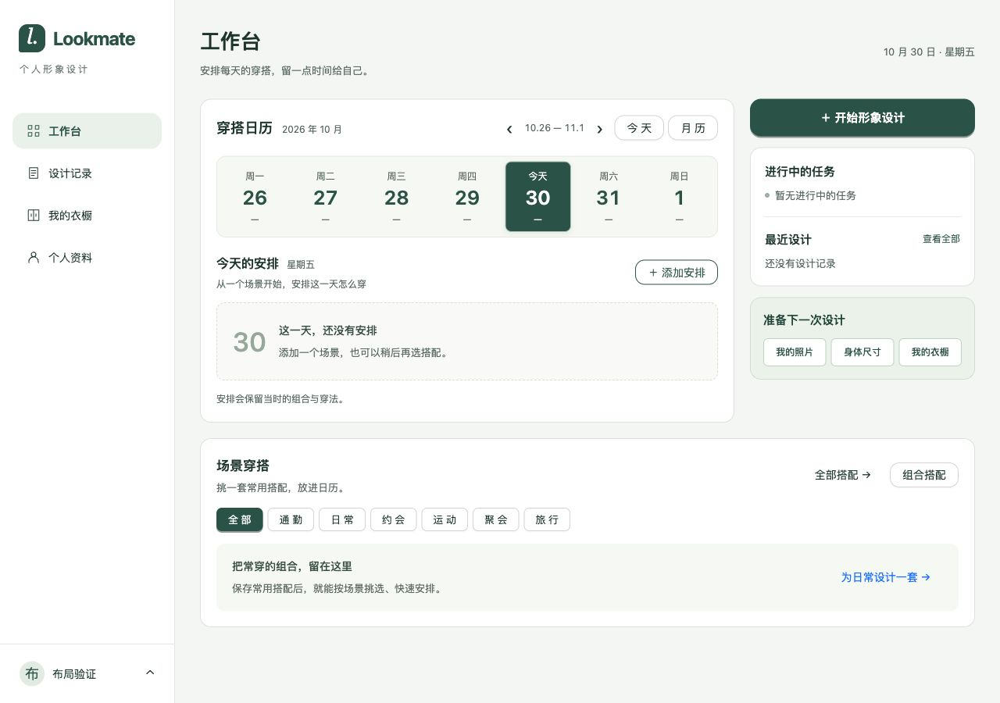
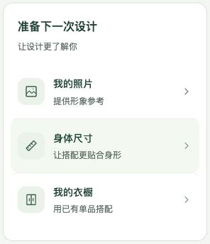

# 工作台布局优化开发验证

日期：2026-10-30。仅调整 `PlannerDashboard.tsx`、`SceneOutfits.tsx` 与 `planner.css` 的展示，未改变接口、数据库或查询分页逻辑。

## 构建与审查

实现 agent 执行 `npm run build`，类型检查及 Vite 构建通过，保留既有大包提示；主 agent 差异审查及 `git diff --check` 通过。实际 Node 为24.14.0，低于项目 engine 下限24.22.0，未安装或切换环境；符合锁定版本的构建仍需复验。

## 浏览器检查

使用内置浏览器加载当前 Vite 页面，临时本机5197端口提供隔离API响应；账号、任务、搭配和安排均为布局样本，无真实数据库写入。检查1440/1280/1024/800宽窗口，页面无横向溢出。非空样本包含活动任务、三条长标题记录、六条安排（每页五条）、四条搭配及长名称；图片位置使用空图片样本，没有复验实际图片加载。

- 周切换后显示11月2日至8日；“今天”返回10月30日。月历选10月31日后，添加弹窗日期为2026-10-31。
- 六条安排第一页展示五条，点击第二页后只展示剩余一条。保留Ant Design分页和原服务端请求参数。
- 点击通勤筛选后展示对应空态与“为通勤设计一套”入口。
- 失败样本展示日历数量、安排、任务、场景选项及搭配读取错误；恢复响应并逐区重试后全部提示消失。
- 从月历按钮按Tab移至第一个日期，焦点显示实线轮廓。
- 发现未来日期空态文案仍写“今天”，已修改为“这一天”并复验。

重试验证第一次批量按索引定位按钮，在部分错误消失后定位失效；改用对应错误区域定位后全部重试成功。这是验证脚本定位问题，未据此修改产品逻辑。

本次没有保存、修改或删除安排，没有执行模型调用。真实后端、图片供应商、持久化与完整导航链路未复验；以上为前端开发验证，不代表生产验收。

## 截图

- [1440非空样本](../../testing/02-checks/2026-10-30-工作台布局优化/02-full-1440.png)
- [1024第二页](../../testing/02-checks/2026-10-30-工作台布局优化/03-full-1024.png)
- [800筛选空态](../../testing/02-checks/2026-10-30-工作台布局优化/04-filter-800.png)
- [错误状态](../../testing/02-checks/2026-10-30-工作台布局优化/05-error-1280.png)
- [键盘焦点](../../testing/02-checks/2026-10-30-工作台布局优化/06-keyboard-1280.png)
- [1024空态](../../testing/02-checks/2026-10-30-工作台布局优化/07-empty-1024.png)

## 第二轮：连续主区与真实统计

日历与场景穿搭合入左侧连续主区，内部使用分隔线，右栏高度不影响场景位置；窄屏主区先于辅助区。新增周统计与当前筛选下搭配total，无新接口、依赖和数据库改动。实现 agent `continuous_dashboard` 的类型检查、构建通过，主 agent差异审查与 `git diff --check` 通过。Node仍为24.14.0，保留上文版本及真实链路验证限制。

沿用隔离响应与浏览器，确认：

- 1280宽、当日无安排、右侧有活动任务与三条记录时，日历底部与场景区顶部均为553.68px，两区域外部间隔为0；右栏底部为701.08px，不再推低场景区。
- 样本周含6条及1条安排，概览为7条、2天已安排、5天未安排。切换下一周后为0条、0天、7天；接口样本仍含上一周日期，页面正确只统计所选七天。
- 全部搭配total为4，切换通勤后total为0，文字同步当前筛选。加载/失败不当作零；失败样本的三个周统计均显示“未知”，搭配数量显示暂时无法读取。
- 1024宽主区连续且无横向溢出，日期、筛选及操作保持可见。此次未重新执行保存和图片加载验证。

[调整前](../../testing/02-checks/2026-10-30-工作台布局优化/08-before-continuous.png)、[1280空态](../../testing/02-checks/2026-10-30-工作台布局优化/09-continuous-empty-1280.png)、[较高右栏与非空搭配](../../testing/02-checks/2026-10-30-工作台布局优化/10-continuous-tall-sidebar-1280.png)、[1024布局](../../testing/02-checks/2026-10-30-工作台布局优化/11-continuous-1024.png)、[错误态](../../testing/02-checks/2026-10-30-工作台布局优化/12-continuous-error.png)。

## 第三轮：独立卡片与纵向准备区

仅修改planner.css。日历与场景穿搭各自使用白底、边框和圆角，主栏透明并保持12px间距；内部搭配卡按可用宽度自动排布，最小宽180px，图片高112px、内边距10px。准备区内边距20px，三个入口各占一行，每行48px。

实现 agent `separate_cards` 的类型检查、构建通过（仍为Node24.14.0及既有大包提示）；主 agent `git diff --check` 与布局核对通过。沿用隔离数据：1280/1024宽均无横向溢出，日历到场景区间距均为12px，不受较高右栏影响。1280宽搭配卡约205px、每行三张；准备入口宽246px，高48px，三个链接未改变。1024宽主区与辅助区按原断点折行，入口仍各占一行。未复验真实图片和保存链路。

[1280布局](../../testing/02-checks/2026-10-30-工作台布局优化/13-independent-full-1280.png)、[1024布局](../../testing/02-checks/2026-10-30-工作台布局优化/14-independent-full-1024.png)。

## 第四轮：准备清单视觉

准备区改为白底清单，标题下说明“让设计更了解你”；三个入口分别使用照片、尺子和衣橱装饰SVG、浅绿图标背景、标题说明及箭头，以细线分隔。保留整行链接、原href和单列布局，未添加数量查询。

实现 agent `preparation_checklist` 类型检查与构建通过（Node24.14.0、既有大包提示及此前版本限制沿用）；主 agent 差异格式检查通过。隔离浏览器1280/1024宽确认三个入口文字完整、图标和箭头对齐；从照片入口按Tab到身体尺寸，显示实线焦点框。三个href逐一核对与修改前一致；本轮未重新执行目标页面或后端业务验证。

[1280清单卡片](../../testing/02-checks/2026-10-30-工作台布局优化/15-preparation-checklist-1280.png)、[1024布局与焦点](../../testing/02-checks/2026-10-30-工作台布局优化/16-preparation-checklist-1024.png)。

## 第五轮：悬停边界与圆角

仅调整准备入口CSS：水平内边距10px、图标文字间距10px、默认及焦点圆角统一10px。实现 agent 构建与类型检查通过，沿用既有Node版本限制及大包提示。主 agent 在1280宽隔离浏览器实际移动鼠标悬停身体尺寸入口，确认hover为true、背景rgb(245,250,243)、padding为14px 10px、圆角10px，图标文字不贴边。保留原链接及分隔线。

[整页效果](../../testing/02-checks/2026-10-30-工作台布局优化/17-preparation-hover-1280.png)、[悬停细节](../../testing/02-checks/2026-10-30-工作台布局优化/18-preparation-hover-detail.png)。

## 第六轮：悬停背景向外扩展

按用户修正，仅增加准备行左右负边距10px抵消内边距，并恢复图标文字间距12px，使内容回到第四轮位置。构建、类型检查与diff检查通过。1280隔离浏览器实际悬停并测量：背景左右各超出列表10px，图标相对列表左边界偏移0px，圆角10px。仅样式调整，未复验业务链路。

