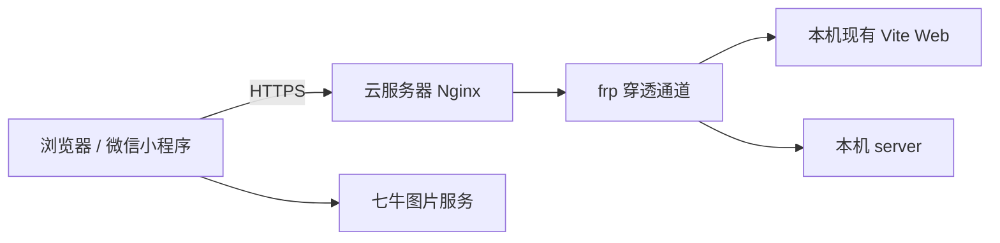

# 微信小程序技术方案草案

创建与最后更新：2026-10-30。

状态：客户端选型、应用边界和开发接入方向已确认；凭证机制、数据结构、接口及部署配置尚未定稿。未搭建工程、安装依赖、执行迁移、部署或真机验证。本文件是设计记录，不是实施计划。

产品规则、页面结构和四期范围统一维护在[需求说明](01-需求说明.md)，本文说明技术边界、已有实现的影响和待完成的设计。

## 已确认的技术基线

| 项目 | 决定 |
| --- | --- |
| 应用目录 | `apps/miniapp/`，与现有应用并列 |
| 开发方式 | 微信原生小程序，独立维护另一套页面和组件开发方式 |
| 页面与逻辑 | WXML、WXSS、原生页面/组件配置，逻辑层 TypeScript |
| 通用组件 | TDesign 微信小程序版，按需引入；业务组件独立开发 |
| 后端 | 复用 `apps/server/`，不新增小程序业务后端 |
| 业务数据与任务 | 共用现有 MySQL、Redis、七牛及服务端任务执行器，按统一业务账号隔离 |
| Web | 保留现有 React Web、本地启动、访问与调试流程；按本需求增加扫码登录及账号头像能力 |
| 当前用途 | 个人主体，开发后自行体验，近期不公开发布 |

TypeScript、TDesign、微信基础库和开发工具的具体版本待搭建前验证并锁定。当前没有批准具体依赖版本，不照搬 Web 的版本组合。通用组件范围参考 [TDesign 官方组件概览](https://static.tdesign.tencent.com/miniprogram/)。

小程序独立维护请求适配、生命周期、页面和组件。复用重点是接口语义、字段定义及纯业务转换逻辑，不直接搬用 Ant Design 页面，也不在尚无稳定重复代码时预建共享包。

列表继续采用服务端 `page`、`pageSize`、`items`、`total` 协议，小程序累计展示已加载页，滚动到底加载下一页，下拉刷新第一页，失败保留已有内容。Web 继续现有 Ant Design 分页控件。两端控件差异不改变后端分页规则。

## 账号与会话设计

### 已确认的行为约束

详细规则见[账号流程](01-需求说明.md#账号流程)，技术实现必须覆盖：

- 统一业务账号，两端会话独立；微信新用户不必有用户名密码。
- 未关联身份由用户选择新建账号或验证旧账号后绑定；账号与微信一对一，冲突不覆盖、不合并，首版不支持解绑换绑。
- 小程序全部业务须登录，无游客模式和退出入口；Web 保留密码登录、注册和退出。
- 小程序会话从登录成功起 30 天，普通访问不延长；过期尝试微信身份恢复，并发失败共用一次恢复，失败后转为用户主动重试。
- 修改密码使两端旧会话失效，微信绑定保留；可重新核验微信身份建立新会话。
- Web 默认显示扫码页签；扫码进入小程序并明确确认，未关联时先注册或绑定再返回确认。
- 登录码从生成起 5 分钟有效，扫码不延长；刷新或取消使旧码失效，已完成的注册绑定保留。
- 恢复登录不自动重放失败的提交或保存；任务按原提交键找回，不因网络结果不明而创建重复任务。

### 凭证与扫码协议建议（待完成契约设计）

小程序由 server 核验微信登录凭据并映射业务账号，返回应用会话凭证。微信密钥和会话密钥留在服务端。建议小程序通过请求头传递不透明会话凭证，保留服务端失效控制；具体机制未确认。

Web 继续 Cookie 和 CSRF 防护。新增小程序鉴权时需明确适用边界，不能整体关闭 Web CSRF 防护或信任客户端传入的账号 ID。

扫码建议采用一次性登录请求：二维码只携带不可猜测的请求标识，领取凭据绑定原浏览器且不放入二维码。确认和领取均校验有效期，结果只能领取一次，成功后轮换浏览器会话。取消、确认和领取的并发状态转换、刷新旧码失效及异常恢复需形成接口契约。

已确认的是“小程序承接扫码确认”产品流程，具体小程序码接口、开发版访问权限尚未核验。该方案不是微信开放平台网站 OAuth 登录。

### 现有实现的影响

| 当前依据 | 需要设计的调整 |
| --- | --- |
| `apps/web/src/api/client.ts` 的 Account 要求 username 为字符串 | 无用户名微信账号的返回契约、显示及密码操作可用性 |
| `AuthService`、`AuthGuardFilter`、`AuthController` 使用密码哈希指纹校验会话 | 支持无密码账号及跨登录方式的会话失效，不能简单复用原密码路径或制造随机密码 |
| Web 请求客户端依赖 fetch、Cookie、CSRF、window 事件 | 小程序独立请求层、身份恢复协调及错误处理 |
| 独立账号头像是新增能力 | 头像字段、文件引用、清理和双端编辑契约；不能复用设计正面照字段冒充独立头像 |

以上依据来自本轮已读配置和认证引用，不代表完成全量代码审查。进入表、索引、事务与迁移设计前需读取[数据库设计](../../01-项目总览/04-数据库设计.md)，接口调整遵循[接口契约](../../01-项目总览/05-接口契约.md)。本轮没有创建表或接口。

## 本地状态与图片接入

发型、穿搭、整体设计草稿按账号分别保存在当前设备，关闭后可恢复，不同步 Web。提交成功清空对应草稿，明确失败保留；再次使用核验照片和衣物引用。页签仅在本次使用期间保留选择，与草稿跨次保存分别管理。

待设计内容包括本地结构和版本、容量、账号变化时的隔离、失效图片提示、未完成上传及提交结果不明的恢复。设计结果返回后不得自动触发新生成。

上传沿用七牛直传、服务端登记核验及业务关联流程，私有访问继续授权；小程序拍照、相册选择和保存效果图需验证权限、格式与失败恢复。六个个人照片位与账号头像分开管理，不改变既有文件引用保留规则。

## 开发接入方案

### 已确认与已知状态

| 项目 | 状态或方案 |
| --- | --- |
| 微信账号 | 用户说明个人主体小程序已注册，已有 AppID；未收集密钥或核验后台权限 |
| 域名 | `lookmate.labno3.com`，用户说明当前不可访问 |
| Web 地址 | `https://lookmate.labno3.com/` |
| API 地址 | `https://lookmate.labno3.com/api/…`，Web 与小程序共用 |
| HTTPS | 云服务器 Nginx 维护证书并终止 HTTPS，按路径转发 |
| 开发运行位置 | 本机现有 Vite Web 和 server，经云服务器及内网穿透访问 |
| 穿透工具 | frp，尚未搭建 |
| 图片地址 | 七牛上传、下载地址独立于上述域名，需按当前配置核验 |

图中表示已确认的逻辑访问链，不表示 frp 代理数量、端口或部署配置已经确认。

用户要求不改变现有 Web 本地启动、访问和调试方式。优先在云端及穿透层配置域名和转发；若实际核验表明确需调整 Web 开发配置，应先说明影响再讨论。该约束不撤销已确认的扫码和账号头像业务增量。

### frp 部署建议（尚未确认）

最近提出的建议是云端运行 Nginx 与 `frps`、本机运行 `frpc`，配置 Web 和 API 两条代理通道，由云端按路径分流。用户随后要求先整理文档，尚未确认该具体分工或双通道方案，不能据此安装或部署。

frp 官方文档支持客户端配置多条代理，参考[配置文件说明](https://gofrp.org/en/docs/features/common/configure/)。具体版本、运行方式、端口、通道与凭据配置留待接入设计，不在文档中填写猜测值或秘密。

DNS、证书、Host 与转发头、WebSocket 热更新、微信请求及文件域名、真机可达性均未核验。开发者工具通过不等于真机通过；此设计不代表云端已有独立业务部署。

## 四期范围索引

范围及验收目标统一维护在需求说明，尚未执行：

| 阶段 | 重点 | 详细范围 |
| --- | --- | --- |
| 第一期 | 工程、账号互通、扫码和图片接入 | [第一期](01-需求说明.md#第一期范围已确认) |
| 第二期 | 发型设计完整链路及真机生成 | [第二期](01-需求说明.md#第二期范围已确认) |
| 第三期 | 衣橱、完整资料、穿搭与整体设计 | [第三期](01-需求说明.md#第三期范围已确认) |
| 第四期 | 常用搭配、日历、收藏管理及完整回归 | [第四期](01-需求说明.md#第四期范围已确认) |

实施前完成对应必要契约和数据设计，按项目流程另存详细实施计划；本次整理不开始编码、调用模型或部署。

## 尚待完成的设计

1. 第一阶段账号数据、绑定唯一性及并发、无密码账号、独立头像与会话失效机制。
2. 小程序身份核验、应用凭证、扫码创建/确认/取消/领取的接口及错误契约。
3. TypeScript、TDesign、基础库和开发工具版本，组件划分、页面视觉和异常状态。
4. 草稿、上传、分页与任务轮询在小程序生命周期中的恢复策略。
5. frp 具体部署分工与代理配置、云端入口、微信开发体验权限和真机联调条件。

个人主体与公开发布的既有资料核查见[主体与发布条件](01-需求说明.md#主体与发布条件)。近期目标仍为自行体验，不自行删减完整设计范围或变更主体。
