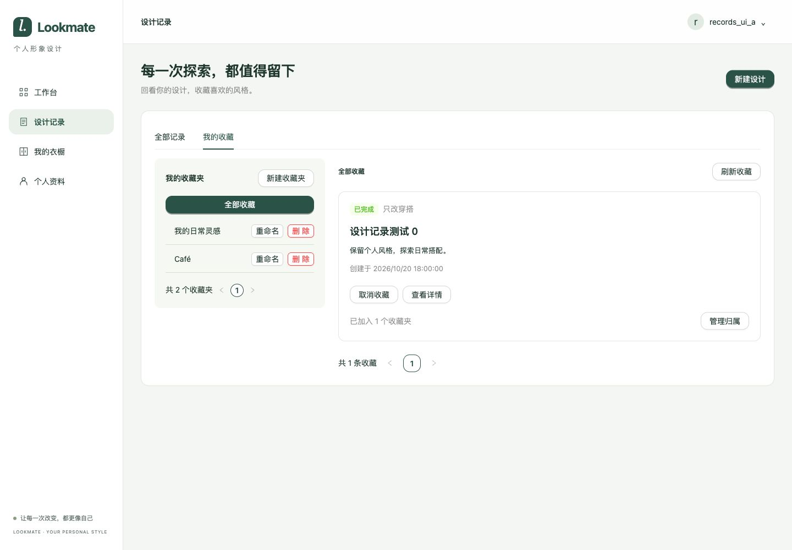

# 设计记录开发验证

日期：2026-10-20。范围依据 [需求与契约](../../02-需求文档/2026-10-20-设计记录/01-需求说明.md)。结论：本次交付范围开发验证通过，生产未验证。

## 环境与证据

Java 21；配置的 MySQL 8.0.45、Redis 7.4.11。使用独立临时数据库执行 V1、独立会话前缀及两个临时账号；HTTP 服务端口 18086，Vite 端口 15186。任务与方案由夹具创建，包含超过 JavaScript 安全整数范围的 ID、隐藏记录及其他账号记录。这些检查不代表生成链路已实现或验证。

前端 `npm run build` 通过；本机实际 Node 24.14.0，未按项目指定的 24.22.0 重跑，仍有既有主包大于 500 kB 的提示。后端 Java 21 全量 `verify` 在真实依赖环境通过 37 项、无跳过；最终增加并发起跑屏障后定向重跑 7 项 RecordsIntegrationTest 通过。脱敏汇总见 [后端结果](2026-10-20-设计记录/backend-tests.json)。

接口初始空状态及认证检查见 [空状态证据](2026-10-20-设计记录/http-empty.json)；之后 46 项 curl 检查见 [HTTP 结果](2026-10-20-设计记录/http-results.json)。仅保存状态码、检查名称与结论，无密码、cookie、CSRF 或数据库连接配置。

## 覆盖结果

| 范围 | 结果 |
| --- | --- |
| 默认分页、第二页、越界空页、相同时间的 ID 倒序、模式与状态组合、非法／空参数 | HTTP 通过，23 条本人可见记录；浏览器确认第二页三条记录 |
| 匿名、其他账号、隐藏记录、失败方案、缺少 CSRF | HTTP 与后端测试通过，拒绝访问或操作 |
| 收藏及归属幂等、同一收藏加入两夹、移出、删除夹与取消收藏的数据保留 | HTTP 通过；浏览器完成收藏、加入两夹、删除夹后收藏保留且归属减一 |
| 名称去边界空白、NFC、大小写、64 码点、未知字段和严格 JSON | HTTP 与后端测试通过；前端校验已对齐 Unicode 边界空白 |
| 版本冲突 | HTTP 通过；浏览器用另一请求修改服务器版本后保存得到冲突，本地输入保留，刷新服务器版本显示当前名，再主动保存成功 |
| 并发与回滚 | 真实 MySQL 下四线程收藏／归属唯一、重命名仅一次成功；删除关联后模拟删除收藏失败，独立读取确认关系与收藏均回滚 |
| 末页边界 | 浏览器在 11 个收藏夹的第二页删除唯一一夹，自动回到第一页，显示剩余 10 夹，收藏仍保留 |
| 网络恢复 | 浏览器通过 CDP 临时阻断 favorites 请求，显示旧数据过期及网络失败提示；解除阻断后重试成功 |
| 页面与详情 | 浏览器检查记录空状态、收藏创建、收藏夹新建、多夹管理、详情链接及详情取消收藏入口；1440×1000 截图无裁切 |

活动任务可见性轮询沿用工作台实现，本轮复核代码，未重新执行完整可见性事件测试。页面筛选组合、取消收藏与单夹移出主要由 HTTP 覆盖，未逐项重复浏览器交互。UNKNOWN 不单独轮询。任务重试、删除／隐藏、图片访问及生成不在本轮范围。

审查修正了末页删除后页码越界、重命名冲突按 ID 读取最新版本，以及前后端 Unicode 边界空白差异。收藏页任务与归属使用批量查询，避免逐条查询。

## 页面证据与清理

临时浏览器页、Vite 和后端进程已关闭，临时数据库与指定 Redis 前缀会话已清理，临时凭据和夹具脚本已删除。原开发库及原配置未修改。未创建提交或推送。

## Controller 资源拆分（2026-10-21）

设计列表与详情合并到 DesignController，收藏和收藏夹分别由 FavoriteController、CollectionController 承接。删除原 RecordsController、DesignQueryController，Service 和 Mapper 保持不变。

静态比对确认 12 个接口的方法、完整路径、处理方法签名和方法体保持一致，且无重复映射。Java 21 下运行 `./mvnw -q test`，格式检查、编译和 43 项测试通过，51 项依赖环境的集成测试跳过；本轮未启用隔离 MySQL/Redis 集成环境，未重跑 HTTP 集成测试。
