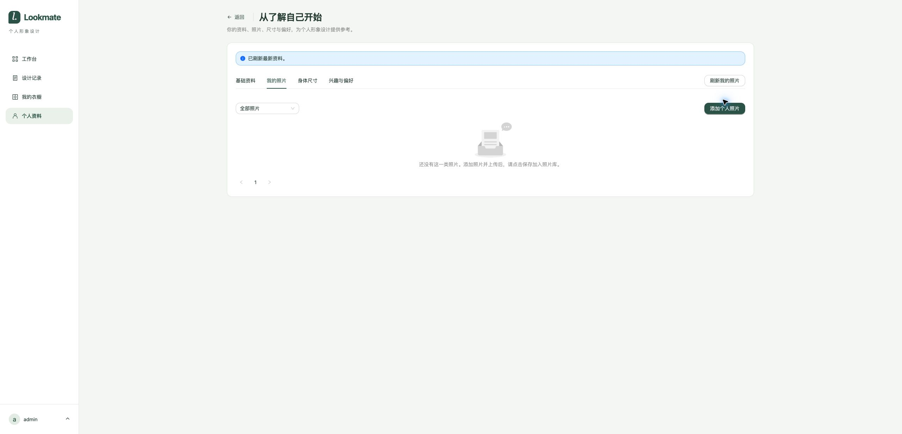

# 临时验证：个人资料刷新

日期：2026-10-24。来源：[个人资料刷新需求](../../02-需求文档/2026-10-24-个人资料刷新/01-需求说明.md)。环境为当前工作区前端、运行中的开发后端，Chrome 实际页面 `http://127.0.0.1:5173/app/profile`，使用现有登录态。执行器为 CUA 浏览器与 Node 测试；仅做局部开发验证，不计正式模块验收。

## 实际检查

- 修复前，“全部照片”为空，添加弹窗也无草稿。数据库只读检查确认该账号照片库 0 条、临时文件 3 条。没有修改或恢复这些文件。
- 照片页点击“刷新我的照片”：按钮进入加载并禁用，GET `/api/profile` 与 `/api/photos` 均返回 200，结束后显示已刷新，空列表仍正确。
- 基础资料输入临时昵称后刷新：输入保留，出现“服务端资料未变化，未保存的输入已保留”。之后清空临时输入恢复原值，未点击保存。
- 身体尺寸点击刷新：GET `/api/profile` 与 `/api/profile/measurements` 返回 200；当前尺寸保持空值。
- 兴趣与偏好有独立刷新文案，点击后发出 GET `/api/profile`，完成后返回照片页。
- 通过当前标签的 Chrome DevTools 网络拦截临时阻断 `/api/profile`，点击照片刷新显示失败；解除阻断后再次刷新恢复成功。发现失败时仍残留上次成功提示，交回实现修正，后续清除旧提示并提供中文网络错误。
- 刷新测试期间没有提交资料保存或照片入库请求，没有上传用户照片。浏览器网络拦截已解除，临时昵称已清空。

## 自动检查与边界

资料会话回归覆盖无草稿采用新值、草稿保护、关联列表刷新、部分查询失败、结果不明和版本冲突恢复。实际结果在需求交付记录汇总。构建包含 TypeScript 检查。运行 Node 24.14.0，未使用 package.json 指定的 24.22.0 补丁版本。

本轮未重新向真实七牛上传或保存照片，未验证真实图片过期恢复。新增待保存提示经代码核对；多文件上传及跨页保存仍沿用此前验证的流程，未在用户账号上构造测试照片。

## 页面证据

## 最后复验

中文失败提示确实可见，旧成功提示不可见。首次等待工具超时，但随后读取实际 DOM 确认两个断言，未将超时掩盖为首次通过。解除网络阻断后，开发后端 GET `/api/profile` 和 `/api/photos` 返回 503；页面显示服务暂不可用及上次数据。后端健康接口返回 200/UP，独立数据库只读查询正常，未定位该 503 原因，也未重启用户服务。此前四标签成功和第一次故障恢复的 200 证据仍保留；最后一次恢复未通过。

最终会话回归 11/11 通过，构建通过（既有大包告警）。主 agent 独立重跑 11 项回归及差异空白检查通过。
