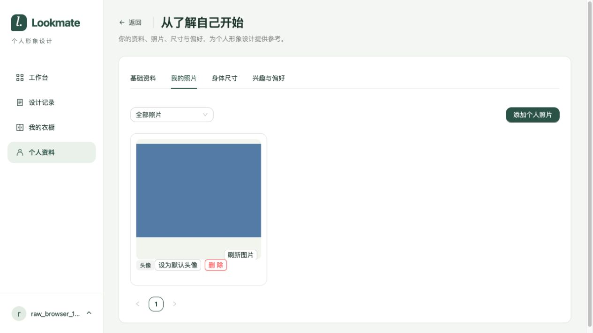

# 原图直传临时验证

日期：2026-10-24。依据：[原图直传与后台识别需求](../../02-需求文档/2026-10-23-原图直传与后台识别/01-需求说明.md)。本轮为开发交付临时验证，未建设新的长期浏览器自动化。

## 环境与范围

MySQL 独立测试库应用 V1—V6，Redis 使用独立 namespace；Spring 测试服务 18089、内存对象存储 19089、Vite 15179。浏览器只上传合成 PNG，不上传用户照片，不使用共享业务库。验证包括同步登记、格式与大小约束、归属与过期、历史资产清理、私有缩略参数签名、空尺寸业务保存及后台识别入队。

## 实际结果

- 后端隔离执行 `./mvnw verify`：178 项，2 项失败、2 项跳过。失败均为旧用例要求空宽高必须拒绝，与本轮已确认规则相反。更新为非法 MIME/零字节拒绝，并新增空尺寸照片保存、衣物保存并识别入队断言后，定向重跑 WardrobeIntegrationTest、ProfileIntegrationTest、RawUploadStoragePolicyTest 共 25 项全部通过。未再次重复全量测试；2 项跳过不计为通过。
- 首轮其余测试通过，其中 FileIntegrationTest 6 项、GenerationIntegrationTest 10 项、RecognitionIntegrationTest 7 项；新增上传完成及存储策略单元测试初次 19 项通过。并发测试使用 mock，不作为真实数据库并发证明。
- 最终 `./mvnw -DskipTests package` 成功；Spotless 与 `git diff --check` 通过。
- 前端 Node 24.14.0 下构建成功，4 项上传组件行为测试通过；构建仍有现有包体积提示。
- CUA 实际浏览器：选图立即本地预览；注入一次登记 503 后显示“重试完成上传”；重试返回 200，保存照片返回 201，刷新后仍有照片。整个场景仅 1 次对象上传、2 次 complete；登记失败至重试间超过 5 秒，没有 GET 文件状态轮询。见 [脱敏请求记录](2026-10-24-原图直传/请求记录.txt)。

存储对象为 359 字节，与合成夹具逐字节一致，SHA256 为 `115f2599abc4ec62d37724ccd8a09f2a5e6a1a6906101c809a80aec564b4b5c7`。验证后已停止临时后端、对象存储与 Vite，删除独立测试库，仅清理专用 Redis namespace 下 3 个键。

## 限制

内存存储模拟七牛，不实际执行缩略变换；真实七牛上传、格式识别及缩略参数效果仍待联调。浏览器未逐一重复衣橱和设计入口，异步识别入队及生成结果原字节保存由集成测试覆盖。本轮未重启共享开发服务，未部署生产。无需新增数据库迁移。
