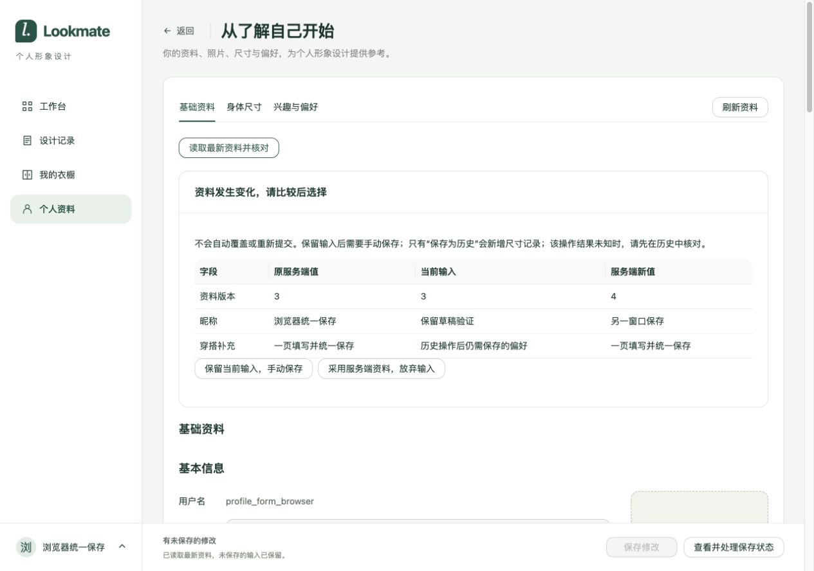
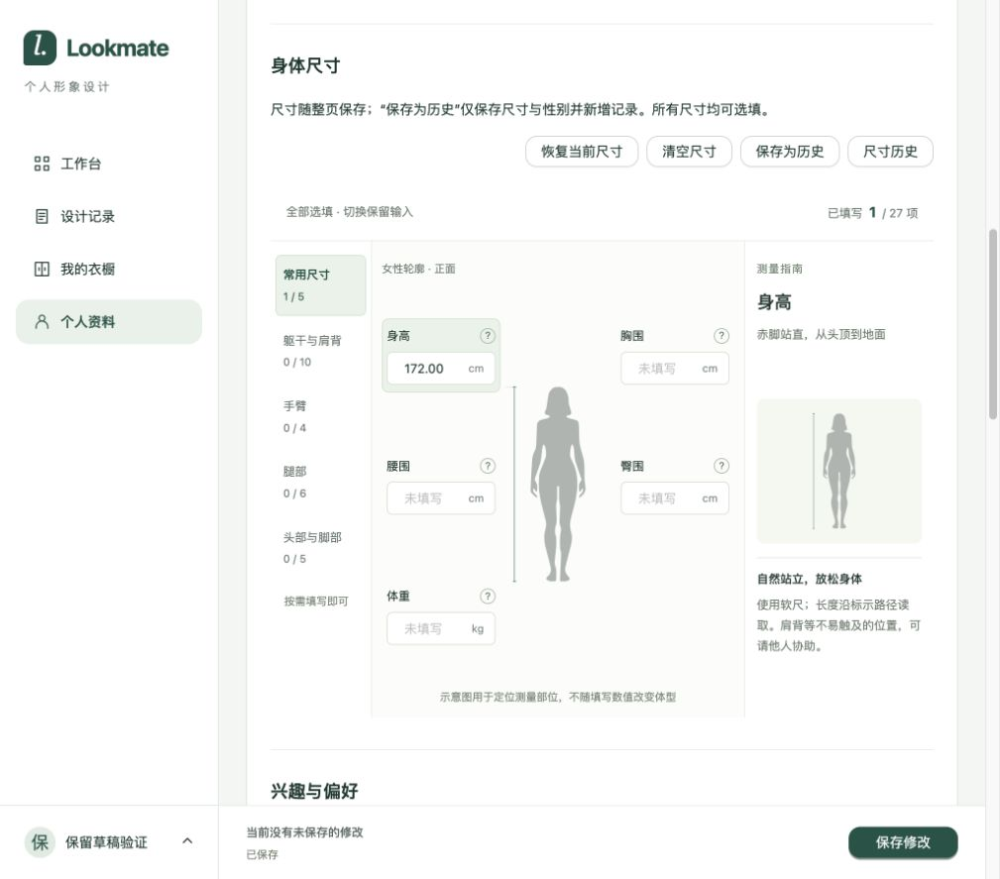
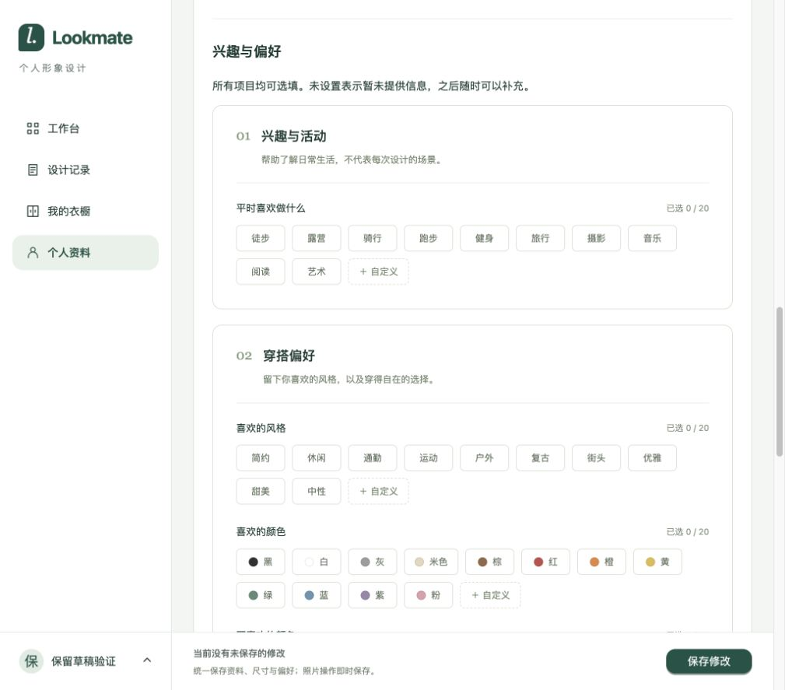
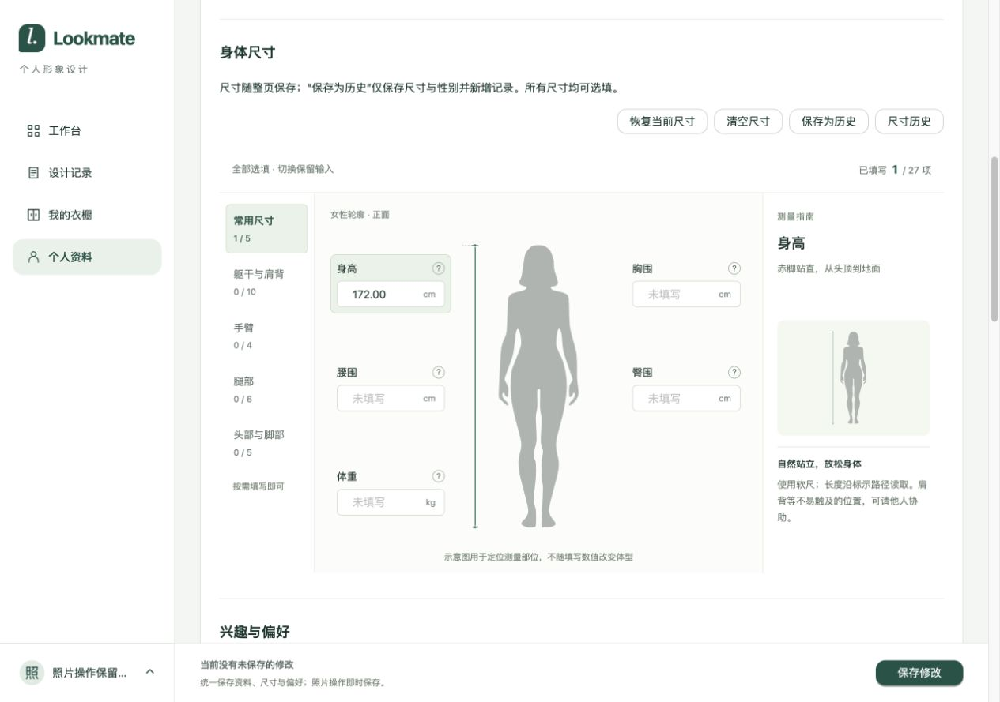
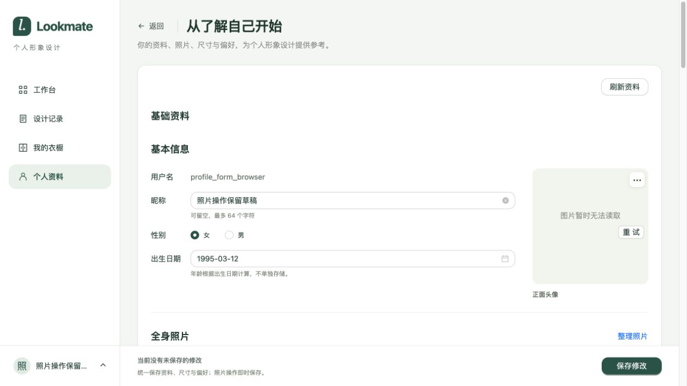
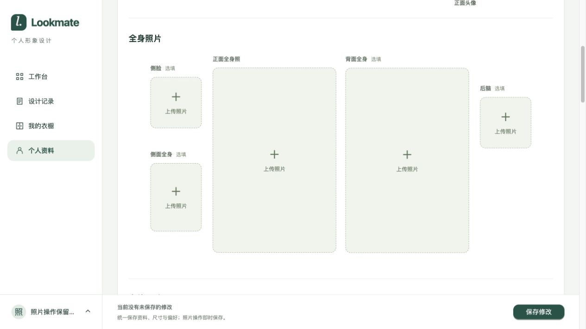

# 个人资料单页填写开发验证

日期：2026-10-29。来源：[需求与契约](../../02-需求文档/2026-10-29-个人资料单页填写/01-需求说明.md)。本轮为开发临时验证，不构成全项目回归或生产验收。

## 环境与范围

当前工作区前后端修改；Java 21、Node 24.22.1，真实 MySQL 隔离库 `lookmate_profile_form_20261029`（V1–V8）、独立 Redis 会话命名空间。临时服务为本机 18095/5195，图片存储使用本地可控实现，不调用真实七牛或模型供应商。浏览器使用 Codex 内置浏览器，视口 1280×900、1024×900。

## 实际结果

- Java Spotless、编译通过。`LOOKMATE_INTEGRATION=true ./mvnw -Dtest=ProfileIntegrationTest test` 配合隔离配置，19 项通过、0 跳过，包含 5 项新增整页保存检查。覆盖完整保存和清空、缺失/未知字段、偏好冲突、旧版本拒绝、插入与更新后的最终写入失败整体回滚、响应与未登录拒绝。见[测试摘要](2026-10-29-个人资料单页填写/backend-tests.txt)。
- Node 24.22.1 下 `npm run build` 和 `node --experimental-strip-types --test tests/*.test.mjs` 通过，74 项测试、0 跳过，包含 6 项新增整页及辅助操作恢复检查。构建保留既有大包提示。
- curl 真实 HTTP 的 5 项检查通过：整份表单保存且版本只增一、旧版本重放拒绝、冲突偏好导致整份拒绝、失败后 GET 保持原值、普通保存不新增历史。见[请求响应证据](2026-10-29-个人资料单页填写/http-results.json)。仅包含人工测试资料，不含认证凭据。
- 真实页面的 9 组代表检查通过，见[浏览器结果](2026-10-29-个人资料单页填写/browser-results.json)和[脱敏网络记录](2026-10-29-个人资料单页填写/http-network.log)。同时修改昵称、身高、偏好后一次保存并刷新，三个值均回显；非法尺寸定位并保留输入；保存历史保留昵称与偏好草稿；另一会话修改后保存被拒绝，比较并保留草稿后可重新保存；照片上传即时保存，表单草稿及后续统一保存正常。
- 1024/1280 宽度均无横向溢出；旧 `tab=measurements/preferences/photos` 与照片 hash 分别定位到对应区域。三栏尺寸、照片布局和偏好分组沿用既有样式。浏览器未观察到控制台 error。

## 过程与限制

后端首次未登录测试未装配安全过滤链，导致断言失败；补齐测试过滤链后整类 19 项重新通过，未修改认证生产逻辑。前端首次使用 Node 24.14.0，随后使用项目要求范围内的 24.22.1 重新构建和运行全部测试。

浏览器一次在保存成功但关联列表仍刷新时进行跨文档跳转，被页面离开保护中断；操作完成后重试通过。未在浏览器注入真实网络断连，未知结果冻结与原版本重试由前端会话测试覆盖。真实供应商、其他业务页和生产部署未复验。

本次临时服务在验证后关闭，隔离数据库与权限受限的临时配置保留供复现。共享开发库未修改，无新增迁移；原开发后端未重启，使用新统一保存接口需加载本轮后端代码。

## 页面证据

## 顶部导航移除复验（2026-10-29）

按用户要求移除三个顶部导航按钮，保留右侧刷新、三个展开分区和统一保存。Node24.22.1 类型检查和构建通过；浏览器观察到导航按钮0个、刷新及保存按钮各1个、三个分区标题均存在。未重复执行前后端业务测试。本次复用隔离库，内存图片存储在服务重启后不保留上次测试图片，因此截图头像显示读取失败；不涉及本次导航修改。临时服务检查后关闭。

## 照片区整理入口移除复验（2026-10-29）

删除“全身照片”标题旁常驻整理按钮，未分类说明不再引导点击已移除入口。Node24.22.1 构建及类型检查通过；真实页面确认整理按钮0个、正面全身照上传按钮1个、已有头像更多操作1个。旧照片满额恢复流程保留，本轮未重复执行其业务验证。隔离临时服务检查后关闭。

