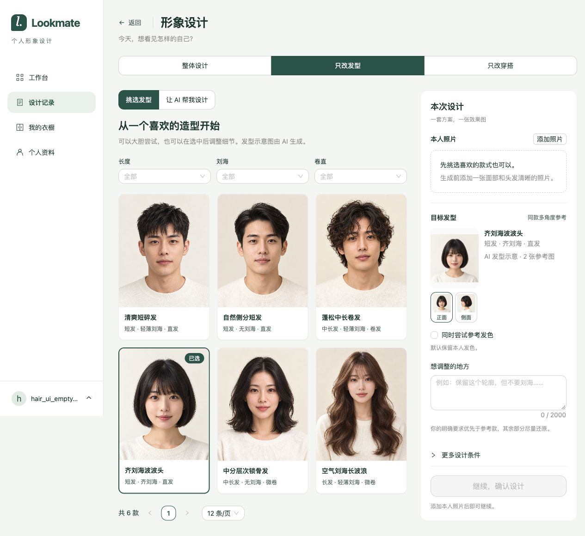
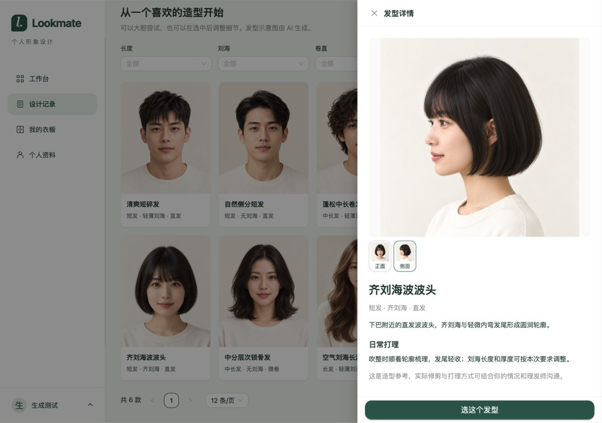
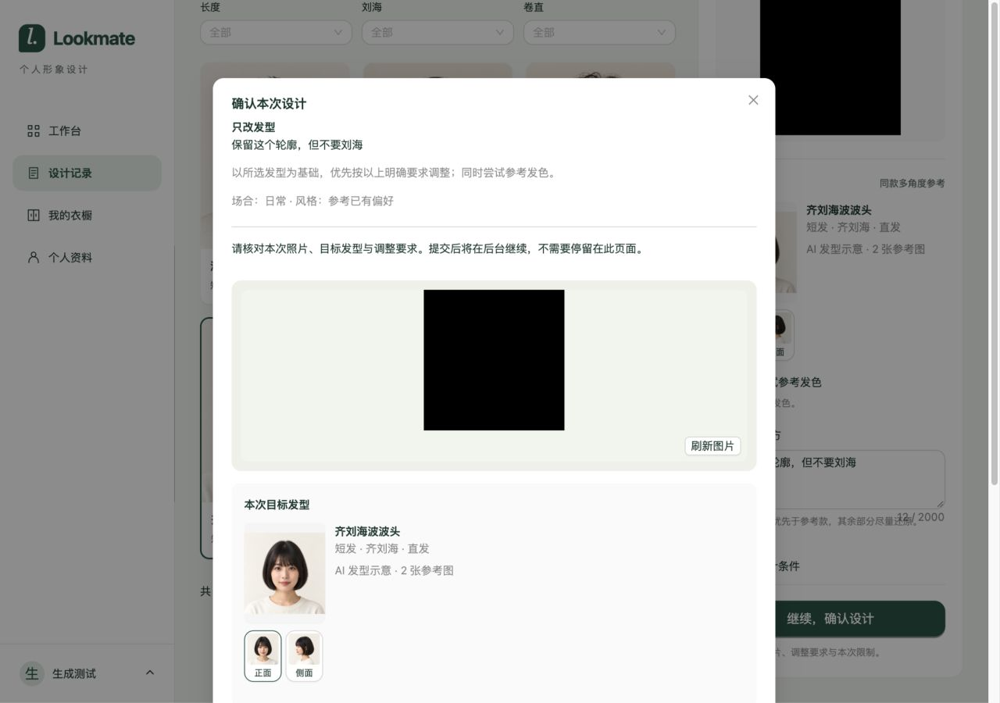

# 发型图库开发验证

日期：2026-10-29。依据：[需求与实施契约](../../02-需求文档/2026-10-28-发型图库与设计交互/01-需求说明.md)及[实施计划](../../02-需求文档/2026-10-28-发型图库与设计交互/02-实施计划.md)。本轮为开发验证，不构成真实供应商效果或生产验收。

## 环境

当前工作区，Java21、Node24.22.1。复用隔离MySQL库 `lookmate_profile_form_20261029` 及测试Redis配置，临时后端18084、前端5196；未迁移共享开发库、未重启原开发服务。模型和对象存储使用项目 GenerationBrowserHarnessTest 的可控实现，不发送真实用户图片或调用真实设计供应商。图库为本次生成的6款7张AI示意图。

后端可复现命令与单独集成结果见[后端验证摘要](2026-10-29-发型图库/backend-test-summary.txt)。

## 检查结果

- 后端定向单测46项通过，覆盖图库目录、分页、版本、图片摘要、网关可信本地图片与预算等；隔离 `GenerationIntegrationTest` 15项通过，其中5项新增，包含同款正侧图与本人照共3张图进入规划及生图、染发例外、旧提交幂等和重试快照。
- 默认后端测试运行279项，其中144项通过、135项环境测试跳过，0失败/错误；包含Spotless检查。跳过项不计作验证通过，前述15项隔离生成测试已单独执行。见[默认测试摘要](2026-10-29-发型图库/backend-default-tests.json)。
- Node24.22.1 `npm run build` 通过，`node --experimental-strip-types --test tests/*.test.mjs` 全部80项通过、0跳过。包含6项发型草稿/例外及6项原预览竞态检查。见[构建](2026-10-29-发型图库/frontend-build.txt)和[测试](2026-10-29-发型图库/frontend-tests.txt)。构建保留已有大包体提示。
- curl真实HTTP20项检查通过：未登录拒绝、两页分页不重复、筛选、非法参数、同款多图及PNG读取、版本冲突、未知字段拒绝、染发冲突与单次例外、202提交、幂等重放、任务完成与快照、长期偏好不被例外修改。见[脱敏结果](2026-10-29-发型图库/http-results.json)。Cookie、CSRF及预览令牌未写入证据。
- Codex内置浏览器14组代表检查通过：图库选款、多角度切换、独立草稿、筛选保留及空态恢复、冲突阻止提交、确认例外后完整生成、原图对照、再次设计恢复并重新确认例外、无照片可选款但不能提交。1280/1024/900宽度检查通过，900下上下堆叠且操作可达，无横向溢出；最终未记录控制台error。见[浏览器结果](2026-10-29-发型图库/browser-results.json)。

## 发现与复验

窄桌面及宽桌面下，发型要求输入框的字数计数曾与帮助文字重叠。已仅对发型表单增加计数留白，1024与1280复验，构建和80项前端测试重新通过。保留[修复前](2026-10-29-发型图库/04-narrow-count-overlap-before.png)及[修复后](2026-10-29-发型图库/05-narrow-fixed.png)截图。

浏览器操作中，Ant Design radio的程序化check与一次精确标题等待超时；依据最新可访问状态执行原操作后通过，未降低业务断言。本人照片与生成效果图使用harness的黑色测试图片，截图只能证明显示和切换链路，不代表换发型效果。

## 限制与收尾

当前默认单图生图协议无法同时传本人照片与图库图片，选款生成会明确拒绝；需配置支持多参考图的协议、模型及预算后进行真实效果验证。代码支持可信本地图片字节进入OpenAI chat和multipart edits；本轮未调整真实供应商配置。自由设计仍沿用现有单图流程。

本轮未在浏览器注入网络断连或供应商失败；相关失败恢复沿用既有流程，预算和协议拒绝由后端测试覆盖。首批6款不足以触发UI下一页，分页跨页由真实HTTP验证。未扩大为运营端、用户上传目标图或多个不同发型混合。

测试账号和任务保留在隔离库供复现，临时配置及会话只在权限受限的临时目录。验证结束已关闭本次临时前后端服务和测试页面。

## 页面证据

