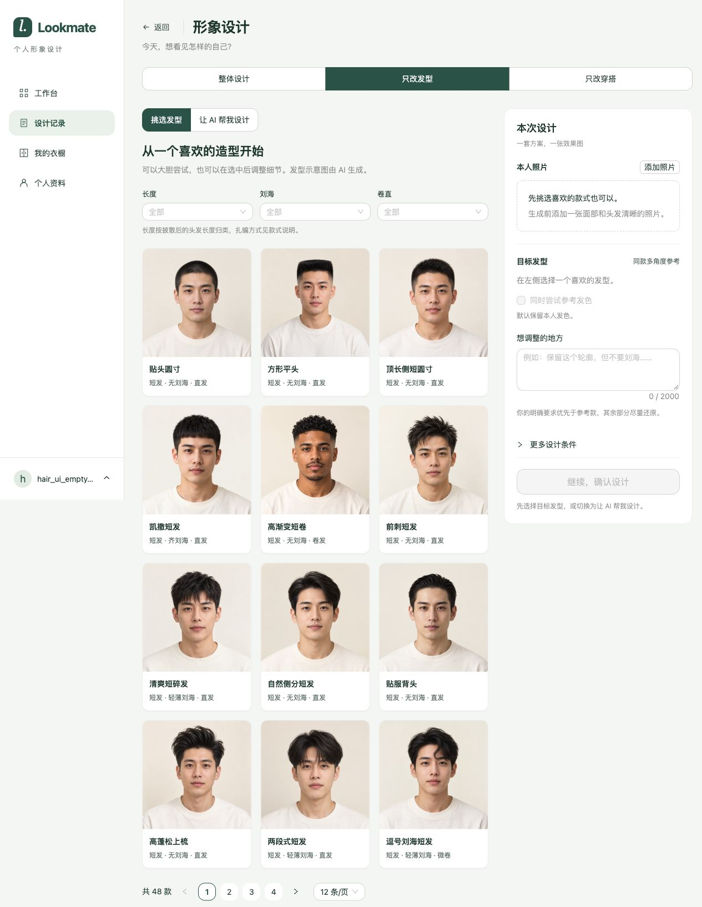
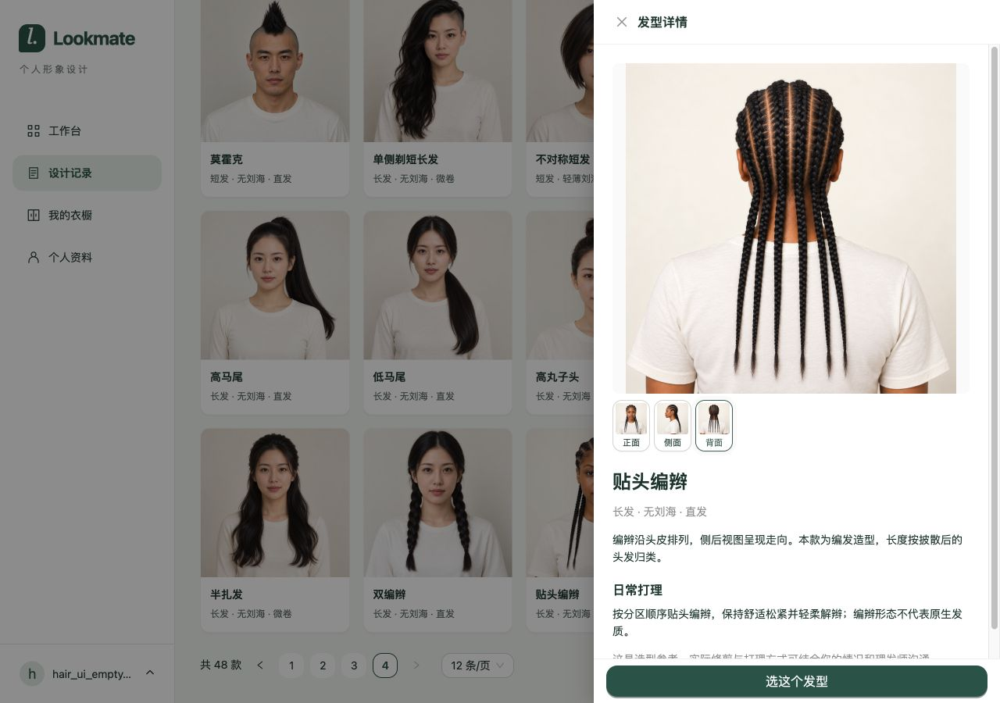
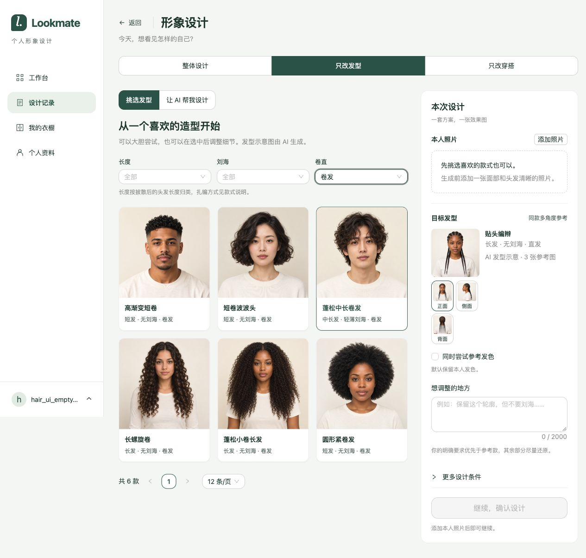
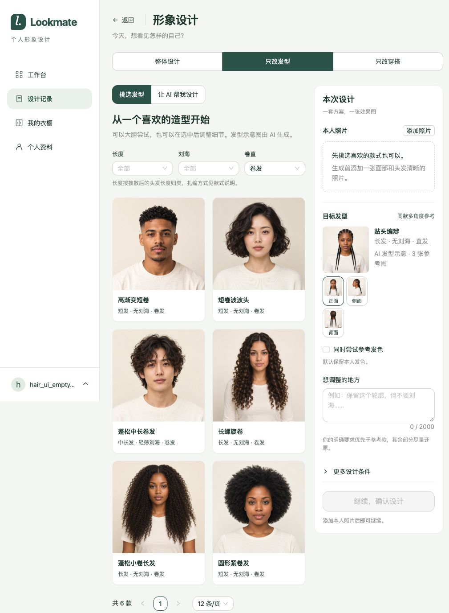

# 发型图库扩充接入验证

2026-10-29。结论：48款144张三视图已接入应用，默认目录为v2；本轮定向测试、隔离集成、真实HTTP及浏览器代表路径均通过。无数据库迁移，未调用真实模型供应商。原开发服务未重启，重启后默认加载新版目录。

## 实施范围

资源保存于 `apps/server/src/main/resources/hairstyles/v2/`，构建不依赖被忽略的output目录。48款沿用现有目录schema、长度/刘海/卷直枚举及服务端分页；每款按正、侧、背排序。144张图片逐项与选定清单SHA256一致，v1资源保持不变。当前版本配置 `lookmate.hairstyles.current-version` 缺省v2，支持显式切换；历史任务按原快照读取。

前端卡片改为方形完整显示，选款缩略图保留轮廓；新增“长度按披散后的头发长度归类，扎编方式见款式说明”。未改变页面流程、筛选枚举或分页协议。

## 验证结果

| 范围 | 结果 | 证据 |
| --- | --- | --- |
| 资源核对 | 48个唯一款式、144个唯一图片路径，全部摘要匹配，标签及三角度完整 | catalog.json及素材selected-assets.json |
| Java定向测试 | 34通过，0跳过；覆盖目录、配置、生成引擎及预算 | [测试结果](2026-10-29-发型图库扩充接入/backend-results.json) |
| 隔离集成 | 16通过，0跳过；本人照加三图、四图边界、v1历史执行及失败后重试 | [命令与说明](2026-10-29-发型图库扩充接入/backend-summary.txt) |
| 前端 | Node24构建通过；80项测试通过，0跳过 | [构建](2026-10-29-发型图库扩充接入/frontend-build.txt)、[测试](2026-10-29-发型图库扩充接入/frontend-tests.txt) |
| 真实HTTP | 26项通过；鉴权、4页及空第5页、9种筛选、详情、图片摘要、v1旧图可读与旧选择拒绝、v2提交至成功 | [结果](2026-10-29-发型图库扩充接入/http-results.json) |
| 浏览器 | 首末页、筛选回首页、三图切换、选款保留页码、无照片禁提交、1280/1024桌面轮廓展示通过；未捕获控制台error | [结果](2026-10-29-发型图库扩充接入/browser-results.json) |

后端使用Java21、真实MySQL/Redis及隔离库 `lookmate_profile_form_20261029`，供应商与存储受控。浏览器使用临时Vite5196代理隔离服务18084。使用测试账号，不上传真人照片或触发付费模型。完成后关闭本次临时服务及浏览器标签，复原视口。

首次单测因沙箱内Mockito自附加受限而出现环境错误，获准在沙箱外运行后34项通过。首次集成新增测试因重新设置抛异常的stub触发旧异常，改为doReturn后16项通过；未为此改变生产逻辑。未将包含系统属性的原始XML或登录凭据保存到仓库。

## 界面证据

## 实际边界

选定PNG共296,679,337字节，未压缩或改写原素材，服务端包体相应增加。最大同款三图共7,390,823字节，20MiB总输入预算余13,580,697字节供本人照使用；较大的本人照片仍可能超过合计预算并被拒绝。本轮未调整预算。

现有单图供应商仍不能执行图库选款生成；浏览选款可用，多图真实效果与实际延迟待供应商联调。受控生成成功仅证明业务链路及四图传递，不代表真实模型效果。未做生产部署、全站回归或全量真实生图。
