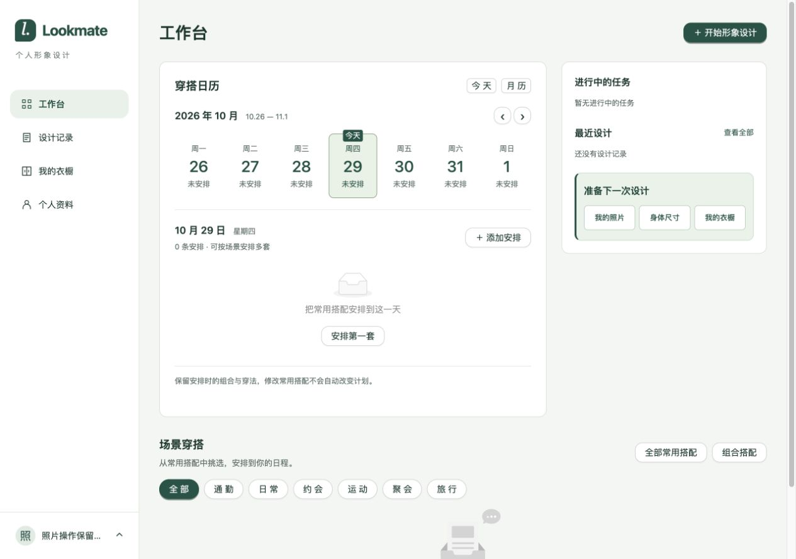
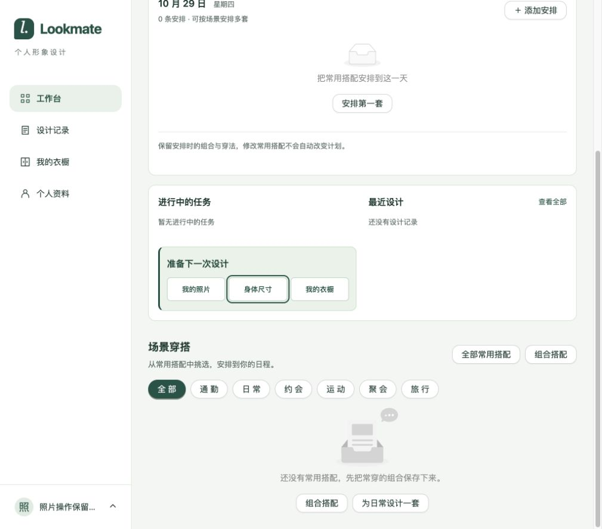
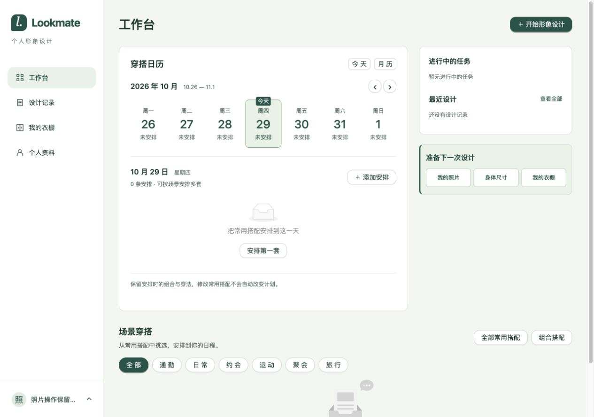
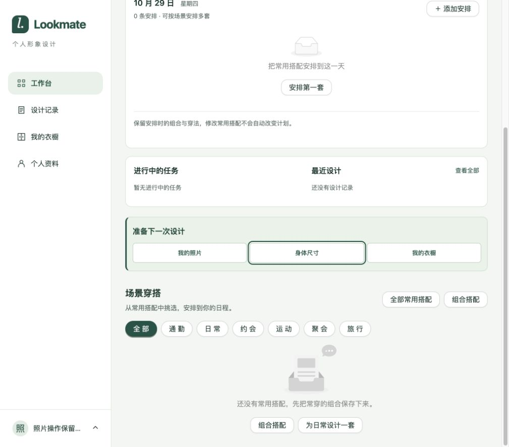
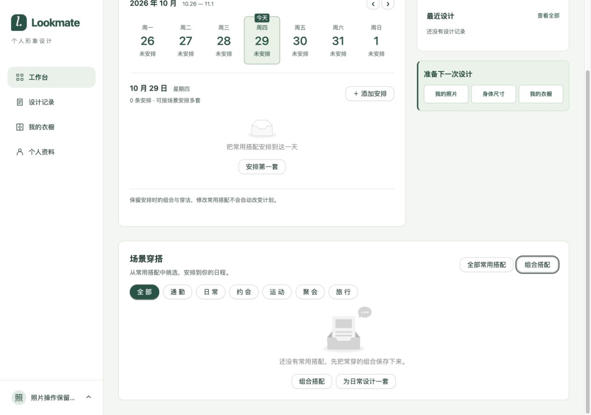
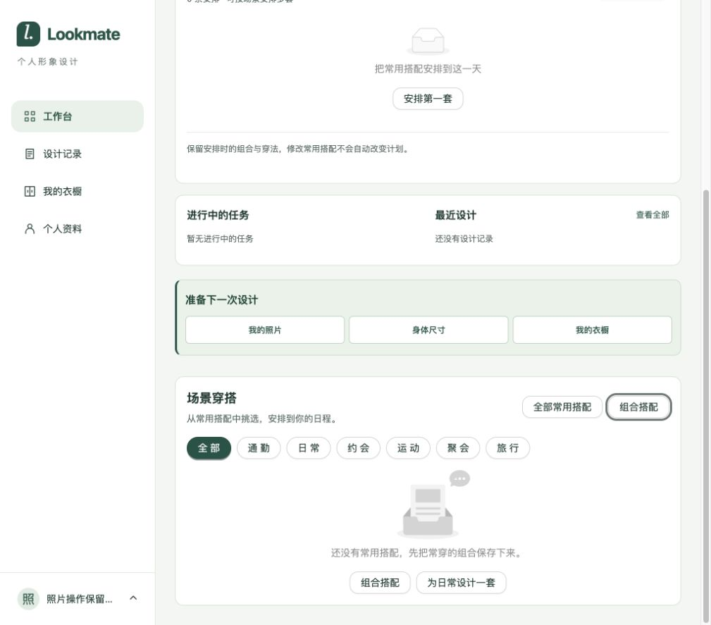

# 工作台准备区开发验证

日期：2026-10-29。依据：[需求](../../02-需求文档/2026-10-28-工作台穿搭日历/01-需求说明.md)与[计划T4](../../02-需求文档/2026-10-28-工作台穿搭日历/03-正式实施计划.md#t4-准备下一次设计视觉强化2026-10-29)。本轮为局部展示开发验证。

只调整正式工作台准备区的结构和CSS：浅绿色背景、左侧绿色强调线、15px加粗标题、三个白底边框入口，保留href与侧栏位置。没有后端、接口、依赖或数据变更。

- Node24.22.1下类型检查及生产构建通过，保留既有大包提示；diff检查通过。纯展示调整未新增测试或重复运行业务测试。
- 使用Codex内置浏览器、真实前后端与专用隔离数据库，检查1280×900和1024×900。准备区完整展示，按钮文字无裁切、页面无横向溢出；较窄桌面沿用现有侧栏折行布局。
- Tab键切换到“身体尺寸”时可见实线焦点轮廓。三个入口实际点击分别到达照片区、尺寸区及衣橱。
- 衣橱跳转首次使用了不匹配实际页面的标题断言，等待超时；随后检查实际URL为`/app/wardrobe`，页面标题为“熟悉的单品，新的搭配”，分类与添加单品入口正常，确认跳转成功。这是验证定位问题，未修改产品代码。

使用本轮个人资料的隔离库 `lookmate_profile_form_20261029`，临时服务18095/5195检查后关闭。共享开发环境未更改。未复验有活动任务和非空设计记录的其他业务行为。

## 独立卡片调整

用户要求准备区独立成块。已将其移出任务卡片，右栏分别容纳任务卡和绿色准备卡。Node24.22.1构建及diff检查通过；真实浏览器1280/1024均确认两卡独立、间距20px且无横向溢出。窄桌面沿用现有日历后排列方式，准备卡独占一行。保留原三个href与强调样式；未重复业务测试。临时服务复验后关闭。

## 场景穿搭卡片调整

场景穿搭整个区域增加白底、1px边框和12px圆角，1280宽度内边距24px，1024宽度16px；标题操作支持换行。仅调整CSS，保留内部搭配卡和业务交互。Node24.22.1类型检查、生产构建和diff检查通过（仍有既有大包提示）。真实浏览器两种宽度下标题、筛选和空态均完整，无横向溢出；本轮未复验非空搭配列表及分页。沿用上述隔离环境，临时服务检查后关闭。

## 开始形象设计按钮调整

按用户要求移除工作台页头右上角入口，在右侧“进行中的任务”卡片上方放置占满栏宽、最小高度56px的大按钮，继续跳转至 `/app/design/new`。本次为局部展示调整，使用现有 Ant Design 主按钮。`npm --prefix apps/web run build`（含类型检查）与 `git diff --check` 通过，仍有既有大包提示。当前本地5173端口未启动，本轮未完成浏览器视觉与跳转复验。
